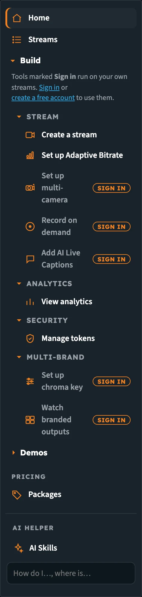
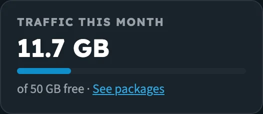
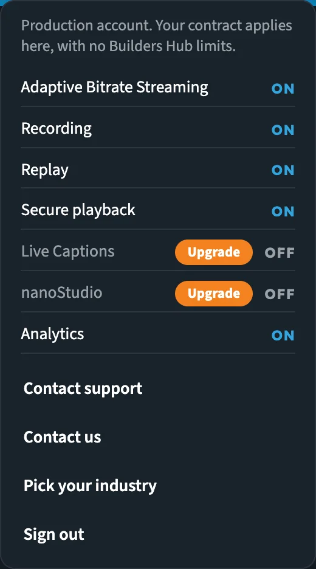
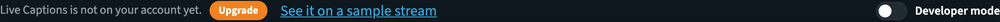

# Builder Hub: Accounts & Access

The Builder Hub works for three kinds of visitor: **guests**, **free accounts** and **production accounts**. The menu looks the same for everyone, but what each tool does, and what Home shows, depends on which one you are.

## Account types at a glance

| | Guest | Free account | Production account |
|---|---|---|---|
| **How you get in** | **Just have a look**, or **I don't want to write, I just want to start streaming** | **No, create a free account** | **Yes, sign me in** with your existing login |
| **Your streams** | Test streams on a shared demo account | Your own streams | Your own streams |
| **Features** | Every demo, plus the tools that don't need an account | Every feature in the platform | The features on your contract |
| **Traffic** | Shared demo account | 50 GB free every month | Your contract, no Builder Hub limits |
| **Pricing in the menu** | Yes | Yes | No |
| **Support** | **Contact us** in the account menu | **Contact us** in the account menu | **Contact support** in the account menu |

A change to your plan shows up the next time you open the hub, without signing out.

## Which tools each account sees

| Tool or demo | Guest | Free | Production |
|---|---|---|---|
| Create a stream | ✓ | ✓ | ✓ |
| Set up Adaptive Bitrate | ✓ | ✓ | ✓ |
| Set up multi-camera | **Sign in** | ✓ | ✓ |
| Record on demand | **Sign in** | ✓ | ✓ |
| Add AI Live Captions | **Sign in** | ✓ | ✓ |
| View analytics | ✓ | ✓ | ✓ |
| Manage tokens | ✓ | ✓ | ✓ |
| Set up chroma key | **Sign in** | ✓ | ✓ |
| Watch branded outputs | **Sign in** | ✓ | ✓ |
| Live Captions demo | ✓ | ✓ | When Live Captions is not on your account |
| Live & Replay Player, Multi-Camera Preview, Multi-Player | ✓ | ✓ | |
| Chroma key with sample content and the Multi-Branding demos | ✓ | ✓ | When nanoStudio is not on your account |

✓ = in the menu and ready to use. **Sign in** = in the menu, but it needs an account.

## Guests

As a guest you can try the hub without an account.

- **Create a stream** and **Set up Adaptive Bitrate** work for you: your test streams run on a shared demo account. Anyone who knows a test stream's name can watch it, so don't stream anything private.
- Home, **Streams** and the **Live wall** show only the test streams you made in this session.
- Every demo opens, with sample content we stream for it.

### The Sign in tag

Tools that work on your own streams carry a **Sign in** tag in the menu. A line at the top of **Build** explains: *Tools marked **Sign in** run on your own streams.* Click one of these tools to open the sign-in form, which also links to the free sign-up.

_As a guest, tools that need an account are marked **Sign in**._

When a guest follows a link to one of these tools, they land on its sample instead:

| Tool | Opens for a guest |
|---|---|
| Set up multi-camera | Multi-Camera Preview |
| Add AI Live Captions | Live Captions demo |
| Set up chroma key | Chroma key with sample content |
| Watch branded outputs | Multi-Branding for Live Dealers |
| Record on demand | The free sign-up |

On every demo, **Try it with your own content** opens the free sign-up.

### Guests on Home

The plan line at the top of Home reads **Guest · shared demo account**, with **Start For Free**. The account menu says *You are exploring as a guest. Guest streams run on a shared demo account.* Anyone who knows a test stream's name can watch it.

## Free accounts

A free account has **every feature in the platform** on your own streams, with **50 GB of traffic free every month**. No credit card.

### Traffic this month

On Home, the **Traffic this month** tile shows how much you've used, with a bar against the 50 GB. The bar changes colour at 80 %. The same figure is in the plan line at the top of Home: **Free plan · 12.4 GB of 50 GB this month**.

_Traffic counts data delivered to viewers and data ingested._

### Your plan

The plan line at the top of Home reads **Free plan · … of 50 GB this month**, with **See packages**. The account menu says *Free account: every feature, with 50 GB of traffic free every month. Packages add more.* and offers **Upgrade: see packages**. See [Pricing & Packages](builder_hub_pricing).

## Production accounts

Sign in with your existing nanocosmos login and the hub shows your own account. Your contract applies, with no Builder Hub limits, no traffic bar and no Pricing section.

### Your account menu

Home shows a **Production** badge in the plan line. Open the account menu (your organisation's name in the header): it reads *Production account. Your contract applies here, with no Builder Hub limits.* and lists your account's features, each **On** or **Off**:

| Feature | |
|---|---|
| Adaptive Bitrate Streaming | |
| Recording | |
| Replay | |
| Secure playback | **Upgrade** when off |
| Live Captions | **Upgrade** when off |
| nanoStudio | **Upgrade** when off |
| Analytics | |

Need a feature switched on? Click **Contact support** in the same menu.

_A production account with Live Captions and nanoStudio not yet on the account._

### Features your account doesn't have yet

When a feature is off on your account:

- Its tools stay in **Build**, marked **off**. Manage tokens is never marked off: it keeps working with your own API key.
- Its demos appear under **Demos**, so you can see what it does on our sample content.
- On Manage tokens (Secure playback) and the Live Captions and nanoStudio tool pages, the bar at the top reads *&lt;Feature&gt; is not on your account yet.* with **Upgrade**.
- Set up Adaptive Bitrate says *Adaptive Bitrate Streaming is not on your account yet. Your account team can switch it on: contact support.*

_The bar on a tool page whose feature is not on the account._

### Upgrade

**Secure playback**, **Live Captions** and **nanoStudio** carry an **Upgrade** button when they're off: in the account menu and on their tool pages. **Upgrade** opens an email to sales@nanocosmos.net asking for an offer, with the feature and your organisation already filled in.

## Secure playback on hub players

If your account has secure playback switched on, or a stream is protected with a token, the players in the hub (the Home preview, the Live wall and the branded outputs player) handle the playback token for you. You don't need to do anything. While the token is being created, the player shows *Starting secure playback…*

If no token can be created, the player says *Secure playback is on, and no playback token could be created.* Sign out and sign in again with an admin login of your organisation.

To create and revoke tokens for your own players, see [Manage tokens](builder_hub_tokens).

## Disabled accounts

If your account is disabled, the account menu says *This account is disabled. Contact support to turn it back on.* Click **Contact us** in the same menu to reach us.

## Your session

- The account menu shows your organisation's name, or **Guest**. Open it to sign in, create a free account, change industry, contact us, or sign out.
- When your session ends, Home says *Your session ended. Please sign in again.*

## Next steps

- [Getting Started](builder_hub_getting_started): your first visit, step by step
- [Pricing & Packages](builder_hub_pricing): when you need more than the free account
- [Developer Mode](builder_hub_developer_mode): the API calls behind every page
