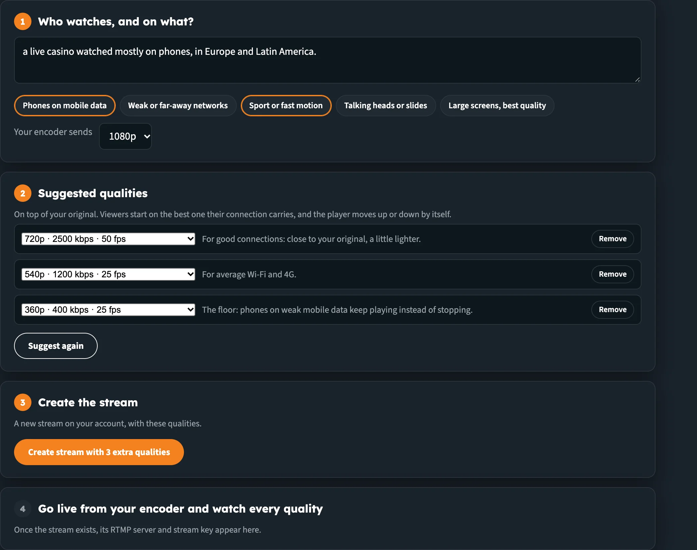
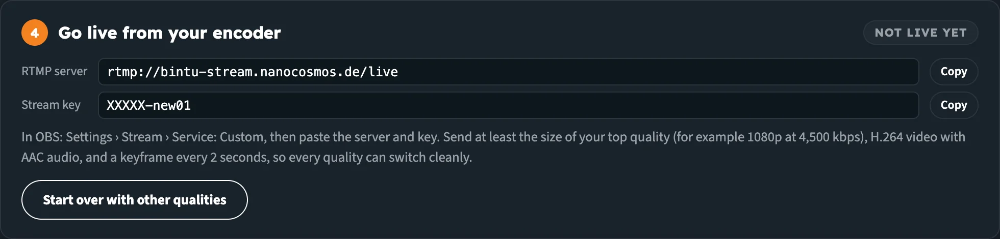
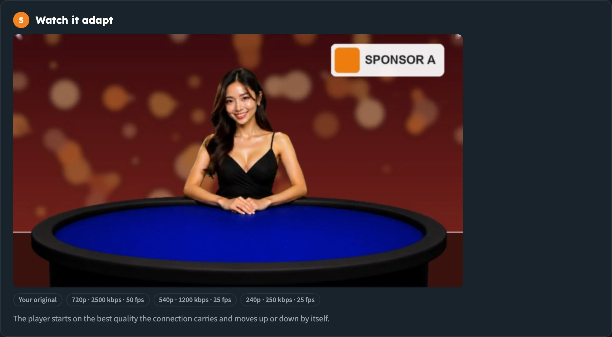

# Builder Hub: Set up Adaptive Bitrate

**Adaptive Bitrate Streaming** delivers your stream in extra qualities, so every viewer gets the best picture their connection can carry. In the Builder Hub you tell us who watches, the hub suggests the qualities, and you go live from your encoder and watch the player move between them.

:::tip Open it
In the Builder Hub menu, open **Build › Stream › Set up Adaptive Bitrate**.
:::

## Before you start

| You need | Details |
|---|---|
| **Access** | Sign in, create a free account, or explore as a guest |
| **Encoder** | OBS, vMix, Wirecast, ffmpeg or a hardware encoder that sends **RTMP** |
| **Encoder settings** | At least the size of your top quality (for example 1080p at 4,500 kbps), H.264 video with AAC audio, and a keyframe every 2 seconds |

## Who can use it

| Account | What happens |
|---|---|
| **Guest** | Works. The stream is *a test stream on our demo account, with these qualities.* |
| **Free account** | Works. The stream is *a new stream on your account, with these qualities.* |
| **Production account** | Works when Adaptive Bitrate Streaming is on for your organisation. If it isn't, the menu item is marked **off** and the page reads *Adaptive Bitrate Streaming is not on your account yet. Your account team can switch it on: contact support.* |

If your account has no extra qualities set up yet, the page reads *No extra qualities on this account yet.* with a link to **Ask us to turn them on**.

## Step 1: Who watches, and on what?

1. Describe your viewers in the box, in your own words. For example: *a live casino watched mostly on phones, in Europe and Latin America.*
2. Click the needs that fit. They can be combined:

   | Need | What it changes |
   |---|---|
   | **Phones on mobile data** | A lighter lowest quality that keeps playing on mobile data |
   | **Weak or far-away networks** | The lightest possible lowest quality |
   | **Sport or fast motion** | More bitrate for every quality, at 30 fps |
   | **Talking heads or slides** | Less bitrate, since the picture changes little |
   | **Large screens, best quality** | A richer top quality (with a 1080p source) |

   When you leave the box, words you typed switch matching needs on by themselves. For example *phones* switches on **Phones on mobile data** and *webinar* switches on **Talking heads or slides**. A size like *720p* in your text sets the next field.
3. Under **Your encoder sends**, choose what your encoder sends: **1080p**, **720p** or **480p**.

_Describe your viewers and pick the needs. The suggestion updates straight away._

## Step 2: Check the suggested qualities

**Suggested qualities** lists up to three qualities, *on top of your original. Viewers start on the best one their connection carries, and the player moves up or down by itself.*

Each quality comes with a reason:

| Quality | Reason shown |
|---|---|
| Top | *For good connections: close to your original, a little lighter.* |
| Middle | *For average Wi-Fi and 4G.* |
| Lowest | *The lightest: viewers on a poor connection keep playing.* With phones or weak networks selected: *The floor: phones on weak mobile data keep playing instead of stopping.* |

With only one quality, the reason reads *A lighter version for viewers whose connection cannot carry your original.*

You can change the suggestion:

- **Swap a quality:** pick another one from its list. Each shows its size, bitrate and frame rate, for example *720p · 2500 kbps · 30 fps*. Only qualities no bigger than your source are offered.
- **Remove** a quality you don't need.
- **Add a quality** when you have fewer than three.
- **Suggest again** to go back to the suggestion for your current needs.

:::note Up to three extra qualities
A stream carries at most three extra qualities, plus your original.
:::

## Step 3: Create the stream

Click **Create stream with 3 extra qualities** (the button counts the qualities you chose). It reads **Creating…** while the stream is made. If something goes wrong, the error appears under the button, and the button changes to **Try again**.

The new stream is tagged `abr`, so you can find it in your stream list.

## Step 4: Go live from your encoder

The page now shows **Go live from your encoder** with a badge: **Not live yet** until your stream arrives, then **Live**.

1. Copy the **RTMP server** and **Stream key** with their **Copy** buttons.
2. In OBS: **Settings › Stream › Service: Custom**, then paste the server and key.
3. Send at least the size of your top quality (for example 1080p at 4,500 kbps), H.264 video with AAC audio, and a keyframe every 2 seconds, so every quality can switch cleanly.
4. Start streaming.

_The server and key for your encoder, with the settings that let every quality switch cleanly._

To try different qualities, click **Start over with other qualities**. You're taken back to step 1, and the next stream you create is a new one.

## Step 5: Watch it adapt

Until your stream arrives, **Watch it adapt** reads *Waiting for your encoder. As soon as the stream is live, it plays here with every quality.* The page checks every 5 seconds.

Once you're live, one adaptive player plays your stream, with every quality listed beside it: **Your original**, then each extra quality with its size, bitrate and frame rate. *The player starts on the best quality the connection carries and moves up or down by itself.*

_One player, the way your viewers get it: it moves between the qualities by itself._

The page remembers your stream: leave and come back, and it opens on step 4 again until you click **Start over with other qualities**.

## See the API behind it

Switch on **Developer mode** at the top right of the page to see the API calls behind it, in six languages. See [Developer Mode](builder_hub_developer_mode).

## Next steps

- [Create a stream](builder_hub_create_stream): go live from your browser in seconds
- [View analytics](builder_hub_analytics): see how your viewers' playback is going
- [Accounts & Access](builder_hub_accounts): what each account type gets
