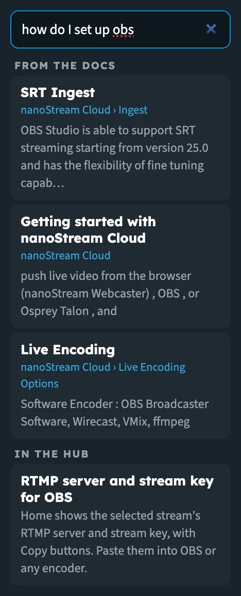
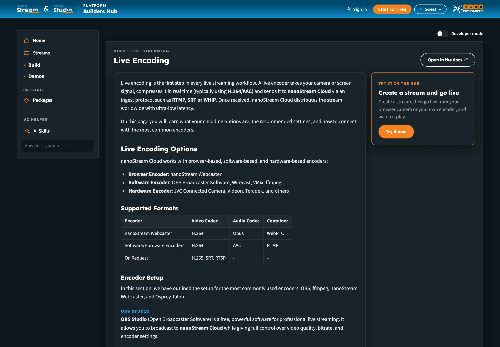
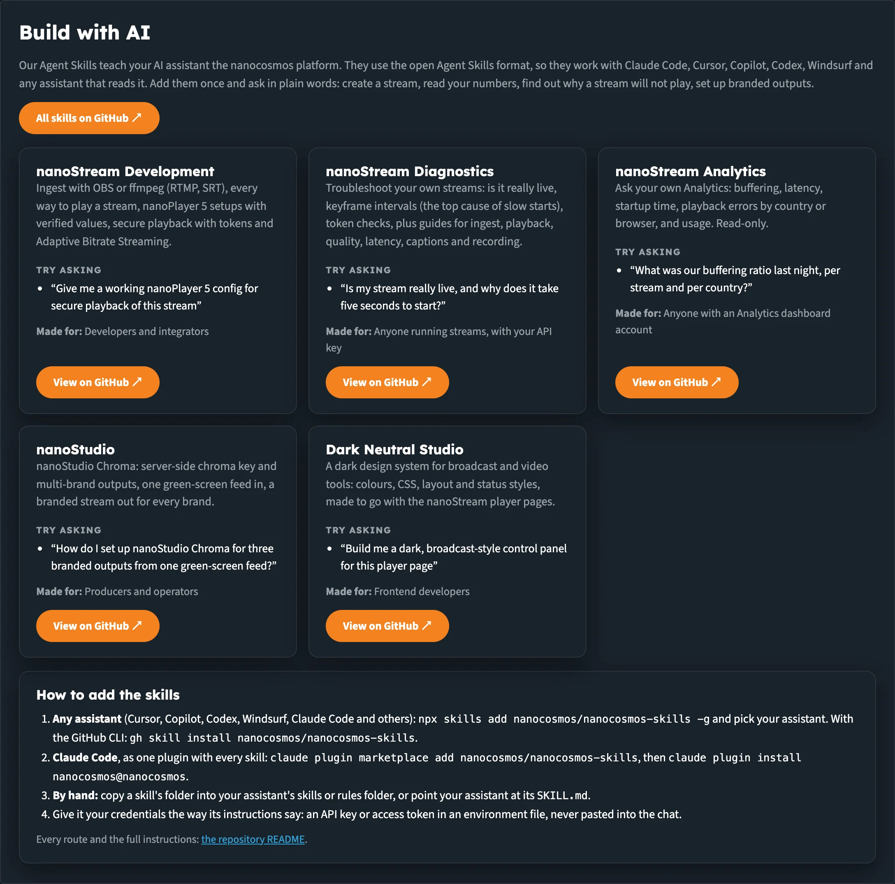

# Builder Hub: AI Helper and AI Skills

**AI helper**, at the bottom of the menu, has two parts:

| Part | What it does |
|---|---|
| **AI Skills** | Lists the nanocosmos Agent Skills, which teach your own AI assistant the nanocosmos platform, and shows how to add them |
| **The question box** | Finds the hub tool or the docs page for what you type, and opens docs pages in the hub next to the tool that does it |

## Ask a question

1. Click the box under **AI helper** (*How do I…, where is…*) and type a few words, for example *record a stream* or *why does my stream buffer*.
2. Results appear under the box as you type.
3. Click a result, or press **Enter** to open the first one. Press **Esc** to clear the box.



_A how-to question: docs pages first, then the hub tool that does it._

### How results are chosen

The box searches the hub's tools and the nanocosmos docs. Short questions with the key words work best.

| You type | You get |
|---|---|
| A tool or a place in the hub, for example *live wall*, *packages*, *captions* | The matching hub tools. Click one to open it. |
| A how-to or why question, or anything technical, for example *how do I set up OBS*, *keyframe interval*, *webrtc* | Up to three pages **From the docs**, and the best hub tool under **In the hub** when one fits |
| Something neither knows | *Nothing found for that. Try other words, or ask us.* with a link to contact us |

Some results do something other than open a tool:

| Result | What it does |
|---|---|
| **Embed the player on your website**, **API examples (Developer mode)** | Switches on [Developer mode](builder_hub_developer_mode) for the page you're on |
| **Change your industry** | Opens the industry picker |
| **Contact support** | Opens the nanocosmos contact page |

As a guest, results for tools that need an account open their sample; **Record a stream** says *Needs a free account.*

Release notes and changelogs only show when you ask for them, for example with *changelog* or *what's new*.

## Read the docs in the hub

A result **From the docs** opens the docs page inside the hub, so you don't leave your work.



_The docs page on the left, the hub tool that does it on the right._

- The page scrolls to the section that matches your question.
- Notes and tips show as notes, and tabbed examples show one after the other.
- Links to other docs pages open in the hub too.
- Links in the docs that lead to the nanoStream Dashboard to sign up, sign in or create a stream lead to the hub's own sign-up, sign-in or tool instead.
- **Open in the docs ↗** at the top right opens the page on docs.nanocosmos.net.

Beside the page:

| Card | What it shows |
|---|---|
| **Try it in the hub** | The hub tool that does what the page describes, with **Try it now** (or **Show me the code** for Developer mode). As a guest, a tool that needs an account shows **Start For Free** instead. |
| **More from the docs** | The other docs pages that matched your question |

If the page doesn't load in the hub, you see the search snippet and *The full page did not load here.* with a link to read it in the docs.

## AI Skills

**AI Skills** opens **Build with AI**. Our Agent Skills teach your AI assistant the nanocosmos platform. They use the open Agent Skills format, so they work with Claude Code, Cursor, Copilot, Codex, Windsurf and any assistant that reads it. Add them once and ask in plain words: create a stream, read your numbers, find out why a stream will not play, set up branded outputs.



_One card per skill, with an example question and who it's made for._

Each card shows what the skill covers, an example to **Try asking**, who it's **Made for**, and **View on GitHub ↗**.

| Skill | What it covers | Made for |
|---|---|---|
| **nanoStream Development** | Ingest with OBS or ffmpeg (RTMP, SRT), every way to play a stream, nanoPlayer 5 setups with verified values, secure playback with tokens and Adaptive Bitrate Streaming | Developers and integrators |
| **nanoStream Diagnostics** | Troubleshoot your own streams: is it really live, keyframe intervals, token checks, plus guides for ingest, playback, quality, latency, captions and recording | Anyone running streams, with your API key |
| **nanoStream Analytics** | Ask your own Analytics: buffering, latency, startup time, playback errors by country or browser, and usage. Read-only. | Anyone with an Analytics dashboard account |
| **nanoStudio** | nanoStudio Chroma: server-side chroma key and multi-brand outputs, one green-screen feed in, a branded stream out for every brand | Producers and operators |
| **Dark Neutral Studio** | A dark design system for broadcast and video tools: colours, CSS, layout and status styles, made to go with the nanoStream player pages | Frontend developers |

**All skills on GitHub ↗** opens the repository: [github.com/nanocosmos/nanocosmos-skills](https://github.com/nanocosmos/nanocosmos-skills).

### Add the skills to your assistant

**How to add the skills**, under the cards, gives every route:

1. **Any assistant** (Cursor, Copilot, Codex, Windsurf, Claude Code and others):

   ```bash
   npx skills add nanocosmos/nanocosmos-skills -g
   ```

   and pick your assistant. With the GitHub CLI:

   ```bash
   gh skill install nanocosmos/nanocosmos-skills
   ```

2. **Claude Code**, as one plugin with every skill:

   ```bash
   claude plugin marketplace add nanocosmos/nanocosmos-skills
   claude plugin install nanocosmos@nanocosmos
   ```

3. **By hand:** copy a skill's folder into your assistant's skills or rules folder, or point your assistant at its `SKILL.md`.

:::warning Keep your credentials out of the chat
Give the skills your credentials the way their instructions say: an API key or access token in an environment file, never pasted into the chat.
:::

Every route and the full instructions are in [the repository README](https://github.com/nanocosmos/nanocosmos-skills#install).

## Next steps

- [Developer mode](builder_hub_developer_mode): the API calls behind each page
- [Getting Started](builder_hub_getting_started): find your way around the hub
- [Demos](builder_hub_demos): see each feature working on our sample content
