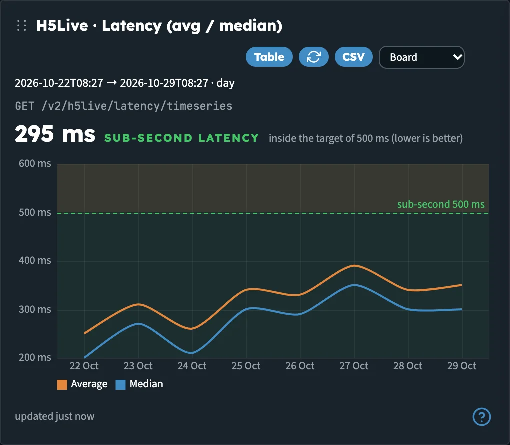
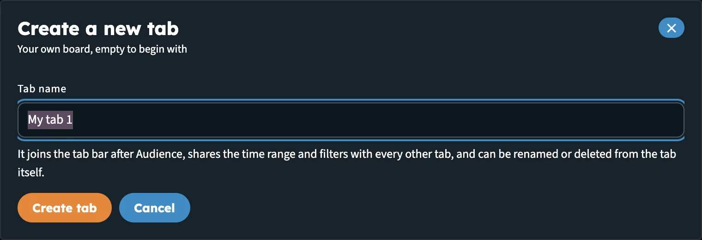
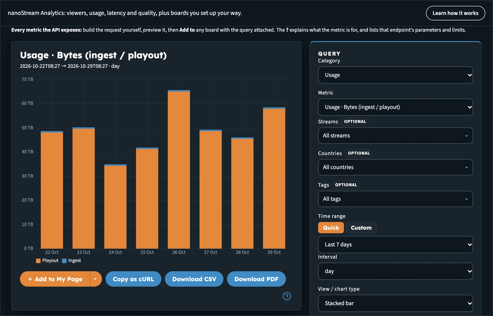
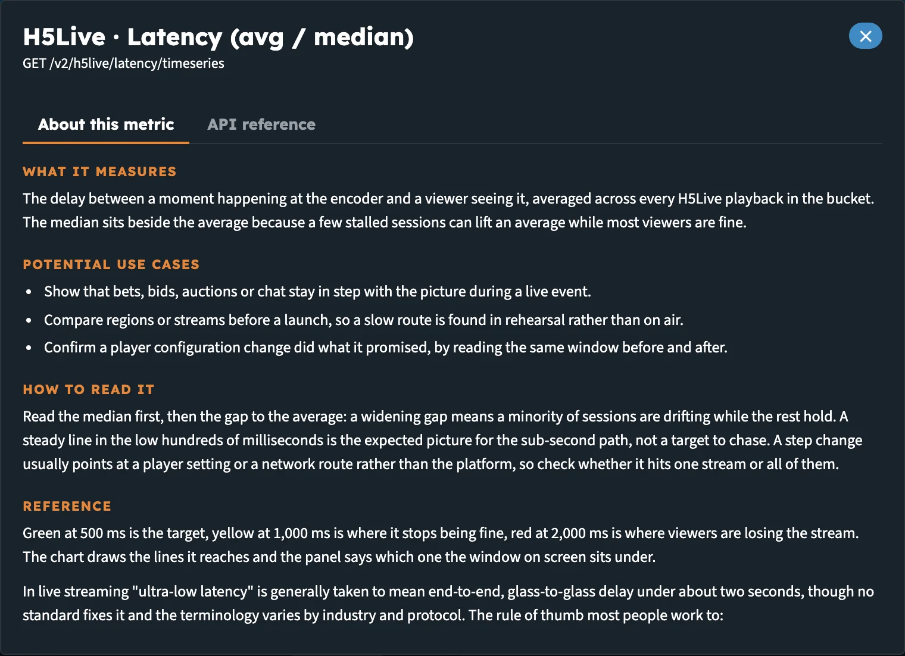
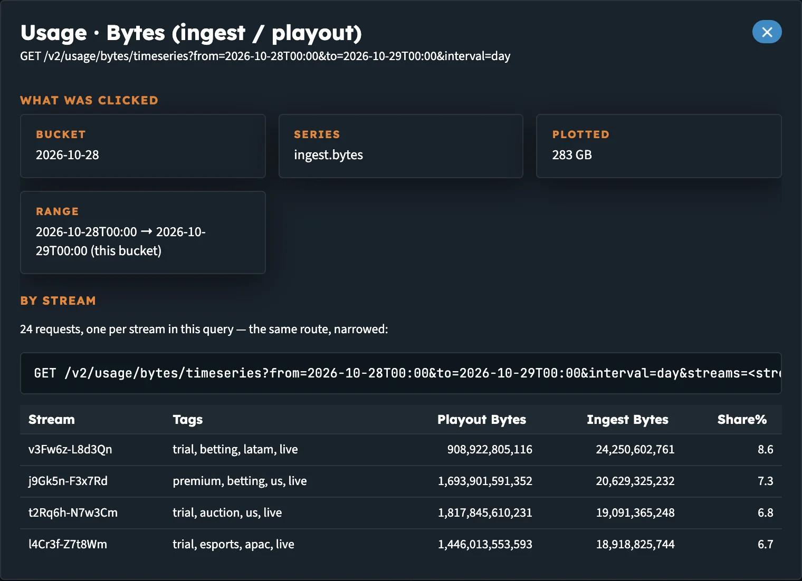
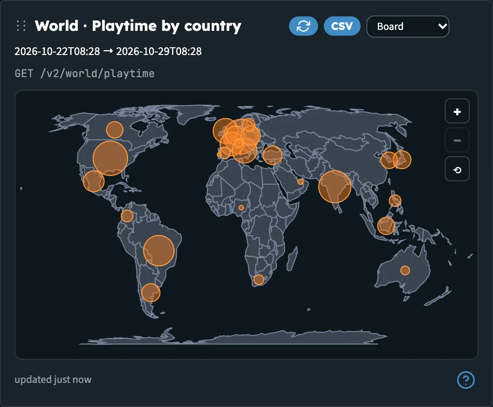

# Builder Hub: Boards & Custom Query

This page covers working with the panels in **View analytics**: adding them, arranging them, reading them and taking the data out. For the boards themselves, sample data and the filters, see [View analytics](builder_hub_analytics).

Everything here works the same with sample data and with your own account. Your boards and tabs are saved in your browser.

## A panel

Each metric on a board is a panel.

_One panel. The controls sit in its header; the **?** at the bottom explains the metric._

| Control | What it does |
|---|---|
| **⋮⋮** | Drag the header to move the panel on the board. The order is saved. |
| **Chart** / **Table** / **Map** | Switches the view. The button names the view you'll switch to. It appears only when a metric has more than one view. |
| **Refresh** | Reloads this panel |
| **CSV** | Downloads the panel's data as a CSV file, with the API's raw values and units |
| **Board** | The panel's time range. **Board** follows the board's time range. Pick **Last 24h**, **Last 7 days**, **Last 30 days** or **Last month** to pin this panel to its own range. |
| **✕** | Removes the panel. Panels that belong to a topic board have no **✕**. |
| **?** | Opens what the metric means and the API route behind it. See [Read a metric](#read-a-metric). |

Charts pick a unit to match the values, so you read 220 ms rather than 0.22 s, and 92 GB rather than a long row of bytes. Metrics that build up over time, such as latency, buffering or viewers, draw as lines; counts that split one total, such as stop reasons or error codes, draw as stacked bars; a breakdown with no time axis is a doughnut or a table.

### Quality ratings

Three panels carry a rating under the chart, worked out from the median of the range on screen, so one bad minute doesn't mark a whole day:

| Panel | Ratings |
|---|---|
| **H5Live · Latency (avg / median)** | **Sub-second latency** (under 500 ms), **Ultra-low latency** (up to 1 s), **Low latency** (up to 2 s) |
| **H5Live · Startup time** | **Instant start** (under 1 s), **Slow start** (from 2 s), **Viewers give up here** (from 4 s) |
| **H5Live · Buffering ratio** | **Smooth playback** (under 0.5 %), **Viewers see stalls** (from 1 %), **Heavy buffering** (from 3 %) |

The panel's **?** explains each band. Latency also depends on the player: a player left on the default latency mode sits higher than one on an adaptive mode, so per-stream latency can differ across your streams.

## Add a panel

1. Open the board you want to add to.
2. In **Add a widget**, pick a metric. The list holds every metric the Analytics API offers, grouped by category.
3. The panel is added to the end of the board and scrolls into view. It uses the board's time range and filters.

On **My Page** and on your own tabs, you can remove any panel. On **Usage**, **Performance**, **Health** and **Audience**, the board's own panels stay; anything you add there can be removed again, including a second copy of one of the board's panels.

To start over, click **Reset board**. It only resets the board on screen.

## Make your own tab

1. Click **＋ New tab** in the tab bar.
2. In **Create a new tab**, type a **Tab name** (up to 28 characters; the hub suggests *My tab 1*), then click **Create tab**.
3. The new tab joins the tab bar after **Audience** and opens empty. Pick metrics from **Add a widget**, or build one on **Custom query** and add it here.

_Your own tab starts empty and shares the time range and filters with every other tab._

Your tab shares the time range and filters with every other tab, so a stream picked here still applies on **Health**.

On your own tab:

- **Rename tab** and **Delete tab** sit beside the board heading. Deleting asks first when the tab has panels; the five built-in boards are not affected.
- **Reset board** reads **Clear tab** and removes every panel from the tab.
- The tab gets its own address, so you can share a link to it.

You can have up to 12 tabs of your own. If two tabs would get the same name, the hub adds a number to the second one.

## Custom query

**Custom query** shows every metric the API exposes. You build the request yourself, preview it, then **Add to** any board with the query attached.

_Custom query: choose a metric and its parameters on the right, render it, then add it to a board._

1. Open **Custom query**.
2. Under **Query**, choose a **Category** and a **Metric**.
3. Set the **Time range** and **Interval**, and the parameters the metric takes, such as streams, tags or countries. Required parameters are marked **required**.
4. Choose a **View / chart type**.
5. Click **Render**. Until you do, the preview reads **Ready to preview**.
6. Add the result to a board:
   - **＋ Add to** *board name* adds it to the board shown on the button.
   - **▾** next to it picks another board, or **Create a new tab…** to make a tab and put the panel on it in one step.

A filter you set in Custom query stays with that panel and wins over the board's own filter.

Below the preview:

| Button | What it does |
|---|---|
| **Copy as cURL** | Copies the request as a cURL command, to run against the API yourself |
| **Download CSV** | Downloads the result as CSV |
| **Download PDF** | Saves the chart, or the table, as a PDF |

:::tip From the board to your own code
**Copy as cURL** gives you the exact request the panel makes. Replace `<YOUR_TOKEN>` with your own access token and run it from your server or terminal.
:::

## Read a metric

Click **?** at the bottom of any panel, or next to the metric in Custom query. The window has two tabs:

- **About this metric**: **What it measures**, **Potential use cases** and **How to read it**, written for people rather than machines. Where a metric is rated, a **Reference** block explains the bands.
- **API reference**: the route behind the panel, with **What it does**, **Limitations & caveats**, **Parameters**, **Response structure**, an **Example response (from the spec)** and the **Rate limit**.

_The ? window. About this metric explains the number; API reference documents the route._

The **API reference** tab of the tool lists the same details for every route at once, with links to the OpenAPI docs and the Analytics docs.

## Drill down

Click any point, bar, slice or country to break it down. The pointer turns into a hand on panels that support it, and the tooltip says **Click to drill down**.

The window that opens shows:

- **By stream**: the same request, narrowed to each stream in the query, as a table you can download with **CSV**. For a metric that adds up across streams (bytes, views), the rows sum to the value you clicked. For an average, a ratio or a duration, each row is that stream's own figure.
- **Records behind this point** (or **Record for this bucket**): the API's raw record for what you clicked, with the request that returned it.

_Drilling into one bucket of Usage · Bytes: each stream's share of the total._

If a metric doesn't take a stream filter, the window says the API has no per-stream answer for that point.

## World map

Panels such as **World · Playtime by country**, **World · Latency by country** and **World · Usage by country** draw a world map.

- Use **Zoom in**, **Zoom out** and **Reset to world view** in the corner of the map.
- Hover over a country for its value, and click it to drill down.
- Switch to **Table** for the same numbers per country.

_The world map. Click a country to see the streams behind its number._

## Next steps

- [View analytics](builder_hub_analytics): the boards, sample and live data, filters and Key numbers on Home
- [Developer Mode](builder_hub_developer_mode): the API calls behind each page
- [Analytics API v2 reference](https://api.nanostream.cloud/docs/analytics/v2/)
