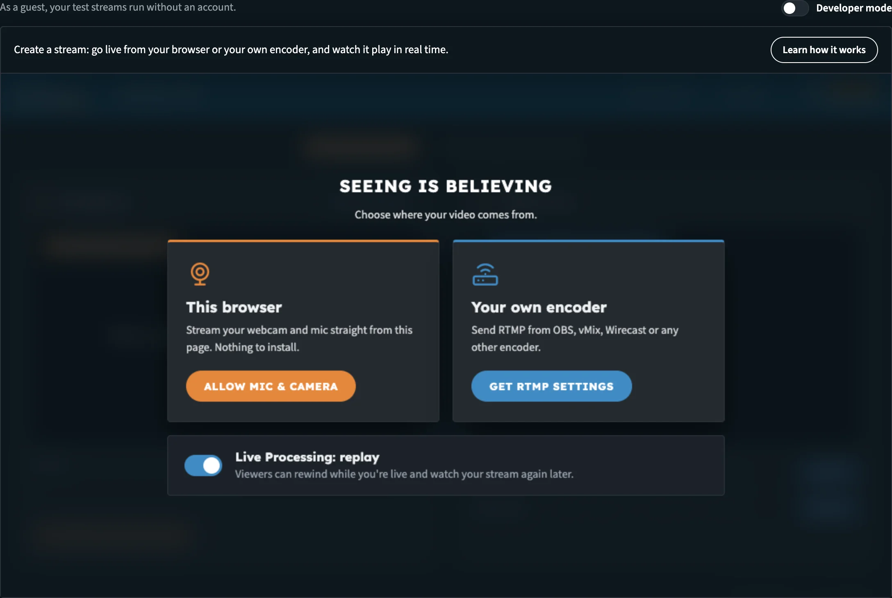
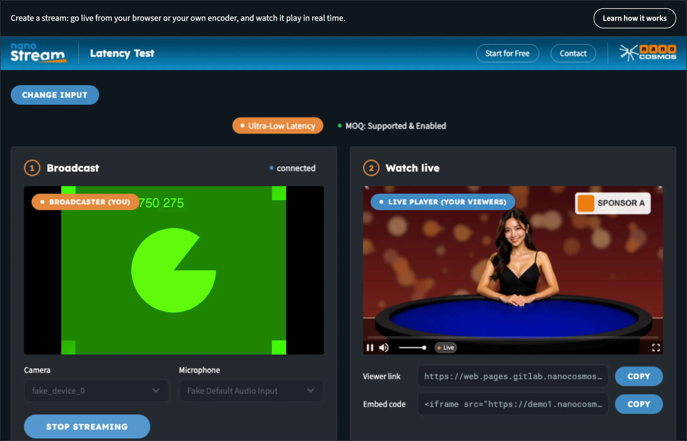
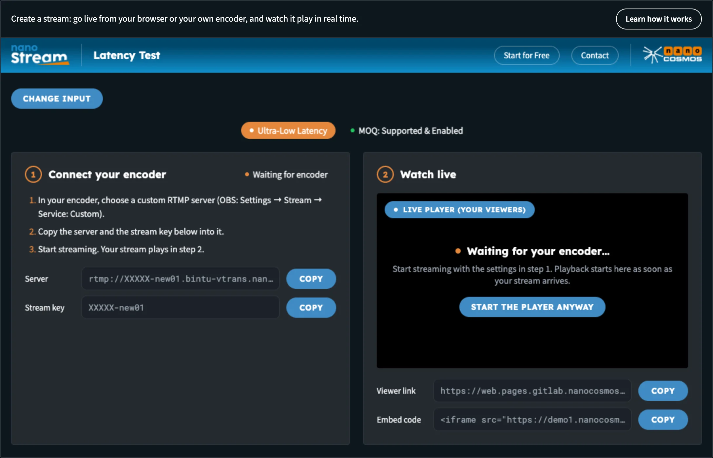

# Builder Hub: Create a Stream

**Create a stream** is the quickest way to see nanoStream working. Go live from your camera, right in the browser, or send your own encoder to the ingest address shown. Your stream then plays next to it, the way your viewers see it, with its latency and bitrate measured live.

It works the same way for everyone: guests, free accounts and production accounts.

:::tip Open it
In the Builder Hub menu, open **Build › Stream › Create a stream**.
:::

## Before you start

| You need | Details |
|---|---|
| **Browser** | A current version of Chrome, Firefox or Safari on a desktop computer, to go live from the browser |
| **Camera and microphone** | For the browser path. Your browser asks for access the first time. |
| **Encoder** (optional) | OBS, vMix, Wirecast, ffmpeg or a hardware encoder that sends RTMP, for the encoder path |
| **Account** | None. Create a stream works as a guest too. |

## Where to start

There are two ways in:

- **From the menu:** **Build › Stream › Create a stream**.
- **From Home:** when you have no stream yet, Home shows **Create your first stream**: *Name it, go live from your browser or OBS, and watch it play. About two minutes.* Click **Create your stream**. Once you have a stream, its card on Home has a **Go live from your browser** button that opens this page too.

At the top of the page, **Learn how it works** sums up what you can do here. As a guest, the bar above the page reads *As a guest, your test streams run without an account.*

## Step 1: Choose where your video comes from

The page opens on **Seeing Is Believing: Choose where your video comes from.**

1. Leave **Live Processing: replay** on if you want a replay, or switch it off:

   | Live Processing: replay | What it means |
   |---|---|
   | **On** (default) | *Viewers can rewind while you're live and watch your stream again later.* |
   | **Off** | *Off. Live only, nothing is stored.* |

2. Choose one of the two paths:
   - **This browser**: *Stream your webcam and mic straight from this page. Nothing to install.* Click **Allow mic & camera**.
   - **Your own encoder**: *Send RTMP from OBS, vMix, Wirecast or any other encoder.* Click **Get RTMP settings**.

A new test stream is created as soon as you choose.

_Pick a path. Live Processing: replay is on by default._

Two badges sit above the steps: **Ultra-Low Latency**, and an **MOQ** badge that shows whether your browser can play over MOQ:

| MOQ badge | Meaning |
|---|---|
| **MOQ: Supported & Enabled** | Your browser supports MOQ and the player uses it. |
| **MOQ: Supported but not enabled** | Your browser supports MOQ, but the player isn't using it. |
| **MOQ: Not supported** | Your browser doesn't support MOQ. The stream still plays with ultra-low latency. |

To switch paths later, click **Change input**. You're taken back to the choice, and the next path you pick creates a new stream.

## Step 2a: Go live from your browser

1. Allow camera and microphone access when your browser asks. Your camera preview appears under **1 Broadcast**, labelled **Broadcaster (You)**.
2. Pick your **Camera** and **Microphone** from the lists if you have more than one.
3. Click **Start Streaming**. The button changes to **Stop Streaming** while you're live.

_Your camera on the left, what your viewers see on the right._

If the camera can't start, the page says why next to the device lists:

| Message | What to do |
|---|---|
| **Camera and mic are blocked** | Allow them for this site (camera icon in the address bar, or the site settings), then click **Try again**. Or use **Change input** to stream from your own encoder. |
| **No camera or mic found** | Connect a camera and a mic, then click **Try again**. Or use **Change input** to stream from your own encoder. |

## Step 2b: Go live from your own encoder

Step 1 becomes **Connect your encoder**, with a status badge that reads **Waiting for encoder**.

1. In your encoder, choose a custom RTMP server. In OBS: **Settings → Stream → Service: Custom**.
2. Copy the **Server** and the **Stream key** into it. Each has a **Copy** button.
3. Start streaming. The badge changes to **Receiving stream** and your stream plays in step 2.

_Paste the server and stream key into your encoder, then start streaming._

The page checks for your stream every 5 seconds. If nothing has arrived after about four minutes, it shows **No stream from your encoder**: check the settings in step 1, or click **Start the player anyway**, which plays as soon as your stream arrives.

## Step 3: Watch it live

**2 Watch live** shows the **Live Player (Your Viewers)**: your stream as your viewers see it. Under it:

| Field | What it is |
|---|---|
| **Viewer link** | A link to a player page for your stream, to share. **Copy** copies it. |
| **Embed code** | An iframe to put the player on your own page. With Live Processing: replay on, it's the player with rewind. |
| **Latency** | Playback latency, measured live |
| **Bitrate** | The video bitrate arriving at the player |
| **Viewers** | *Live audience (simulated)*. The viewer count is for illustration only. |
| **Stream health** | Real-time latency: **Average**, **Minimum** and **Maximum** |

To stop, click **Stop Streaming** (browser) or stop the stream in your encoder.

## Your stream and your account

Create a stream makes a **test stream** every time, whether you're a guest or signed in. It's the place to try going live and see the latency for yourself.

To go live on a stream of your own account, use **Home**: your stream's card shows its **Stream name**, **RTMP server** and **Stream key**, each with **Copy**. *Paste the server and key into OBS, or go live right here from your browser.* The preview on the card starts by itself once the stream is live. See [Getting Started](builder_hub_getting_started).

:::note Guests
As a guest, your test streams run on a shared demo account, so anyone with their name can watch. A free account gives you your own streams. See [Accounts & Access](builder_hub_accounts).
:::

## See the API behind it

Switch on **Developer mode** at the top right of the page to see the API calls behind it, in six languages. See [Developer Mode](builder_hub_developer_mode).

## Next steps

- [Set up Adaptive Bitrate](builder_hub_adaptive_bitrate): your stream in extra qualities for every connection
- [Record on demand](builder_hub_recording): record a live session and play it back
- [Add AI Live Captions](builder_hub_live_captions): captions and translations on your stream
- [View analytics](builder_hub_analytics): see how your streams are doing
