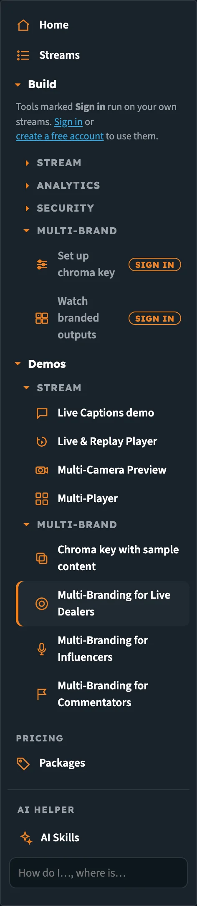
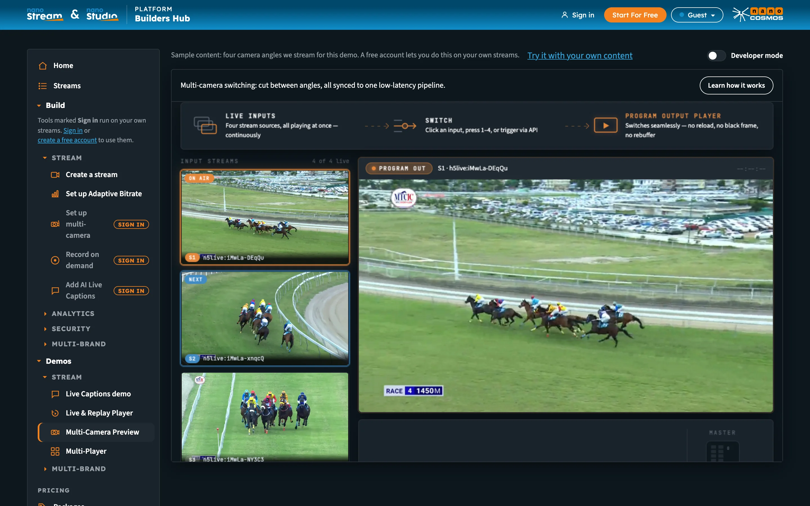
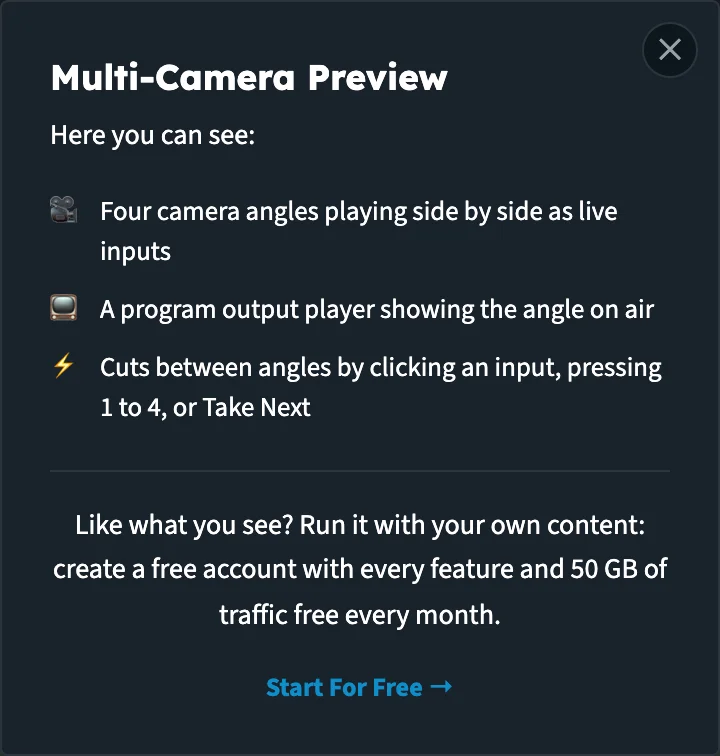
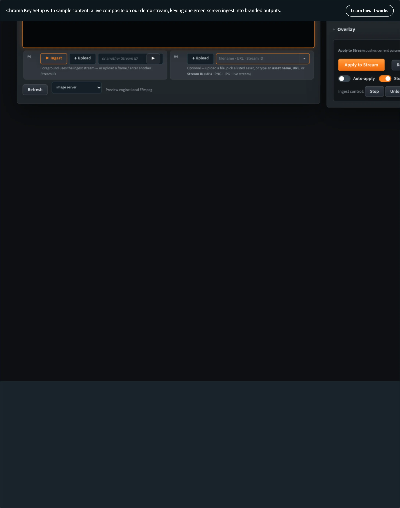
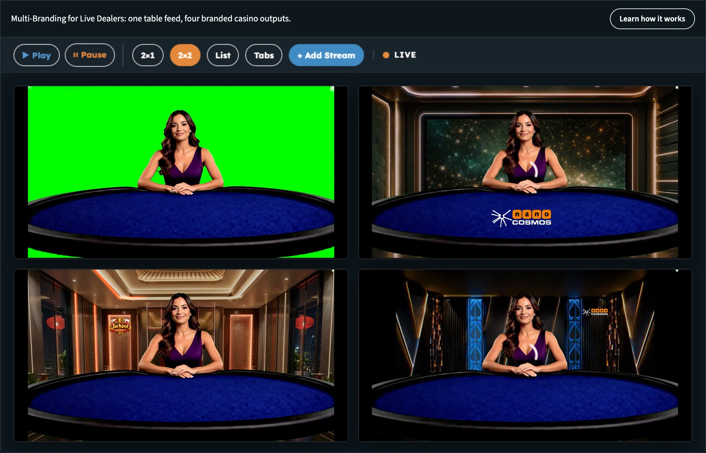

# Builder Hub: Demos

The **Demos** section of the menu plays our own sample content: live streams, camera angles and green-screen feeds that we run for the hub. You don't need a stream, an encoder or an account to watch them, and nothing in a demo touches your account.

Each demo shows one feature working. When you want the same thing on your own streams, the demo points you to the **Build** tool that does it.

## Find the demos

Open **Demos** in the menu. The demos are grouped like the tools:

| Group | Demos |
|---|---|
| **Stream** | Live Captions demo, Live & Replay Player, Multi-Camera Preview, Multi-Player |
| **Multi-Brand** | Chroma key with sample content, Multi-Branding for Live Dealers, Multi-Branding for Influencers, Multi-Branding for Commentators |

_Demos sit in their own section of the menu, folded by group._

Which demos you see depends on your account:

| Account | Demos in the menu |
|---|---|
| **Guest** | Every demo |
| **Free account** | Every demo |
| **Production account** | The demos for features your account doesn't have yet, so you can see what they do |

See [Accounts & Access](builder_hub_accounts) for more on what each account sees.

## How a demo page works

Every demo page has the same parts:

1. **The toolbar**, with one line on what the demo shows and **Learn how it works**.
2. **The demo itself**, playing our sample content.
3. **The line at the top of the page**, which says that this is sample content and leads to the next step.

_Every demo page starts with the toolbar and plays our sample content._

### Learn how it works

**Learn how it works** opens a short summary that starts with *Here you can see:* and lists what to look for in the demo. It ends with the next step:

| You are | The summary ends with |
|---|---|
| A guest | *Like what you see? Run it with your own content: create a free account with every feature and 50 GB of traffic free every month.* and **Start For Free →** |
| Signed in | *This plays our sample content. To do the same with yours:* and a link to the Build tool |

Close it with **✕** or by clicking outside the card.

_The summary lists what the demo shows and ends with the next step._

### Try it with your own content

As a guest, **Try it with your own content** at the top right of every demo opens the free sign-up. The line beside it says what the sample is, for example *You are watching sample content we stream for this demo. Create a free account to use it on your own streams.*

Signed in, the demos that have a matching tool show a link back to it instead, for example **Back to set up the key**.

## Stream demos

### Live Captions demo

*Live Captions: real-time, multi-language, download-ready (VTT/SRT/TXT).*

Here you can see:

- a recorded stream playing with its live captions on screen
- a language picker under the player to switch the captions
- the caption files, ready to download as VTT, SRT or TXT

Pick a language under the player to switch the captions.

**On your own streams:** [Add AI Live Captions](builder_hub_live_captions). A guest who opens Add AI Live Captions lands on this demo.

### Live & Replay Player

*Live & Replay Player: DVR-style rewind on a live stream, one player component.*

Here you can see:

- a live stream playing in the player, at the live edge
- a timeline you drag back to rewind, while the stream stays live
- Player Info showing whether you watch live or replay, and one click back to live

Drag the timeline back to rewind, then jump back to live.

**On your own streams:** [Record on demand](builder_hub_recording).

### Multi-Camera Preview

*Multi-camera switching: cut between angles, all synced to one low-latency pipeline.*

Here you can see:

- four camera angles playing side by side as live inputs
- a program output player showing the angle on air
- cuts between angles by clicking an input, pressing 1 to 4, or Take Next

Click an input, press a number key from 1 to 4, or use **Take Next** to cut to another angle.

**On your own streams:** [Set up multi-camera](builder_hub_multicamera). Signed in, **See it with sample cameras** on that page opens this demo.

### Multi-Player

*Multi-Player: switch between streams, or watch them all together.*

Here you can see:

- four live streams in one player, each on its own tab
- layout buttons to watch them together: 2×1, 2×2 or a list
- Play, Pause and Add Stream to bring in a stream of your own

Switch between the tabs, or pick a layout to watch every stream at once.

**On your own streams:** the **Live wall**, under your streams in the menu, plays every live stream of your account at once. See [Getting Started](builder_hub_getting_started).

## Multi-Brand demos

These demos show nanoStudio Chroma: one green-screen or camera feed, keyed and branded once for every brand, in real time.

### Chroma key with sample content

*Chroma Key Setup with sample content: a live composite on our demo stream, keying one green-screen ingest into branded outputs.*

Here you can see:

- key colour, similarity, blend and despill tuned against a live composite
- one green-screen ingest, three branded backgrounds
- **Apply to Stream** pushing the settings to our demo outputs, never to your account

This is the workbench of the Chroma Key Setup tool, signed in to our demo account. Move the sliders to see the key change.

_The workbench on our demo stream. Changes go to our demo outputs only._

**On your own streams:** [Set up chroma key](builder_hub_chroma_key). A guest who opens Set up chroma key lands on this demo.

### Multi-Branding for Live Dealers

*Multi-Branding for Live Dealers: one table feed, four branded casino outputs.*

Here you can see:

- one live dealer table in four tabs: the green screen original and Brand 1, 2 and 3
- each brand with its own background, from the same table feed
- all four side by side in the 2×2 layout, in sync

_One table feed, four casino outputs side by side._

**On your own streams:** [Watch branded outputs](builder_hub_chroma_key#watch-branded-outputs). A guest who opens Watch branded outputs lands on this demo. Signed in, **Back to your outputs** at the top opens it.

### Multi-Branding for Influencers

*Multi-Branding for Influencers: one stream, four branded operator outputs.*

Here you can see:

- one influencer stream in four tabs, Operator 1 to 4
- each operator with its own branding, from the same stream
- all four side by side in the 2×2 layout, in sync

**On your own streams:** [Watch branded outputs](builder_hub_chroma_key#watch-branded-outputs).

### Multi-Branding for Commentators

*Multi-Branding for Commentators: one stream, four branded commentary outputs.*

Here you can see:

- one race commentary in four tabs, Operator 1 to 4
- each operator with its own branded overlay, from the same stream
- all four side by side in the 2×2 layout, in sync

**On your own streams:** [Watch branded outputs](builder_hub_chroma_key#watch-branded-outputs).

:::note Production accounts without nanoStudio
The Multi-Brand demos stay in the menu, and the line at the top of each one reads *nanoStudio is not on your account yet.* with an **Upgrade** button. See [When nanoStudio isn't on your account](builder_hub_chroma_key#when-nanostudio-isnt-on-your-account).
:::

## Demos and their tools

| Demo | Does the same on your own streams |
|---|---|
| Live Captions demo | [Add AI Live Captions](builder_hub_live_captions) |
| Live & Replay Player | [Record on demand](builder_hub_recording) |
| Multi-Camera Preview | [Set up multi-camera](builder_hub_multicamera) |
| Multi-Player | Live wall ([Getting Started](builder_hub_getting_started)) |
| Chroma key with sample content | [Set up chroma key](builder_hub_chroma_key) |
| Multi-Branding for Live Dealers, Influencers, Commentators | [Watch branded outputs](builder_hub_chroma_key#watch-branded-outputs) |

## Next steps

- [Create a stream](builder_hub_create_stream): go live on your own stream
- [Accounts & Access](builder_hub_accounts): what a free account adds
- [Pricing & Packages](builder_hub_pricing): packages for a real audience
