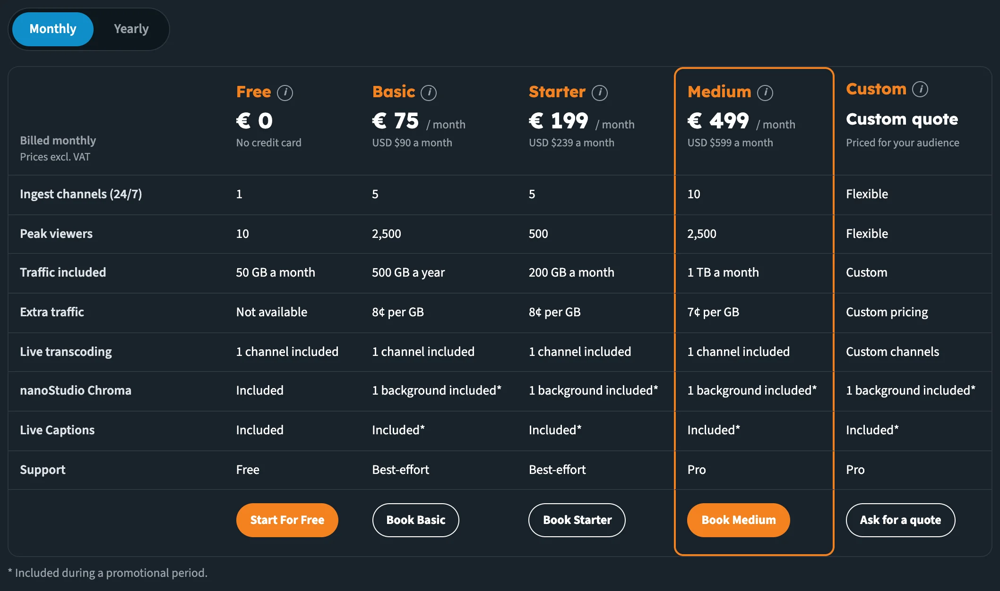
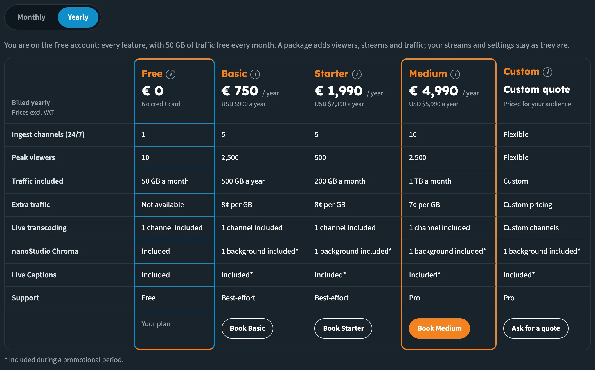
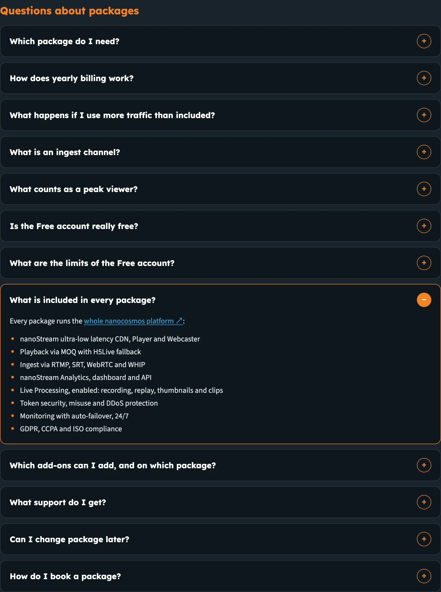

# Builder Hub: Pricing and Packages

The free account gives you every feature, with 50 GB of traffic free every month. When you're ready for a real audience, **Packages** in the Builder Hub compares what each package adds and lets you book one from the same page.

:::tip Current prices
The hub always shows the current prices. You can also find them on [nanocosmos.net/pricing](https://www.nanocosmos.net/pricing).
:::

## Who sees Pricing

| Account | Pricing in the hub |
|---|---|
| **Guest** | Yes |
| **Free account** | Yes. Your current plan is marked in the table. |
| **Production account** | No. A production account has its own agreement. For changes, contact support or your account manager. |

## Open Packages

You can open Packages from several places:

- **Pricing › Packages** at the bottom of the menu
- **See packages** in the plan line at the top of **Home** (*Free plan · … of 50 GB this month*)
- **See packages** on the **Traffic this month** number on Home
- **Upgrade: see packages** in the account menu
- the **AI helper**, for example by typing *pricing* or *custom quote*

## Compare the packages

Packages shows one table with a column per package:

| Package | Best for |
|---|---|
| **Free** | Trying the platform and building a first integration, before any audience watches |
| **Basic** | Businesses that do not stream every day but a few times a year, for up to 2,500 viewers: corporate events, town halls, auctions, annual meetings |
| **Starter** | Regular shows for up to 500 viewers: webinars, education sessions, small auctions, church and community streams |
| **Medium** | Growing platforms with several streams at once: live casino tables, horse racing, corporate events and town halls, with adaptive bitrate included |
| **Custom** | Large audiences and operators: iGaming and betting brands, sports, public safety and enterprise rollouts beyond 2,500 viewers or 10 streams |

Click or hover over the **ⓘ** next to a package name to see who it's best for.

_One column per package. The Book button closes each column._

Each column shows the package's price and the rows that differ between packages:

| Row | What it tells you |
|---|---|
| **Ingest channels (24/7)** | How many streams can be live at the same time |
| **Peak viewers** | The most people watching at the same moment |
| **Traffic included** | The traffic that comes with the package |
| **Extra traffic** | The price per GB above that |
| **Live transcoding** | The live transcoding channels included, for Adaptive Bitrate Streaming |
| **nanoStudio Chroma** | Chroma key backgrounds included |
| **Live Captions** | Whether Live Captions are included |
| **Support** | Free, Best-effort or Pro support |

### Monthly or yearly

Use the **Monthly** / **Yearly** switch above the table. With **Yearly**, the table shows the price per year. The corner of the table shows which billing you're looking at, and that prices exclude VAT.

_Yearly billing: the table shows the price per year._

## Book a package

Each column ends with its button:

| Package | Button | What happens |
|---|---|---|
| **Free** | **Start For Free** (guests) | Opens the free sign-up. On a free account the column reads **Your plan**. |
| **Basic, Starter, Medium** | **Book Basic**, **Book Starter**, **Book Medium** | Opens our secure checkout page in a new tab, for the billing you picked |
| **Custom** | **Ask for a quote** | Opens an email to our sales team, with the billing and your organisation filled in, and lines for your peak viewers, streams at the same time and how often you stream |

To book a package:

1. Pick **Monthly** or **Yearly**.
2. Click **Book** on the package.
3. Complete the payment on the checkout page that opens in a new tab.

:::note Changing package later
Write to us and we move your account to the new package. Your streams and settings stay as they are.
:::

## Questions about packages

Under the table, **Questions about packages** answers the common questions. Click a question to open it.

_The FAQ answers what every package includes and which add-ons you can book._

Two of the answers list what you get:

**What is included in every package?** Every package runs the whole nanocosmos platform:

- nanoStream ultra-low latency CDN, Player and Webcaster
- Playback via MOQ with H5Live fallback
- Ingest via RTMP, SRT, WebRTC and WHIP
- nanoStream Analytics, dashboard and API
- Live Processing, enabled: recording, replay, thumbnails and clips
- Token security, misuse and DDoS protection
- Monitoring with auto-failover, 24/7
- GDPR, CCPA and ISO compliance

**Which add-ons can I add, and on which package?** Every package can add:

- More live transcoding channels
- More nanoStudio Chroma backgrounds
- Secure playback

The other questions cover which package you need, yearly billing, extra traffic, what an ingest channel and a peak viewer are, the Free account and its limits, support, changing package, and how booking works.

## Next steps

- [Accounts & Access](builder_hub_accounts): what guests, free accounts and production accounts see
- [View analytics](builder_hub_analytics): check your traffic and peak viewers before you pick a package
- [nanocosmos.net/pricing](https://www.nanocosmos.net/pricing)
