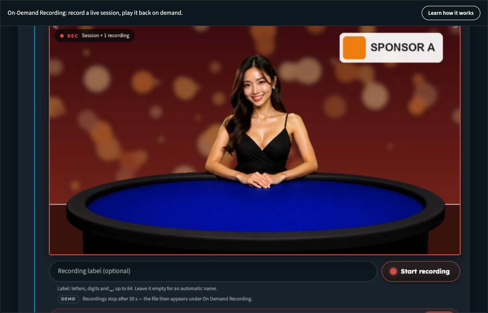
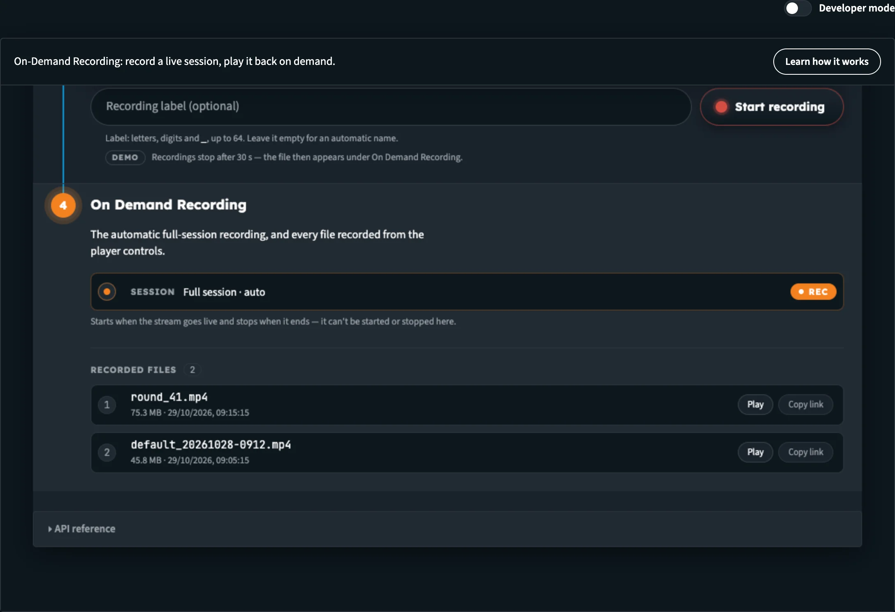

# Builder Hub: Record on Demand

**On-Demand Recording** records a live session while you're live, and plays it back on demand. You start and stop each recording yourself, and each recording produces its own file.

:::tip Open it
In the Builder Hub menu, open **Build › Stream › Record on demand**.
:::

:::tip Detailed On-Demand Recording documentation
This page covers the tool inside the Builder Hub. To start and stop recordings from your own application, see the **Real-Time API** docs:

- [On-Demand Recording](../realtime-api/realtime_api_recording): start and stop recordings with REST calls, with code examples
- [Real-Time API](../realtime-api/realtime_api_introduction): base URL and authentication
:::

## Before you start

| You need | Details |
|---|---|
| **Account** | A free or production account with recording on |
| **Encoder** | OBS, vMix, ffmpeg or a hardware encoder that sends RTMP |
| **Stream** (optional) | An existing stream of yours, or let the tool create one |

## Who can use it

| Account | What happens |
|---|---|
| **Guest** | **Record on demand** is marked **Sign in** in the menu, and clicking it opens the sign-in form. A link straight to the page opens the free sign-up. To see a recording played back without an account, open the [Live & Replay Player](builder_hub_demos) demo. |
| **Free account** | Works. |
| **Production account** | Works when recording is on for your organisation. If it isn't, the menu item is marked **off**. |

**Learn how it works** at the top of the page sums it up: pick a new or existing stream of yours and watch it live, start and stop a recording, then replay the file on demand. It also links to **Open the Live & Replay Player**, which shows a recording played back with sample content.

## Step 1: Sign in

The page opens the **On Demand Recording** tool. Your Builder Hub sign-in carries over, so **Sign in** shows *Signed in as …* and is already done.

## Step 2: Your stream

Choose one of these:

- Click **Create a stream**. *A new stream is created recordable.*
- Paste a stream ID into **Or use an existing stream** and click **Use this stream**.

The step then shows **Stream ready**:

1. Copy the **Ingest URL (for OBS / ffmpeg)** and the **Stream key** with their **Copy** buttons.
2. Start your encoder with them. The stream plays in the player below once it's live.

To pick another stream, click **Change** on the step.

## Step 3: Watch it live

**Live player** plays your stream. **Open in new tab ↗** opens the player on its own. While anything records, the player gets a red frame and a **Rec** tag.

## Step 4: Record

Under the player:

1. Optionally type a **Recording label**: letters, digits and `_`, up to 64. Leave it empty for an automatic name.
2. Click **Start recording**. The recording shows with a running clock.
3. Click **Stop recording** when you're done.

:::note Recordings in the Builder Hub are short
In the Builder Hub, each recording stops after **30 seconds**, and the file then appears under On Demand Recording. To record for as long as you need, use the [On-Demand Recording API](../realtime-api/realtime_api_recording).
:::

_Your stream playing live while a recording runs._

## Step 5: Play back your files

**On Demand Recording** lists your recordings:

| Row | What it is |
|---|---|
| **Session · Full session · auto** | The automatic full-session recording. It starts when the stream goes live and stops when it ends, and can't be started or stopped here. It reads **Inactive** when it's off for the stream. |
| **Recorded files** | Every file you recorded, numbered, with **Play** and **Copy link** |

A new file shows *Processing recording: the file appears shortly.* About a minute after you stop, it's ready. Click **Play** to watch it, or **Copy link** to share it.

_Every recording is its own file, ready to play or share._

## Build it into your app

Start and stop recordings from your own application with the **Real-Time API**. See [On-Demand Recording](../realtime-api/realtime_api_recording).

## Next steps

- [On-Demand Recording API](../realtime-api/realtime_api_recording): the API behind the tool
- [Demos](builder_hub_demos): the Live & Replay Player
- [Create a stream](builder_hub_create_stream): go live from your browser
