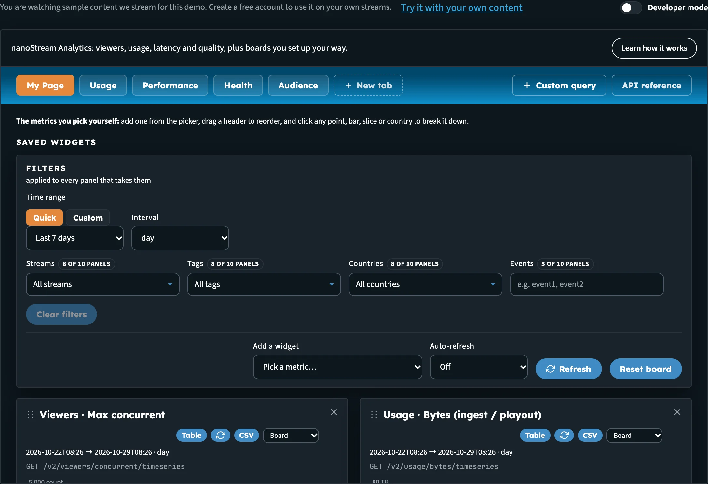
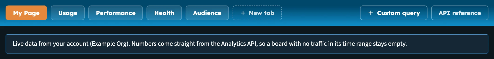
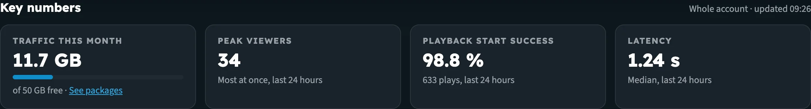
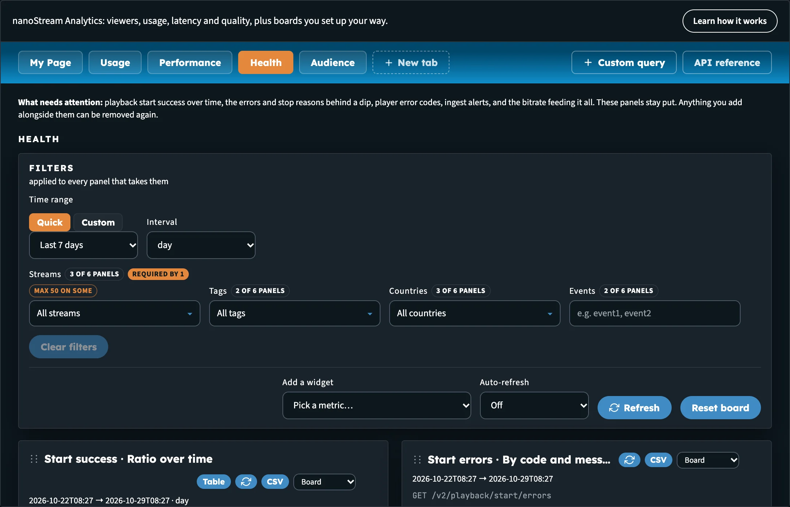
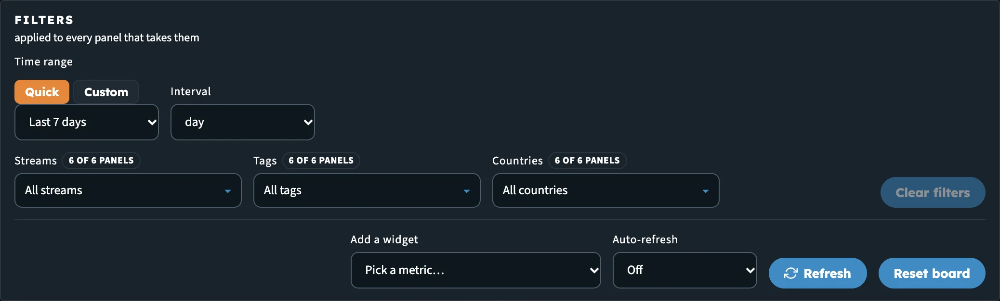

# Builders Hub: View Analytics

**View analytics** opens **nanoStream Analytics** inside the Builders Hub: viewers, usage, latency and quality, plus boards you set up your way. Every number comes from the [nanoStream Analytics API v2](https://api.nanostream.cloud/docs/analytics/v2/), the same API your own applications can call.

You find it in the sidebar under **Build › Analytics › View analytics**.

_The Analytics tool on My Page, with the board tabs, the Filters bar and the panels below._

## Sample data or your own data

What the boards show depends on how you're using the hub.

| You are | What you see |
|---|---|
| **Guest** | Sample numbers from an example account. They have exactly the shape the API returns, so every chart, table and export works as it would on a real account. Nothing is read from any account. |
| **Free account** | Your account's own numbers, straight from the Analytics API. |
| **Production account** | Your account's own numbers, straight from the Analytics API. |

When you're signed in, a line above the boards confirms it:

> Live data from your account (*your organisation*). Numbers come straight from the Analytics API, so a board with no traffic in its time range stays empty.

The footer of the tool also says which data it's using: **nanoStream Analytics, running on sample data** or **nanoStream Analytics, running on your account**.

As a guest, the bar above the page also offers **Try it with your own content**, which opens the free sign-up.

_Signed in, the boards read your own account._

:::tip Try it before you sign up
The sample account behaves like a well-configured nanoStream account, including a few busy days and a short incident in its history, so each time range shows something different. Open **Health** on **Last 7 days** to see what an incident looks like in the numbers.
:::

Signed in, the stream and tag pickers in the filters list your own streams and tags.

## Key numbers on Home

You don't need to open Analytics to see how your account is doing. **Home** shows four **Key numbers** from the same API, with a note that says what they cover (**Your test streams** for a guest, **Whole account** when signed in) and when they were last updated.

| Tile | What it shows |
|---|---|
| **Traffic this month** | Delivered and ingested bytes since the first of the month. On a free account the tile shows a bar against the **50 GB free** included every month, with a **See packages** link. |
| **Peak viewers** | The most viewers at once in the last 24 hours |
| **Playback start success** | The share of plays that started, over the last 24 hours, with the number of plays |
| **Latency** | Median latency over the last 24 hours |

_Key numbers on Home. On a free account, Traffic this month shows how much of the free 50 GB is used._

If a tile can't be filled, it says why: **No plays in the last 24 hours**, **Not on your plan** (the account doesn't have Analytics), or **Not available right now**.

:::note Guests
As a guest, the Key numbers on Home are real: they cover only the test streams you created in this session. The Analytics tool itself stays on sample data until you sign in.
:::

## The boards

Analytics opens on a row of tabs. Five are boards that come ready-made; two are tools.

| Tab | What it answers |
|---|---|
| **My Page** | The metrics you pick yourself. It starts with a useful set and is yours to change. |
| **Usage** | How much data moved: bytes in and out over the range, the hourly shape, the streams behind the volume, and last month's total. These are delivery volumes, not billing. |
| **Performance** | How playback felt: latency, startup time, buffering and watch time, with the country and per-stream views for finding where it got worse. |
| **Health** | What needs attention: playback start success over time, the errors and stop reasons behind a dip, player error codes, ingest alerts, and the bitrate feeding it all. |
| **Audience** | Who watched and from where: peak concurrent viewers, playtime by country, the browser and OS mix, the sites that drove delivery, and the caption languages in use. |
| **Custom query** | Every metric the API exposes. Build a request yourself and add it to any board. See [Boards & Custom Query](builders_hub_analytics_boards#custom-query). |
| **API reference** | Every route in the API version the tool uses, with the parameters, response fields and limits the API's own documentation declares. |

You can also make tabs of your own with **New tab**. See [Make your own tab](builders_hub_analytics_boards#make-your-own-tab).

### What's on each board

| Board | Panels |
|---|---|
| **My Page** | Viewers · Max concurrent, Usage · Bytes (ingest / playout), H5Live · Latency (avg / median), H5Live · Buffering ratio, H5Live · Startup time, H5Live · Views by browser, H5Live · Stop reasons, Start success · Ratio over time, Start errors · By code and message, World · Playtime by country |
| **Usage** | Usage · Bytes (ingest / playout), Usage · Bytes, hourly buckets, Usage · Playout bytes by stream, Usage · Ingest bytes by stream, Usage · Last month, World · Usage by country |
| **Performance** | H5Live · Latency (avg / median), H5Live · Startup time, H5Live · Buffering ratio, H5Live · Playtime (avg / median), World · Latency by country, H5Live · Latency, one stream |
| **Health** | Start success · Ratio over time, Start errors · By code and message, H5Live · Stop reasons, H5Live · Player error codes, Alerting · Current ingest alerts, Monitoring · Ingest bitrate by stream |
| **Audience** | Viewers · Max concurrent, World · Playtime by country, H5Live · Views by browser, H5Live · Views by OS, Audience · Playout bytes by referrer, Captions · Target languages |

The panels on **Usage**, **Performance**, **Health** and **Audience** stay put, because they are that board's answer to the question its name asks. They have no **✕**. Anything you add alongside them can be removed again. On **My Page** every panel can be removed.

_The Health board. Its six panels are fixed; panels you add next to them can be removed._

:::info Usage is volume, not money
Usage shows the bytes your streams delivered and ingested. The Analytics API carries no prices or invoice amounts. For what's included in your package, see [Pricing & Packages](builders_hub_pricing).
:::

## Filters and time range

Every board has a **Filters** bar, *applied to every panel that takes them*.

_The Filters bar. The stream and tag pickers appear because panels on this board accept them._

1. Under **Time range**, choose **Quick** and pick **Last 24h**, **Last 7 days**, **Last 30 days** or **Last month**. Or choose **Custom** and enter a **From (UTC)** and **To (UTC)** time.
2. Choose an **Interval** for the charts over time: **minute**, **hour**, **day**, **week**, **month** or **year**.
3. Narrow the board with the filters below the range. Only the filters that the panels on the board accept are shown:
   - **Streams**: one or more stream names
   - **Tags**: stream tags
   - **Countries**: country codes
   - **Events**: event types, for the routes that take them

The time range, interval and filters are **shared by every board**, including your own tabs. Spot a spike on **Usage**, switch to **Health**, and you're looking at the same window and the same streams.

A filter that no panel on the current board accepts is kept for the boards that do. The bar tells you so, for example *Not applied here: streams = … Kept for the boards that do.* **Clear filters** drops every board filter, including those.

On the right of the bar:

| Control | What it does |
|---|---|
| **Add a widget** | Adds a metric to the board on screen. See [Add a panel](builders_hub_analytics_boards#add-a-panel). |
| **Auto-refresh** | Reloads every panel every **30s**, **1m** or **5m**, or **Off** |
| **Refresh** | Reloads every panel now |
| **Reset board** | Restores the board's default panels. It only resets the board on screen. On your own tab this button reads **Clear tab**. |

When a filter matches nothing, the panel says **No data available** and names the filter and range that emptied it, for example *Nothing matched the streams filter for …*.

## Link to a board

The board on screen is part of the hub's address. Share that link and it opens on the same board.

## Developer mode

Switch on **Developer mode** at the top right of the page to see the API calls behind the boards (the viewer count and byte usage routes), in the language of your choice. See [Developer Mode](builders_hub_developer_mode).

## Next steps

- [Boards & Custom Query](builders_hub_analytics_boards): add panels, make your own tabs, read a metric, drill down and export
- [Manage tokens](builders_hub_tokens): protect your streams with playback tokens
- [Analytics API v2 reference](https://api.nanostream.cloud/docs/analytics/v2/)
- [nanoStream Analytics documentation](../cloud/analytics)
