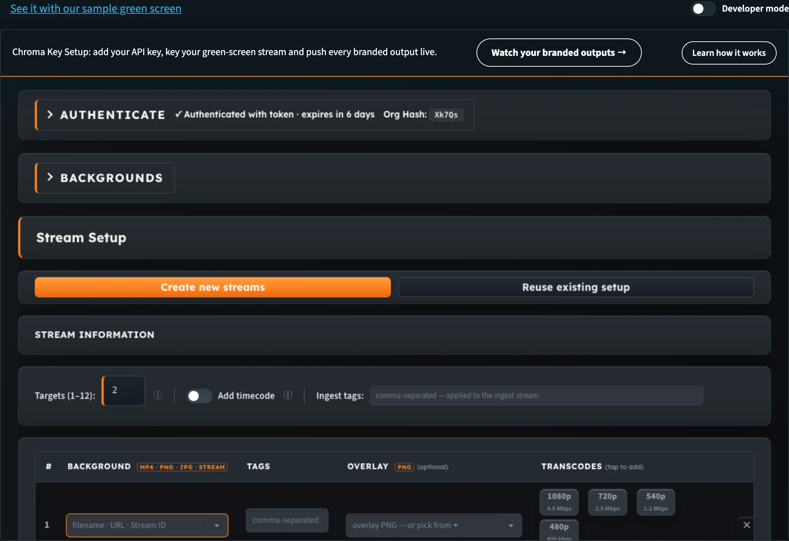
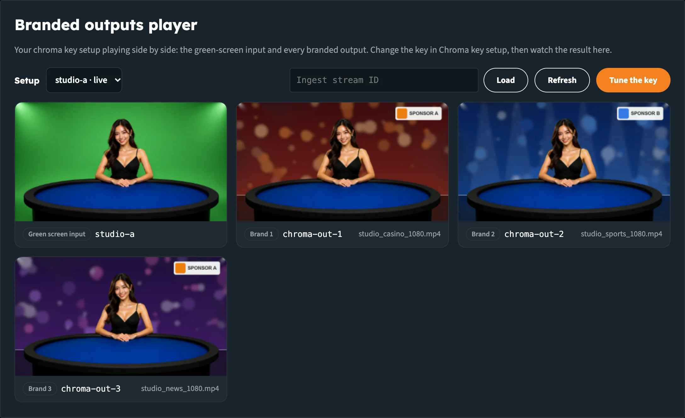
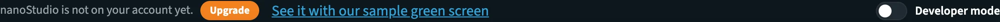

# Builders Hub: Chroma Key and Branded Outputs

The **Multi-Brand** group under **Build** holds the two tools for nanoStudio Chroma:

| Menu item | What it does |
|---|---|
| **Set up chroma key** | Opens the **Chroma Key Setup** tool inside the hub. You create the streams, tune the key against a live composite and push every branded output live. |
| **Watch branded outputs** | Opens the **Branded outputs player**. It plays your green-screen input and every branded output side by side, so you can check the result of your key. |

One green-screen ingest feeds **multiple branded outputs**. Each output has its own background and logo, and you can keep adding outputs as your production grows.

:::info Who can use them
Both tools work on your own streams, so they need an account. A free account includes nanoStudio. As a guest you see the same tools with our sample content (see [As a guest](#as-a-guest)).
:::

:::tip Detailed chroma key documentation
This page covers the chroma key tools inside the Builders Hub. For the full setup, every control and fixes for common problems, see the **Chroma Key** docs:

- [Getting Started](../nanostudio/chroma_key_getting_started): the five setup steps, from sign-in to going live
- [Tuning the Key](../nanostudio/chroma_key_tuning): what every control does, and how to check your key
- [Outputs & Branding](../nanostudio/chroma_key_outputs): backgrounds, overlays, tags and transcodes per output
- [Troubleshooting & FAQ](../nanostudio/chroma_key_troubleshooting): fixes for common problems
:::

## Before you start

| You need | Details |
|---|---|
| **An account** | A free account or a production account, signed in to the hub. See [Getting Started](builders_hub_getting_started). |
| **Green or blue screen** | Evenly lit |
| **Encoder** | OBS, vMix, ffmpeg or a hardware encoder that can send RTMP |
| **Backgrounds** | MP4 video, PNG or JPG at the same resolution as your camera |

## Set up chroma key

1. In the menu, open **Build › Multi-Brand › Set up chroma key**.
2. The **Chroma Key Setup** tool opens inside the hub. When you're signed in to the hub, it opens signed in with the same account.
3. Follow the five steps in the tool: upload backgrounds, create your streams, point your encoder at the ingest, tune the key, and go live.

   Point your encoder at `rtmp://bintu-studio.nanocosmos.de/live` with the ingest's **Stream Key**. Publishing to this server is what starts the chroma key; see [Getting Started](../nanostudio/chroma_key_getting_started).

_The Chroma Key Setup tool runs inside the hub. The toolbar above it links to your branded outputs._

The tool is the same Chroma Setup Tuner documented in the nanoStudio docs. For every step and control, see [Chroma Key: Getting Started](../nanostudio/chroma_key_getting_started) and [Tuning the Key](../nanostudio/chroma_key_tuning).

The toolbar above the tool has two buttons:

- **Watch your branded outputs →** opens the [Branded outputs player](#watch-branded-outputs) with your setup.
- **Learn how it works** opens a short summary: *On your own account, you can:* connect with your API key and pick your green-screen stream, tune key colour, similarity, blend and despill against the live composite, and push the settings straight to every branded output with **Apply to Stream**.

At the top right of the page, **See it with our sample green screen** opens the same tool on our demo stream. **Back to set up the key** takes you back to your own setup.

:::tip Try the sample first
The sample shows the workbench on our demo green-screen stream and its branded outputs. **Apply to Stream** there pushes the settings to our demo outputs, never to your account.
:::

## Watch branded outputs

The **Branded outputs player** plays one chroma key setup at a time: the green-screen input first, then one tile per branded output.

1. In the menu, open **Build › Multi-Brand › Watch branded outputs**, or click **Watch your branded outputs →** in Chroma Key Setup.
2. The player looks for your chroma key setups (*Looking for your chroma key setups…*) and opens the most recent one.
3. To watch another setup, pick it in **Setup**. Setups that are live are marked **· live**.
4. If a setup isn't in the list, paste its **Ingest stream ID** into the box next to it and click **Load**.

_The green-screen input and every branded output play side by side. Each tile shows its stream name and background._

Each tile has a label and the stream name:

| Tile | What it shows |
|---|---|
| **Green screen input** | Your raw ingest stream, as your encoder sends it |
| **Brand 1, Brand 2, …** | Each keyed output, with the file name of its background |

The bar above the tiles has:

- **Refresh** to reload the setup, for example after you've added an output
- **Tune the key** to go back to Chroma Key Setup

Above the player, **See it with a sample casino table** opens Multi-Branding for Live Dealers. **Back to your outputs** brings you back.

### When a tile says Not live

The outputs follow the input. Until your encoder publishes to the ingest, the tiles read:

| Tile | Message |
|---|---|
| Input | **Not live.** Go live on this stream and every brand follows. |
| Output | **Not live.** Starts once the input is live. |

Start your encoder, wait a few seconds, and click **Refresh**.

### When no outputs show

A setup is the ingest stream that Chroma Key Setup creates, together with its outputs.

| Message | What to do |
|---|---|
| **No chroma key setup on your account yet.** | Create one with **Set up chroma key**. If you made one already, paste its ingest stream ID. |
| **No branded outputs found for this stream.** Is it the ingest of a chroma key setup? | The ID you loaded belongs to a stream without chroma key outputs. Paste the ID of the ingest stream instead. |

:::info Secure playback
If your organisation has secure playback switched on, the player gets a playback token for every tile on its own. If it can't create one, the tile says so instead of staying black.
:::

## As a guest

Guests see both tools in the menu, marked **Sign in**. Clicking one opens the sign-in, with a link to create a free account.

A guest who opens one of these tools from a link sees our sample content instead:

| Tool | A guest sees |
|---|---|
| **Set up chroma key** | **Chroma Key Setup with sample content**: the workbench on our demo green-screen stream and its branded outputs |
| **Watch branded outputs** | **Multi-Branding for Live Dealers**: one live dealer table of ours, branded for four casinos |

At the top right, **Try it with your own content** opens the free sign-up. For both samples, see [Demos](builders_hub_demos).

## When nanoStudio isn't on your account

On a production account without nanoStudio, the hub says so and offers to ask for it:

- In the account menu, nanoStudio reads **Off**, with an **Upgrade** button.
- In the menu, **Set up chroma key** and **Watch branded outputs** carry an **off** tag.
- On the Chroma Key pages and the Multi-Branding demos, the line at the top reads *nanoStudio is not on your account yet.*, followed by **Upgrade**.

_On a production account without nanoStudio, every chroma page offers Upgrade._

**Upgrade** opens an email to sales@nanocosmos.net that asks for an offer, with the feature and your organisation filled in. The Multi-Branding demos stay under **Demos**, so you can still see what nanoStudio does.

## Next steps

- [Chroma Key: Getting Started](../nanostudio/chroma_key_getting_started): every step in the Chroma Key Setup tool
- [Outputs & Branding](../nanostudio/chroma_key_outputs): backgrounds, overlays, tags and transcodes per output
- [Tuning the Key](../nanostudio/chroma_key_tuning): what every control does
- [Troubleshooting & FAQ](../nanostudio/chroma_key_troubleshooting): fixes for common problems
- [Demos](builders_hub_demos): the Multi-Branding samples
- [Developer mode](builders_hub_developer_mode): the API calls behind each page
