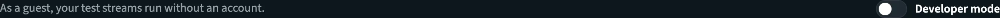
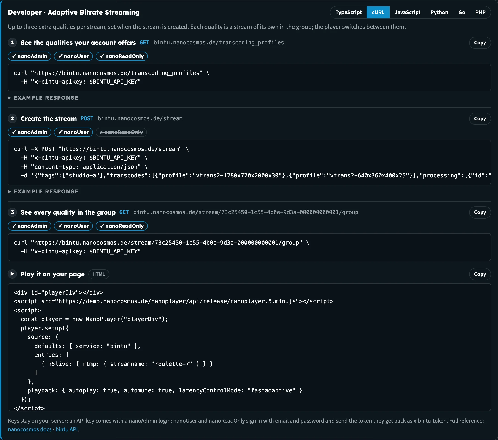
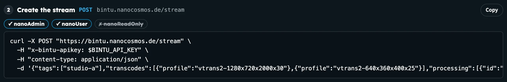
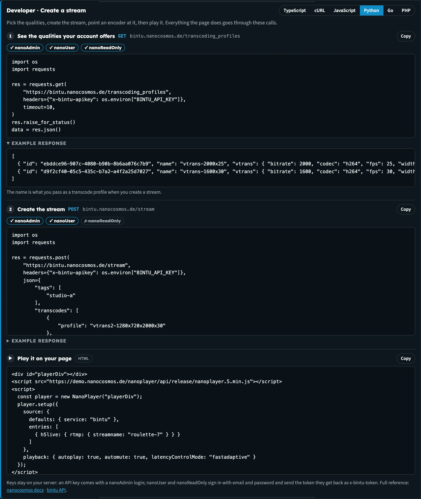

# Builders Hub: Developer Mode

Everything the Builders Hub does goes through the same public APIs you can use from your own application. **Developer mode** shows you those calls on every tool and demo page, in order, so you can build the same thing yourself.

## Turn it on

1. Open any tool or demo page. Developer mode is not on Home or the entry page.
2. Switch on **Developer mode** at the top right of the page.

The developer panel opens above the page. It stays on as you move between pages, and the next time you visit, until you switch it off.

_The switch sits at the top right of every tool page._

## What it shows

The panel is headed **Developer · &lt;what the page does&gt;**, for example **Developer · Adaptive Bitrate Streaming**, with one line on how the page works in API terms. Then come the calls behind the page, numbered in the order the page makes them.

_Set up Adaptive Bitrate in Developer mode: read the qualities, create the stream, read the group, then play it._

Each call shows:

| Part | What it is |
|---|---|
| **Name and route** | What the call does, for example *Create the stream*, with its method and address, for example **POST** bintu.nanocosmos.de/stream |
| **Roles** | Which account roles may make the call: **✓** or **✗** for **nanoAdmin**, **nanoUser** and **nanoReadOnly** |
| **Code** | The full request, ready to copy with **Copy** |
| **Example response** | Folded under **Example response**, with a line on how to read it |

After the calls, pages that play a stream end with the player code for your web page (marked ▶ and **HTML**): **Play it on your page**, **Play and switch cameras** on the multi-camera pages, or **Play it with the token** on Manage tokens.

### Roles

The role row tells you which logins can make a call before you try it:

| Role | Typical use |
|---|---|
| **nanoAdmin** | Full access, including creating playback tokens. An admin login comes with an API key. |
| **nanoUser** | Creates and changes streams, but can't create playback tokens with the Cloud Token Service |
| **nanoReadOnly** | Reads streams and settings only |

_Creating a stream needs nanoAdmin or nanoUser._

### Six languages

Pick a language at the top of the panel: **TypeScript**, **cURL**, **JavaScript**, **Python**, **Go** or **PHP**. Every call on the page switches together, and the hub remembers your choice for the next page. Example responses you've opened stay open when you switch.

_The same call in Python. Every language makes exactly the same request._

### Your stream, never your credentials

The code is filled in with the stream you selected on Home, so you can run it against that stream. Your API key and tokens are **never** filled in. Every example reads them from an environment variable, for example `BINTU_API_KEY` for nanoStream Cloud calls and `NANO_API_TOKEN` for Analytics calls.

:::warning Keep keys on your server
API keys and playback tokens belong on your server, never in a web page. An API key comes with a nanoAdmin login; nanoUser and nanoReadOnly sign in with email and password and send the token they get back as `x-bintu-token`.
:::

The panel ends with links to the full reference: the nanocosmos docs and the bintu API.

## Pages with Developer mode

| Page | What the panel shows |
|---|---|
| **Streams** | List every stream, newest first; read a stream back |
| **Live wall** | List your live streams; play one |
| **Create a stream** | See the qualities your account offers; create the stream; play it |
| **Set up Adaptive Bitrate** | The qualities; create the stream with them; see every quality in the group; play it |
| **Record on demand** | Switch on recording; read the stream back |
| **Add AI Live Captions**, Live Captions demo | Turn captions on; read them back; turn them off |
| **Set up multi-camera**, Multi-Camera Preview, Multi-Player | List your live streams; play them and switch cameras |
| **View analytics** | Concurrent viewers and traffic from the Analytics API |
| **Manage tokens** | Create a playback token; play the stream with it |
| **Set up chroma key**, **Watch branded outputs**, the Multi-Branding demos | Read the chroma key setup; read the stream; play the branded outputs |
| Live & Replay Player | Switch on recording |

For some features, for example revoking tokens or the nanoStudio API, the panel links to the docs instead.

## Next steps

- [Create a stream](builders_hub_create_stream): the simplest page to start with
- [Getting Started](builders_hub_getting_started): your first visit, step by step
