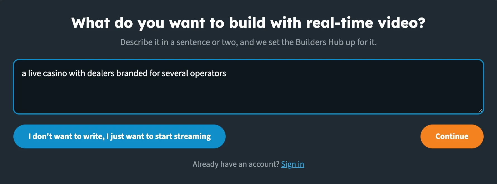
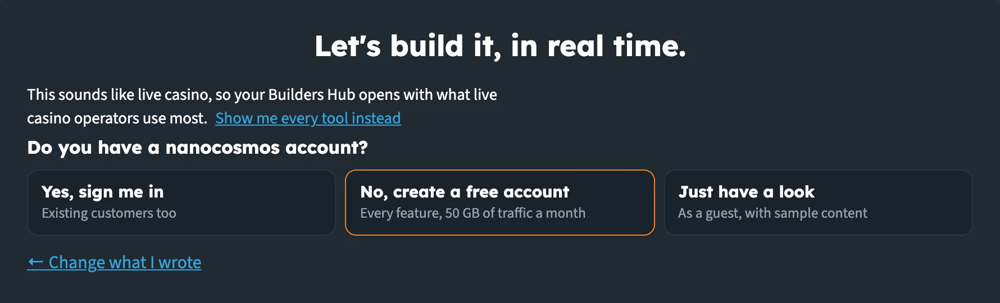
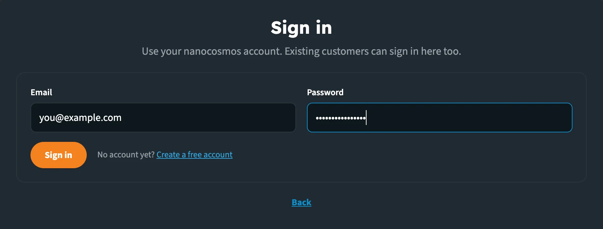
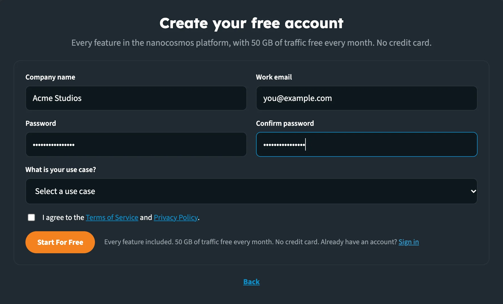
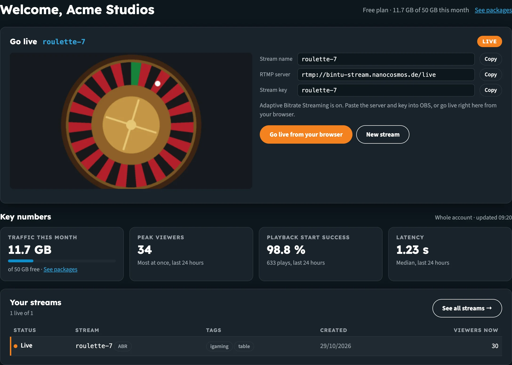
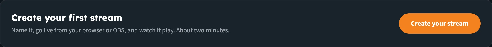
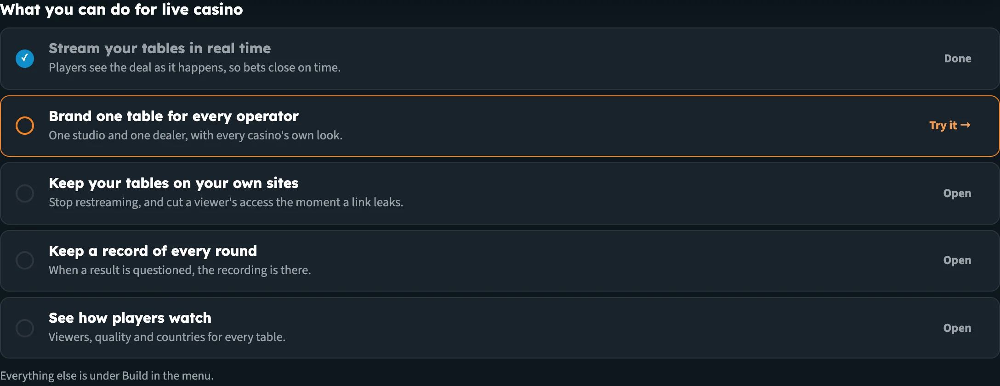
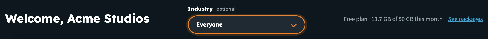
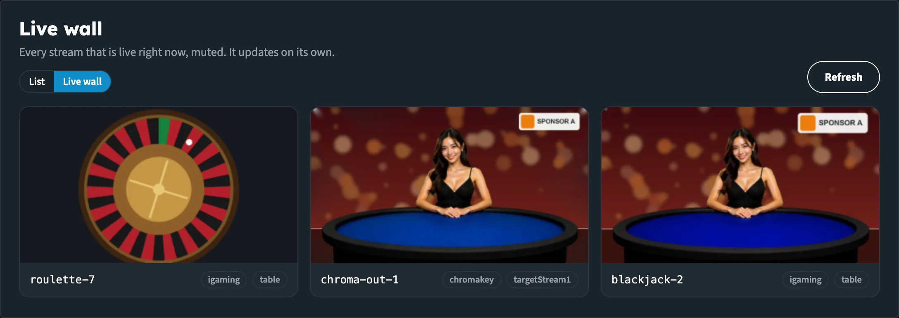
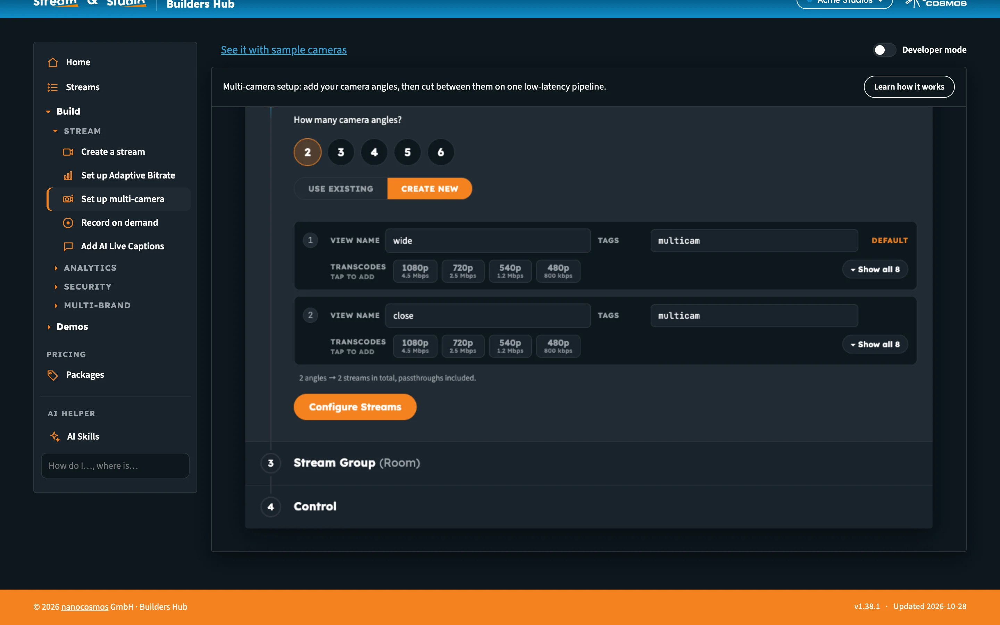

# Builders Hub: Getting Started

This page walks through a first visit to the Builders Hub: describing what you want to build, choosing how to come in, and finding your way around **Home**, your streams and the tools.

:::tip Open the Builders Hub
[web.pages.gitlab.nanocosmos.cloud/builder-hub/](https://web.pages.gitlab.nanocosmos.cloud/builder-hub/)
:::

## Before you start

| You need | Details |
|---|---|
| **Browser** | A current version of Chrome, Firefox, Edge or Safari |
| **Account** (optional) | Your nanoStream Dashboard email and password. Without one, create a free account or look around as a guest. |
| **Camera** (optional) | To go live from your browser. Or use OBS, vMix, ffmpeg or a hardware encoder that sends RTMP. |

## Step 1: Describe what you want to build

The entry page asks **What do you want to build with real-time video?**

1. Type your idea into the box in a sentence or two, for example *a live casino with dealers branded for several operators*.
2. Click **Continue**. The button unlocks once you've typed a few characters. You can also press Ctrl+Enter (⌘+Enter on a Mac).

_Describe your idea, or skip straight to streaming._

The hub picks the industry experience that fits your idea: **iGaming & Live Casinos**, **Horse Racing**, **Live Auctions**, **Corporate Events**, **Public Safety** or **Educational Services & Training**. If nothing fits, the hub opens with every tool.

:::tip Just want to stream?
Click **I don't want to write, I just want to start streaming** under the box. You go straight in as a guest, with every tool in the menu.
:::

Already have an account? Click **Sign in** under the box to go straight to the sign-in form.

## Step 2: Choose how to come in

The page now reads **Let's build it, in real time.** One line tells you which experience opens, for example *This sounds like live casino, so your Builders Hub opens with what live casino operators use most.* Click **Show me every tool instead** to skip the industry experience.

Then answer **Do you have a nanocosmos account?**

| Answer | What happens |
|---|---|
| **Yes, sign me in** | Opens the sign-in form. Existing customers sign in here too. |
| **No, create a free account** | Opens the free sign-up: every feature, 50 GB of traffic a month. |
| **Just have a look** | You go in as a guest, with sample content. |

Click **← Change what I wrote** to go back and edit your idea.

_The hub tells you which experience opens, then asks how you want to come in._

### Sign in

1. Enter the **Email** and **Password** of your nanocosmos account (your nanoStream Dashboard login).
2. Click **Sign in**.

Home opens with your organisation's name, for example **Welcome, Acme Studios**. If the details don't match, the form says *That email and password don't match. Please try again.* If a field is empty, it says *Enter your email and password.*, and if the sign-in service can't be reached, *Could not reach the sign-in service. Please try again.*

_Use your nanocosmos account. Existing customers can sign in here too._

### Create a free account

1. Enter your **Company name** (at least 3 characters), **Work email**, **Password** and **Confirm password**.
2. Answer **What is your use case?**: iGaming, Horse Race, Live Auction, Webcasts & Educational Training, Public Safety & Monitoring, Entertainment or Other. If you described your idea or picked an industry, the hub selects the matching answer for you; you can change it.
3. Tick **I agree to the Terms of Service and Privacy Policy**.
4. Click **Start For Free**.

The form shows **Your account is ready.** Check your inbox to confirm your email, then click **Sign in** and sign in with the email you used. Click **Explore while you wait** to look around as a guest in the meantime.

If the email already has an account, the form says so and offers **Sign in instead**.

If a field is missing or the passwords don't match, the form highlights it and says *Please fix the highlighted fields.* If the box isn't ticked, it says *Please accept the Terms of Service to continue.*

Click **Back** under either form to return to the previous step.

_Every feature in the nanocosmos platform, with 50 GB of traffic free every month. No credit card._

### Look around as a guest

As a guest you can create test streams and open every demo. Your test streams run on a shared demo account, so anyone with their name can watch. Tools that work on your own streams are marked **Sign in** in the menu. See [Accounts & Access](builders_hub_accounts) for the details.

## Home

Home is the page you land on once you're in. It shows, from the top:

1. **The heading:** *Welcome, &lt;your organisation&gt;* when signed in, or *Your guest workspace*. Beside it, a one-line plan summary: **Guest · shared demo account** with **Start For Free**, **Free plan · … of 50 GB this month** with **See packages**, or a **Production** badge.
2. **Your stream.**
3. **What you can do for …**, when you came in with an industry experience.
4. **Key numbers.**
5. **Your streams.**

_Home for a free account with one stream._

### Your stream

The stream card grows with your account:

| When | The card shows |
|---|---|
| **No stream yet** | **Create your first stream**: *Name it, go live from your browser or OBS, and watch it play. About two minutes.* Click **Create your stream** to open [Create a stream](builders_hub_create_stream). |
| **You have a stream** | **Go live** (or **Your test stream** as a guest), with the stream name, a **Live** or **Not live** badge, a preview, and the ingest details. |

The ingest details are the **Stream name**, **RTMP server** and **Stream key**, each with a **Copy** button. Paste the server and key into OBS, or click **Go live from your browser**. When the stream has extra qualities, the card says *Adaptive Bitrate Streaming is on.* Click **New stream** (**New test stream** as a guest) to create another one.

The preview starts on its own as soon as the stream is live. Until then it reads *Not live yet. Go live from your browser or OBS, and the preview starts here on its own.*

_A new account, or a guest, starts with this card._

### Your account menu

Click your organisation's name (or **Guest**) in the header. The menu says which account you're on:

| Account | The menu says |
|---|---|
| **Guest** | *You are exploring as a guest. Guest streams run on a shared demo account.* |
| **Free** | *Free account: every feature, with 50 GB of traffic free every month. Packages add more.* |
| **Production** | *Production account. Your contract applies here, with no Builders Hub limits.*, then your account's features, each **On** or **Off**, and **Contact support** |

See [Accounts & Access](builders_hub_accounts) for each account type in detail.

### Key numbers

Four tiles from nanoStream Analytics:

| Tile | What it shows |
|---|---|
| **Traffic this month** | Data delivered and ingested since the first of the month. On a free account, a bar shows how much of the 50 GB you've used. |
| **Peak viewers** | The most viewers at once, last 24 hours |
| **Playback start success** | The share of plays that started, and how many plays, last 24 hours |
| **Latency** | The median latency, last 24 hours |

A guest sees the numbers for their own test streams; a signed-in account sees the whole account. The line above the tiles says which, and when the numbers were last updated. A tile shows *Not on your plan* if your account doesn't include Analytics.

### Your streams

The five newest streams, live ones first, with **Status**, **Stream**, **Tags**, **Created** and **Viewers now**. Streams with Adaptive Bitrate Streaming carry an **ABR** tag. Click a row to make it the stream on your stream card. Click **See all streams →** for the full list.

Home refreshes on its own: stream states every few seconds, the numbers every minute.

## Industry experiences

When your idea matched an industry, or you picked one, the hub speaks your industry's language. A stream is called by its own word everywhere, from the menu to the buttons:

| Industry | A stream is a |
|---|---|
| iGaming & Live Casinos | **table** |
| Horse Racing | **race** |
| Live Auctions | **sale** |
| Corporate Events | **event** |
| Public Safety | **feed** |
| Educational Services & Training | **session** |

Home also shows **What you can do for &lt;industry&gt;**: five outcomes, each with why it matters. Click one to open the tool that does it. An outcome gets a tick once you've tried it, and the next one to try is highlighted with **Try it →**. A note beside an outcome tells you where it leads when the tool isn't open to you yet:

| Note | Meaning |
|---|---|
| **With sample content** | You're a guest, so it opens the demo on our sample content. |
| **Needs a free account** | You're a guest and there's no demo, so it opens the free sign-up. |
| **Not on your account yet** | Your production account doesn't include this feature, so it opens the demo. |

Everything else is under **Build** in the menu.

_The live casino experience. Each outcome opens the tool, or its sample, that does it._

### Change industry

1. Open the account menu (your organisation's name, or **Guest**, in the header).
2. Click **Change industry** (**Pick your industry** if you haven't chosen one).
3. Choose from the **Industry** list at the top of Home, or choose **Everyone** to go back to every tool with no industry wording.

_The industry is optional. Change it at any time._

## Streams and Live wall

Click **Streams** in the menu (or the industry's word, for example **Tables**) to see every stream on your account, newest first.

- Filter with **All**, **Live** or **Not live**.
- Page through with **Previous** and **Next**.
- Click a row to open its stream card above the list, with the preview and ingest details.
- Click **New stream** to create one.

As a guest, the list shows the test streams you made in this session.

Switch to the **Live wall** tab to see every stream that is live right now, muted, side by side. The wall updates on its own: new live streams are added and finished ones removed, without restarting the players that are still playing. Click **Refresh** to check straight away. When nothing is live, click **Go live** to start.

_The Live wall: everything live right now, muted._

## On every tool page

Each tool and demo page opens with a one-line description and a **Learn how it works** button. It opens a short card that sums up what the page does, and what to do next: **Start For Free →** for a guest, or a link to the tool that does the same on your own streams.

Above the page, a bar tells you what you're looking at and links to the other side:

| You're on | The bar shows |
|---|---|
| **A tool with a sample** | A link to the sample, named for what it is, for example **See it with sample cameras** or **See it with our sample green screen** |
| **A sample** | What the sample is, for example *Sample content: four camera angles we stream for this demo. Nothing here touches your account.*, and a link back to the tool |
| **A demo, as a guest** | *You are watching sample content we stream for this demo.* and **Try it with your own content**, which opens the free sign-up. View analytics and Manage tokens show the same line to a guest. |
| **A feature your account doesn't have** | On Manage tokens (Secure playback) and the Live Captions and nanoStudio pages: *&lt;Feature&gt; is not on your account yet.* with an **Upgrade** button |

The **Developer mode** switch sits at the right of the same bar. See [Developer Mode](builders_hub_developer_mode).

_The bar above every tool page links the tool and its sample._

## Sign out

Open the account menu and click **Sign out**, or **Leave guest mode** as a guest. You're back at the entry page.

## Next steps

- [Create a stream](builders_hub_create_stream): go live from your browser or your own encoder
- [Accounts & Access](builders_hub_accounts): what each account type sees
- [Demos](builders_hub_demos): every feature on sample content
