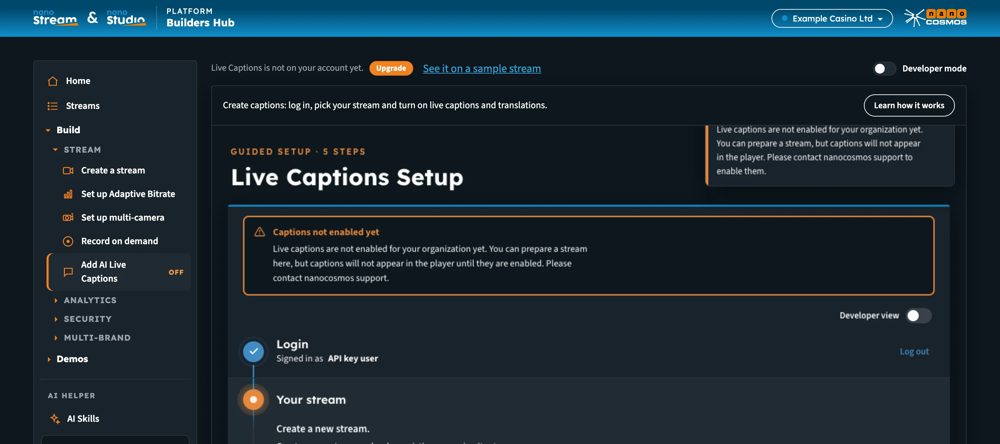
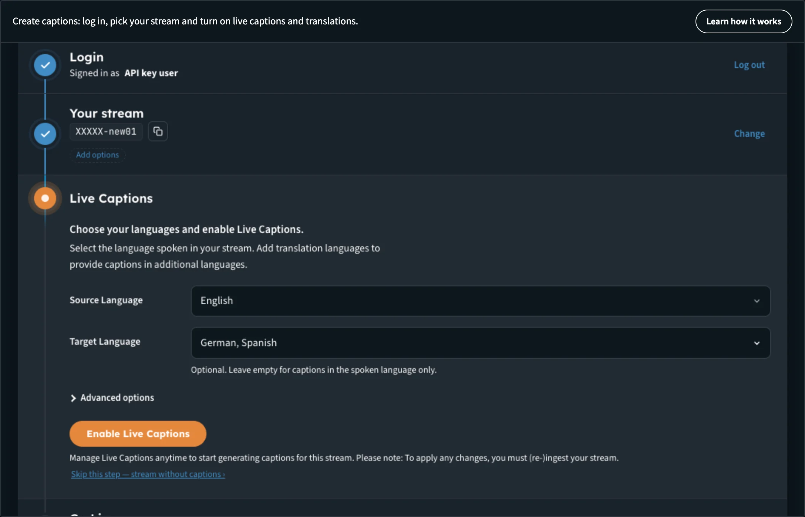
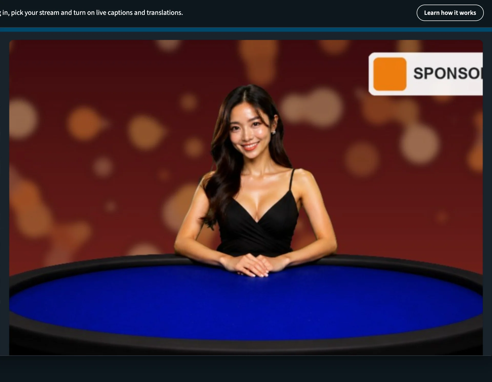
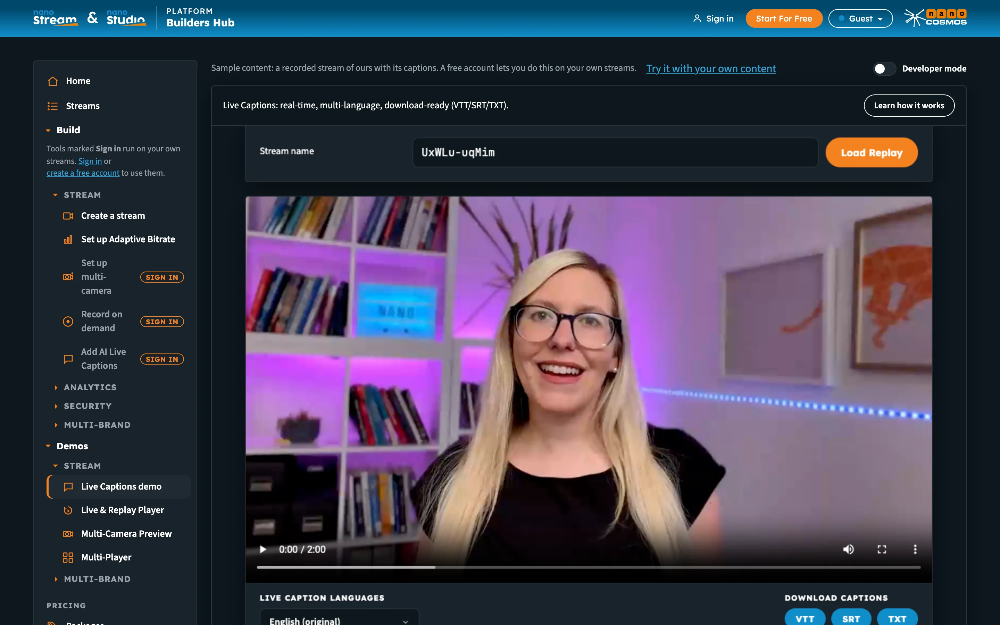

# Builders Hub: Add AI Live Captions

**AI Live Captions** adds real-time captions to your live stream, in its spoken language and in as many translations as you choose. After the stream, you can replay it with captions and download the caption files as VTT, SRT or TXT.

The page has two sides:

- **Create captions** works on your own streams. It needs an account.
- **See it on a sample stream** plays a recorded stream of ours with captions in several languages. Anyone can open it, guests included.

:::tip Open it
In the Builders Hub menu, open **Build › Stream › Add AI Live Captions**.
:::

## Before you start

| You need | Details |
|---|---|
| **Account** | A free account, or a production account with Live Captions on. Guests see the sample instead. |
| **Encoder** | OBS, vMix, ffmpeg or a hardware encoder that sends RTMP |
| **Speech** | Someone speaking in your stream, in the language you choose as the source |

## Who can use it

| Account | What happens |
|---|---|
| **Guest** | **Add AI Live Captions** is marked **Sign in** in the menu, and clicking it opens the sign-in form. A link straight to the page opens the Live Captions demo. On the demo, **Try it with your own content** opens the free sign-up. |
| **Free account** | Both sides. The sample is also listed under **Demos › Stream › Live Captions demo**. |
| **Production account, Live Captions on** | Both sides. |
| **Production account, Live Captions off** | The menu item is marked **off**, and the bar above the page reads *Live Captions is not on your account yet.* with an **Upgrade** button. **Upgrade** opens an email to sales@nanocosmos.net asking for an offer, with your organisation filled in. The Live Captions demo stays under **Demos** for you to try. |

_On a production account without Live Captions, Upgrade asks us for an offer._

## Create captions

The page opens the **Live Captions Setup**, a guided setup in five steps. **Learn how it works** at the top sums it up: log in, turn on live captions for a stream in its spoken language, add translations, go live, and download the transcripts after.

### Step 1: Login

Your Builders Hub sign-in carries over, so the step is already done and shows who is signed in.

### Step 2: Your stream

*We create a stream for your video, or you bring your own.*

1. Optionally open **Stream options**:
   - **Tags** help you find and group streams later. Press Enter after each tag.
   - **Stream quality** adds extra qualities for adaptive playback, when your plan includes them.
2. Choose one of these:
   - Click **Create new stream**.
   - Click **Load your Stream**, enter its **Stream name**, and load it.

When Live Replay is on for your organisation, the step reads **Live Replay is on for this stream**: *After the stream ends, you can replay it with captions and download the caption files.* Without Live Replay you can still use live captions, you just won't get a replay with subtitles after the stream ends.

To switch to another stream later, click **Change** on the step.

### Step 3: Live Captions

*Choose the spoken language and any translations. Optional: you can skip this step.*

1. Under **Source Language**, select the language spoken in your stream.
2. Under **Target Language**, add the translation languages you want. *Optional. Leave empty for captions in the spoken language only.*
3. Optionally open **Advanced options** to choose the **AI engine** and **Model**.
4. Click **Enable Live Captions**.

_The spoken language, plus the translations your viewers can switch to._

The step then reads *Captions on* with your languages. Click **Edit** to change them, or **Turn off captions**. To apply a change, you must (re-)ingest your stream. To stream without captions, click **Skip this step: stream without captions ›**.

### Step 4: Go Live

There's no button to press here.

1. Under **Encoder settings**, copy the server URL and stream name into your encoder (OBS, for example).
2. Start streaming. *Live Captions begin automatically.*

The page waits for your stream and updates by itself. Once it arrives, it reads *Stream connected: Live Captions are active.* and the player shows your stream, with the caption languages as tabs above it. Viewers can switch between caption languages the same way.

To end the session, stop the stream in your encoder. Live Captions stop automatically.

_Your stream live with captions. Each language has its own tab._

### Step 5: Replay & download

After you stop, the page reads *Stream finished: preparing your replay.* Your replay and captions are ready within one minute after the stream stops, and they open here automatically.

- Click **Watch Replay** to review your stream with captions and check the timing.
- Under **Caption files of this run**, download each language as **VTT**, **SRT** or **TXT**.
- Click **Stream again** for your next run. Start your encoder again and the page picks it up automatically. The previous replay stays available.

:::note No video or Live Captions?
**No Live Captions:** check that Live Captions was enabled for the stream. Caption files may take up to one minute to appear after the stream ends. **No video:** check that the stream and server names are correct, and that Live Replay is enabled for your account. Our support team is standing by.
:::

## See it on a sample stream

On the setup page, click **See it on a sample stream** above the setup to open the **Live Captions** demo. The bar reads *Sample content: a recorded stream of ours with its captions.*

Here you can see:

- a recorded stream playing with its live captions on screen
- a language picker under the player to switch the captions
- the caption files, ready to download as VTT, SRT or TXT

_The sample: one of our recorded streams with captions in several languages._

To go back, click **Back to create captions**. As a guest, the link reads **Try it with your own content** and opens the free sign-up.

## Next steps

- [Demos](builders_hub_demos): the Live Captions demo and the other samples
- [Accounts & Access](builders_hub_accounts): what each account type gets
- [Developer Mode](builders_hub_developer_mode): the API calls behind each page
