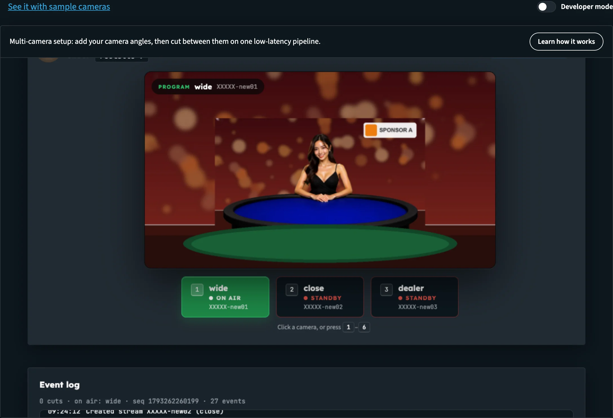
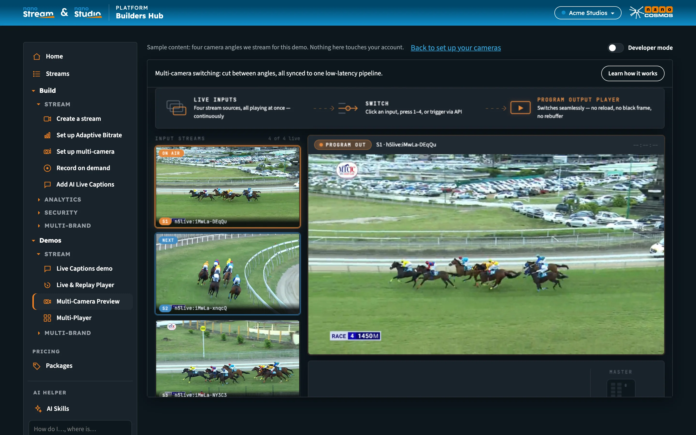

# Builders Hub: Set up Multi-Camera

**Multi-camera setup** lets you add your camera angles, then cut between them on one low-latency pipeline. Viewers watch one continuous video while you decide which camera is on air.

The page has two sides:

- **Set up your cameras** works on your own streams. It needs an account.
- **See it with sample cameras** plays four camera angles we stream for this demo. Anyone can open it, guests included.

:::tip Open it
In the Builders Hub menu, open **Build › Stream › Set up multi-camera**.
:::

:::tip Detailed Multi-Camera Switching documentation
This page covers the tool inside the Builders Hub. To build multi-camera switching into your own application, see the **Real-Time API** docs:

- [Multi-Camera Switching](../realtime-api/realtime_api_switching): how it works, step by step, with code examples
- [Multi-Camera Switching: API Reference](../realtime-api/realtime_api_switching_reference): every endpoint, field, event and error
- [Real-Time API](../realtime-api/realtime_api_introduction): base URL and authentication
:::

## Before you start

| You need | Details |
|---|---|
| **Account** | A free or production account. Guests see the sample instead. |
| **Streams** | Two or more streams of your own as camera angles, or let the setup create them |
| **Encoders** | One encoder per camera angle, sending RTMP |

## Who can use it

| Account | What happens |
|---|---|
| **Guest** | **Set up multi-camera** is marked **Sign in** in the menu, and clicking it opens the sign-in form. A link straight to the page opens the sample. On the sample, **Try it with your own content** opens the free sign-up. |
| **Free account** | Both sides. The sample is also listed under **Demos › Stream › Multi-Camera Preview**. |
| **Production account** | The setup. The sample opens from the link on the setup page. |

## Set up your cameras

The page opens the **Multi-Camera Switch** tool. You're already signed in with your Builders Hub account, so it opens ready to use. **Learn how it works** at the top sums up what you can do: pick your own streams as camera angles, group them into one room, and switch between them live, with a log of every switch.

The tool walks through four steps:

1. **Connect.** Your Builders Hub sign-in carries over, so this step is already done.
2. **Camera Angles.** Choose **How many camera angles?** Then:
   - **Create new** makes a fresh stream for each angle.
   - **Use existing** lets you pick streams your organisation already has. **Refresh streams** reloads the list.

   Then click **Configure Streams**.
3. **Stream Group (Room).** *Bind the angles into one group.* Enter a **Group Name**, or leave it blank to get one generated, and click **Create Stream Group**. Reuse a name to pick up a group you made earlier: its angles are replaced, and whatever it has on air stays on air.
4. **Control.** The player shows what viewers see. Click a camera, or press **1** to **6**, to cut. The **Event log** lists every switch.

_Your own angles, grouped and switched live._

In **Control**, **Copy player link** gives you the link to the player for your viewers, and **How it works & API** shows the ingest details and the exact API calls for your group.

For every step of the tool in detail, see [Try it in the demo](../realtime-api/realtime_api_switching#try-it-in-the-demo-no-code) in the Multi-Camera Switching docs.

## See it with sample cameras

On the setup page, click **See it with sample cameras** above the tool to open **Multi-Camera Preview**. The bar reads *Sample content: four camera angles we stream for this demo.* Signed in, it adds *Nothing here touches your account.*

Here you can see:

- four camera angles playing side by side as live inputs
- a program output player showing the angle on air
- cuts between angles: click an input, press **1** to **4**, or **Take Next** (or press Space)

_The sample: four angles we stream, cut to one program output._

To go back, click **Back to set up your cameras**. As a guest, the link reads **Try it with your own content** and opens the free sign-up.

## Build it into your app

Everything the tool does is available through the **Real-Time API**: create a stream group, embed the player, and switch angles with one call. See [Multi-Camera Switching](../realtime-api/realtime_api_switching).

## Next steps

- [Multi-Camera Switching](../realtime-api/realtime_api_switching): the API behind the tool
- [Multi-Camera Switching: API Reference](../realtime-api/realtime_api_switching_reference): every endpoint, field, event and error
- [Demos](builders_hub_demos): the Multi-Camera Preview and the other samples
- [Accounts & Access](builders_hub_accounts): what each account type gets
