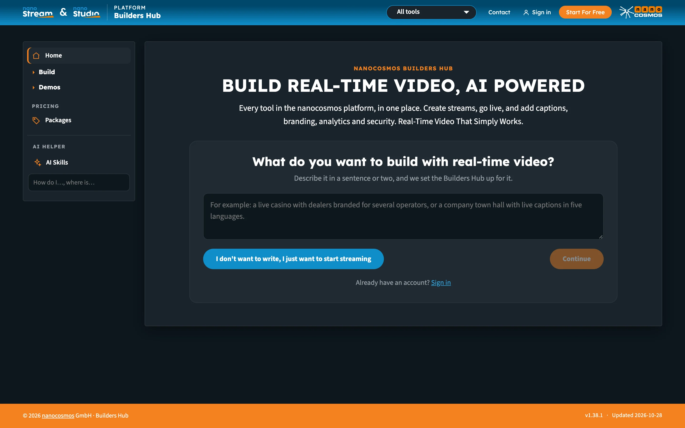
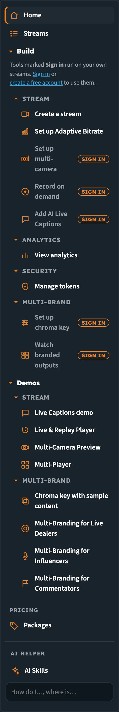

# nanocosmos Builders Hub

The **Builders Hub** is where you create streams, go live and try every tool in the nanocosmos platform without leaving the page. You can add captions, branding, analytics and security to your own streams, or watch each feature first on sample content we stream for you.

:::tip Open the Builders Hub
[builder.nanocosmos.net](https://builder.nanocosmos.net)
:::

_The entry page. Describe what you want to build, or go straight to streaming._

## Who it's for

- **New visitors** who want to see real-time streaming working before they sign up
- **Free account holders** who want to build and test every feature on their own streams
- **Customers** who want one place to go live, check their numbers and set up nanocosmos tools on their account

## Three ways in

| Way in | What you get |
|---|---|
| **Guest** | No account needed. Create test streams and watch every demo. Test streams run on a shared demo account. Tools that work on your own streams are marked **Sign in**. |
| **Free account** | Every feature in the platform, on your own streams, with 50 GB of traffic free every month. No credit card. |
| **Existing nanocosmos login** | Sign in with the email and password you use for the nanoStream Dashboard. Customers see their own account, with no Builders Hub limits. |

You choose at the front door, and you can switch at any time from **Sign in** and **Start For Free** in the header, or from the account menu. See [Getting Started](builders_hub_getting_started) for the full first-visit flow, and [Accounts & Access](builders_hub_accounts) for what each account type sees.

## The menu

The menu on the left is the same for everyone, and **Streams** appears once you're in. What you can open from it depends on how you came in.

| Menu item | What it holds |
|---|---|
| **Home** | Your stream to go live with, a one-line plan summary, the key numbers and your stream list. See [Getting Started](builders_hub_getting_started#home). |
| **Streams** | Every stream on your account, with a **Live wall** tab that plays everything live right now. When you pick an industry, this item takes its name, for example **Tables** for iGaming. |
| **Build** | The tools, in four groups. Each group folds on its own. |
| **Demos** | Every feature on sample content we stream, in the same groups. |
| **Pricing** | **Packages**, for guests and free accounts. See [Pricing & Packages](builders_hub_pricing). |
| **AI helper** | **AI Skills** and a search box for questions about the hub and the docs. See [AI Helper & AI Skills](builders_hub_ai_helper). |

### Build

| Group | Tools |
|---|---|
| **Stream** | [Create a stream](builders_hub_create_stream), [Set up Adaptive Bitrate](builders_hub_adaptive_bitrate), [Set up multi-camera](builders_hub_multicamera), [Record on demand](builders_hub_recording), [Add AI Live Captions](builders_hub_live_captions) |
| **Analytics** | [View analytics](builders_hub_analytics) |
| **Security** | [Manage tokens](builders_hub_tokens) |
| **Multi-Brand** | [Set up chroma key](builders_hub_chroma_key), [Watch branded outputs](builders_hub_chroma_key) |

### Demos

| Group | Demos |
|---|---|
| **Stream** | Live Captions demo, Live & Replay Player, Multi-Camera Preview, Multi-Player |
| **Multi-Brand** | Chroma key with sample content, Multi-Branding for Live Dealers, Multi-Branding for Influencers, Multi-Branding for Commentators |

See [Demos](builders_hub_demos) for what each one shows.

_The menu, with Build and Demos open. Tools marked **Sign in** need an account._

## Detailed product documentation

Some Builders Hub tools have their own detailed documentation, for the full setup or to build the feature into your own application:

| Builders Hub tool | Detailed documentation |
|---|---|
| [Set up chroma key](builders_hub_chroma_key) and **Watch branded outputs** | [Chroma Key](../nanostudio/chroma_key_getting_started): setup, tuning, outputs and troubleshooting |
| [Set up multi-camera](builders_hub_multicamera) | [Multi-Camera Switching](../realtime-api/realtime_api_switching) with the Real-Time API |
| [Record on demand](builders_hub_recording) | [On-Demand Recording](../realtime-api/realtime_api_recording) with the Real-Time API |

## Next steps

- [Getting Started](builders_hub_getting_started): your first visit, step by step
- [Accounts & Access](builders_hub_accounts): guest, free and production accounts
- [Developer Mode](builders_hub_developer_mode): the API calls behind every page
