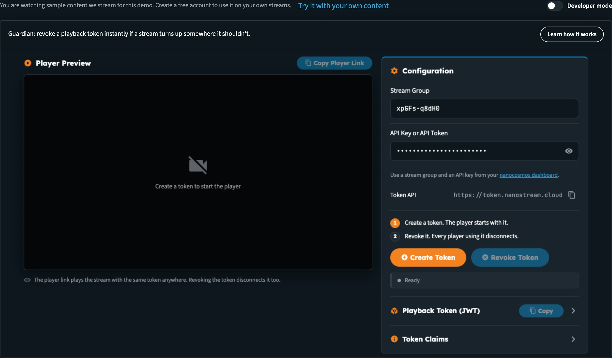
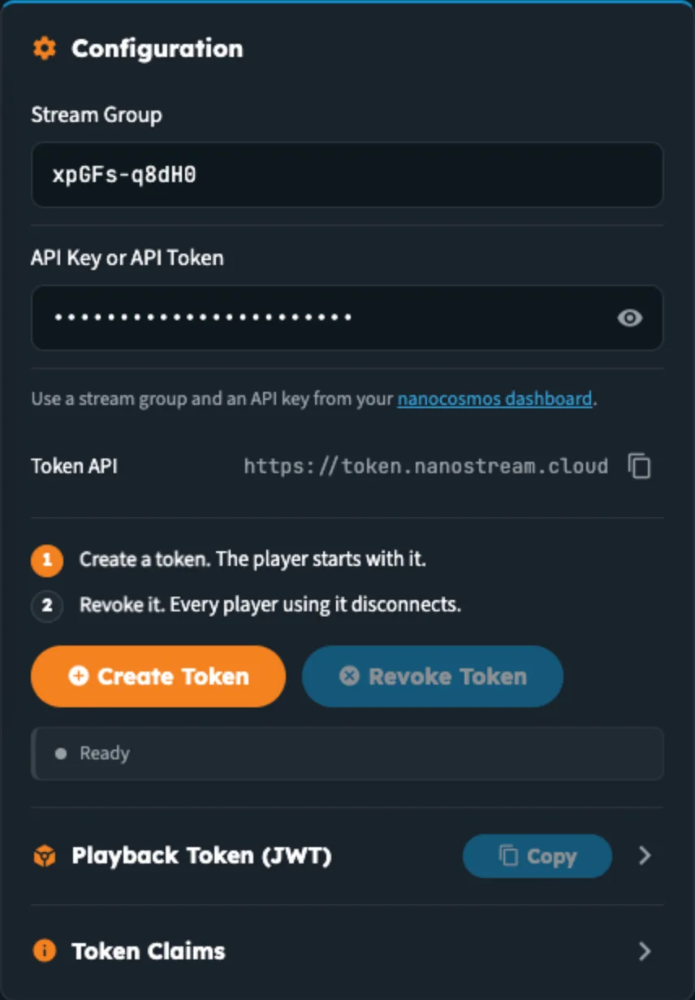
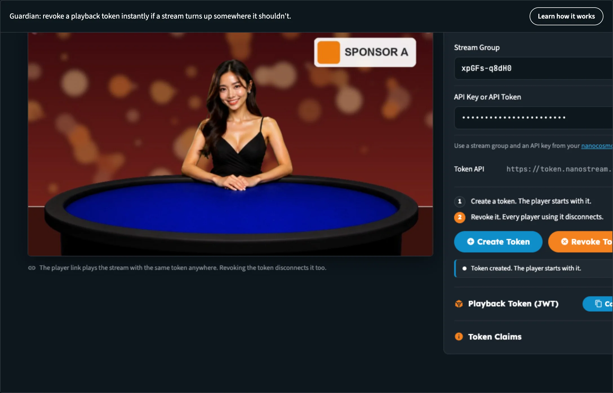
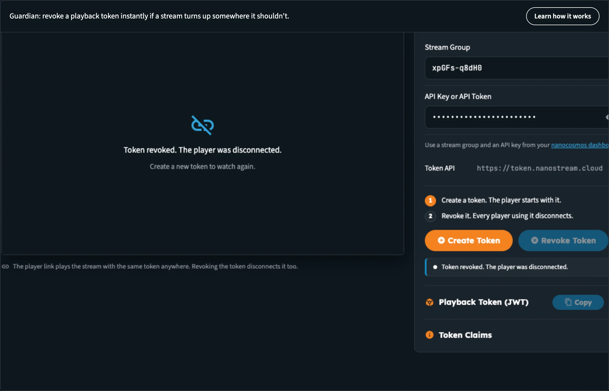

# Builders Hub: Manage Tokens

**Manage tokens** lets you create a playback token and revoke it instantly if a stream turns up somewhere it shouldn't.

A playback token is a signed key (a JWT) that lets a player watch one stream group for a limited time. With secure playback on, a player without a valid token can't play the stream. Manage tokens adds the other half: you can **revoke** a token at any time, and every player using it disconnects.

You find it in the sidebar under **Build › Security › Manage tokens**.

_Manage tokens before a token exists. The player waits for one._

## Who can use it

| You are | What you get |
|---|---|
| **Guest** | The full flow on a sample stream of ours, with a demo key filled in. Nothing touches any account. The bar above the page offers **Try it with your own content**, which opens the free sign-up. |
| **Free account** | The same flow on the sample stream, or on your own stream group with your own API key |
| **Production account** | The same. If secure playback isn't on your account yet, the bar above the page says **Secure playback is not on your account yet.** with an **Upgrade** button that emails our sales team for an offer, with the feature and your organisation filled in. |

Click **Learn how it works** in the toolbar above the tool for a short summary of the page.

## Create and revoke a token

The page opens with a sample **Stream Group** and a demo **API Key or API Token** already filled in, so you can start straight away.

_The Configuration section and the two steps: create a token, then revoke it._

### Step 1: Create a token

1. Click **Create Token**. The status reads **Creating token...**.
2. When it reads **Token created. The player starts with it.**, the **Player Preview** starts playing the stream with the new token.
3. Open **Playback Token (JWT)** to see the token itself, and click **Copy** to copy it.
4. Open **Token Claims** to inspect what's inside it: the stream group it's for, when it expires, and whether it can be revoked.

_A token was created and the player started with it. The token and its claims are ready to inspect._

To watch the stream with the same token somewhere else, click **Copy Player Link**. The player link plays the stream with the same token anywhere. Revoking the token disconnects it too.

:::tip Test it like an attacker would
Open the copied player link in another browser or on your phone before you revoke. When you revoke the token in the next step, that player loses the stream as well.
:::

### Step 2: Revoke it

1. Click **Revoke Token**. The status reads **Revoking token...**.
2. Every player using the token disconnects. In place of the player you see **Token revoked. The player was disconnected.** and **Create a new token to watch again.**

_After Revoke Token, the player loses access right away._

Click **Create Token** again to issue a fresh token and watch again. The tokens the hub creates here are short-lived (a few minutes) and can be revoked.

### Use your own stream

1. Under **Configuration**, replace **Stream Group** with the ID of one of your own stream groups.
2. Paste an **API key or API token** from your account into **API Key or API Token**. Use the eye button to show or hide it.
3. Click **Create Token**, then **Revoke Token**, as above.

Your stream must be live for the player to show a picture. You'll find your stream groups and your API key in the [nanoStream Dashboard](https://dashboard.nanostream.cloud).

**Token API** shows the address of the token service the page calls, with a button to copy it.

### When something goes wrong

| Status | What to do |
|---|---|
| **Enter a stream group** | Fill in **Stream Group** |
| **Enter an API key or token** | Fill in **API Key or API Token** |
| **Token API error …** | The token service refused the request. Check that the API key belongs to the organisation that owns the stream group. |
| **Player Error** with a **Message** and **Code** | The player couldn't play. Check that the stream is live, and that the token is still valid. |

## Secure playback across the hub

Signed in with a production account, the account menu lists your account's features, including **Secure playback** as **On** or **Off**.

When secure playback is on for your organisation, or a stream is set to require a token, every player the hub draws for you gets a playback token automatically: the stream preview on **Home**, the **Live wall**, and the [branded outputs player](builders_hub_chroma_key). While the token is created, the player reads **Starting secure playback…**.

If no token can be created, the player says so instead of staying black: **Secure playback is on, and no playback token could be created.** When that happens, sign out and sign in again with an admin login, so the hub can create tokens for your organisation.

:::note Production accounts without secure playback
If your account doesn't have secure playback yet, the account menu and the Manage tokens page show it as **Off** with an **Upgrade** button. Upgrade opens an email to sales@nanocosmos.net asking for an offer, with the feature and your organisation filled in.
:::

## In your own application

Switch on **Developer mode** at the top right of the page to see **Playback tokens**: the API call that creates a token on your server, in the language of your choice, and **Play it with the token**, the player code that hands the token to the H5Live Player. Keep your API key on your server and create tokens there; never put the key in a web page. See [Developer Mode](builders_hub_developer_mode).

For every token option, see [Secure Playback](../dashboard/secure_playback).

## Next steps

- [View analytics](builders_hub_analytics): see where your streams are watched
- [Create a stream](builders_hub_create_stream)
- [Accounts & Access](builders_hub_accounts): what guests, free and production accounts see
