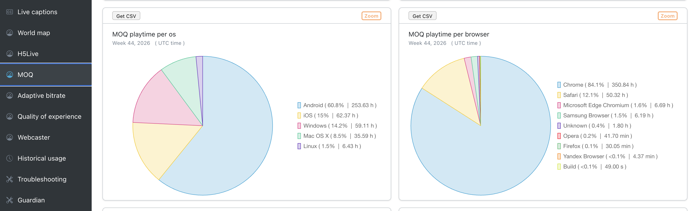

# MoQ

The MoQ page shows metrics for playbacks of the H5Live player that use [Media over QUIC (MoQ)](../nanoplayer/nanoplayer_feature_moq.md).
MoQ playbacks are shown here and not on the [H5Live](./h5live) page.
The selected filter options affect all available metrics.

*Screenshot: MoQ Charts*

### MoQ playtime per os

Distribution of MoQ playtime on operating systems (OS), as a percentage and as total playtime.

### MoQ playtime per browser

Distribution of MoQ playtime in browsers, as a percentage and as total playtime.
