# MoQ

The MoQ page shows metrics for playbacks of the Player that use [Media over QUIC (MoQ)](../nanoplayer/nanoplayer_feature_moq.md).
The selected filter options affect all available metrics.

*Screenshot: MoQ Charts*

### MoQ playback count per os

Distribution of MoQ playbacks on operating systems (OS), as a percentage and as a count.

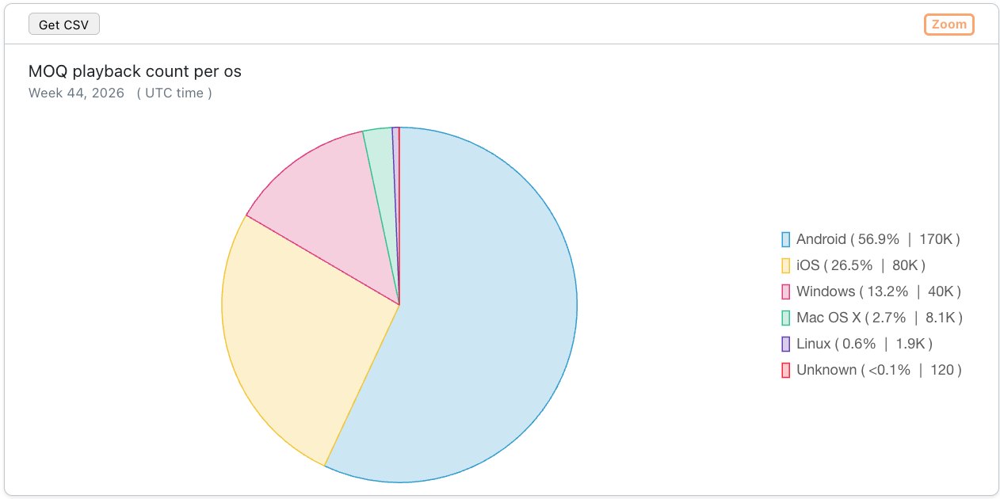
*Screenshot: MoQ playback count per os*

### MoQ playback count per browser

Distribution of MoQ playbacks in browsers, as a percentage and as a count.

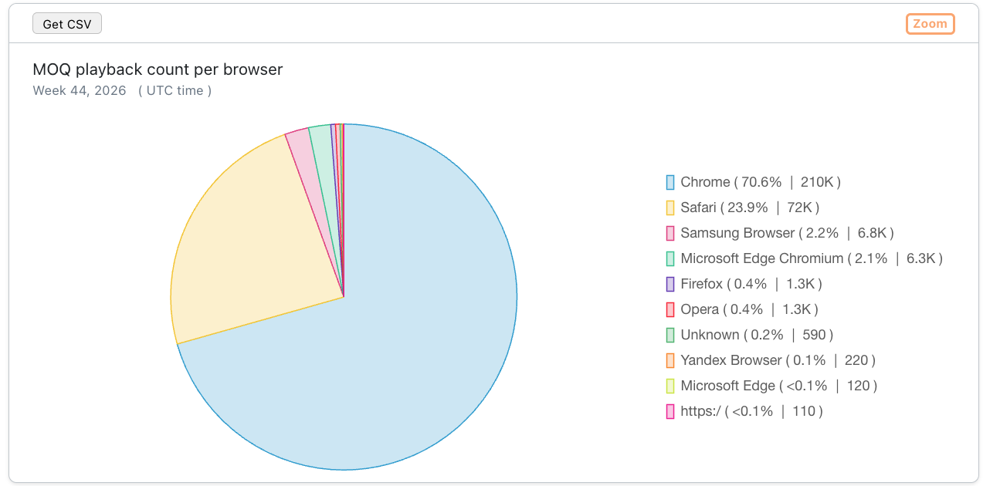
*Screenshot: MoQ playback count per browser*

### MoQ playtime per os

Distribution of MoQ playtime on operating systems (OS), as a percentage and as total playtime.

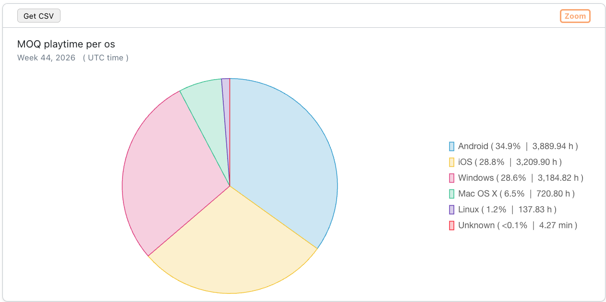
*Screenshot: MoQ playtime per os*

### MoQ playtime per browser

Distribution of MoQ playtime in browsers, as a percentage and as total playtime.

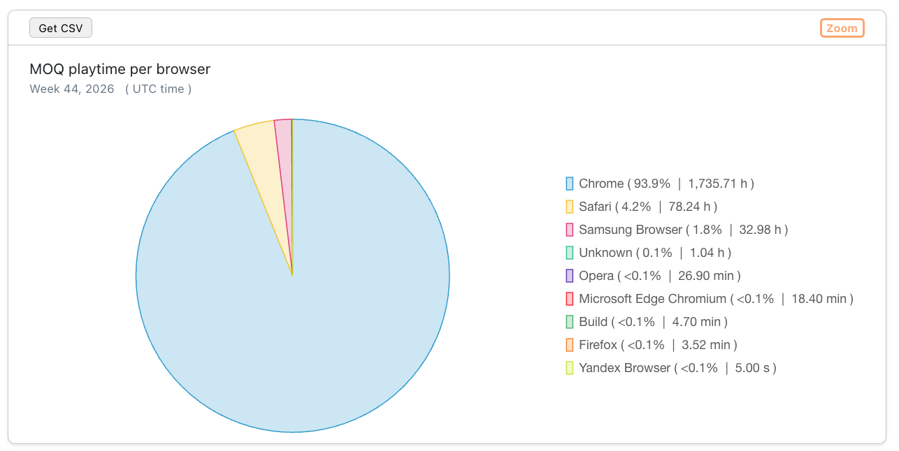
*Screenshot: MoQ playtime per browser*

### Average and median playing time in seconds

The average and median duration of a MoQ playback, shows how long a viewer watches a stream.

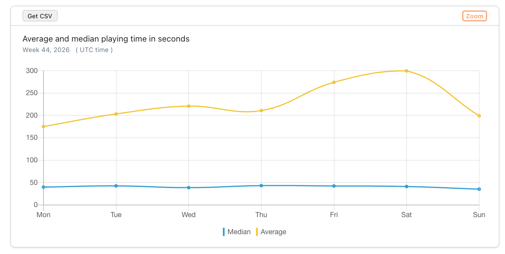
*Screenshot: Average and median playing time in seconds*

### Play buffering ratio in percent

The ratio between buffer and playback duration over all MoQ playouts.

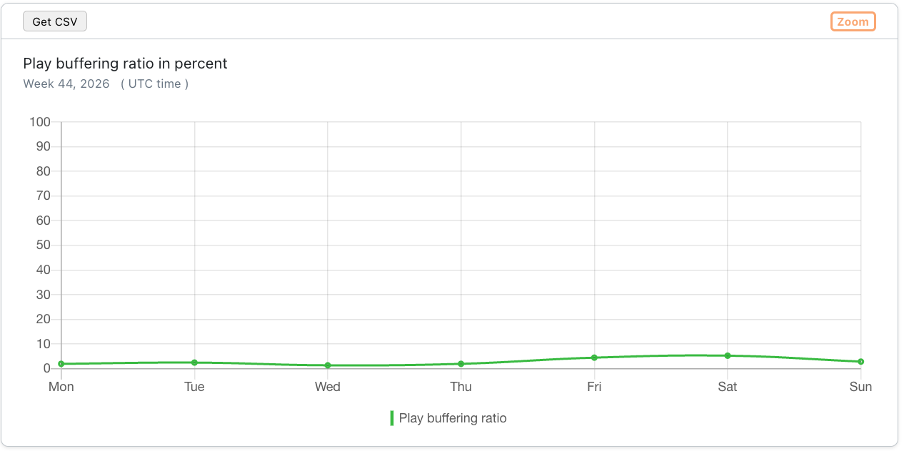
*Screenshot: Play buffering ratio in percent*

### Player loading count per country

The number of player initialisations (clients which attempt to play back a stream via MoQ) per country.

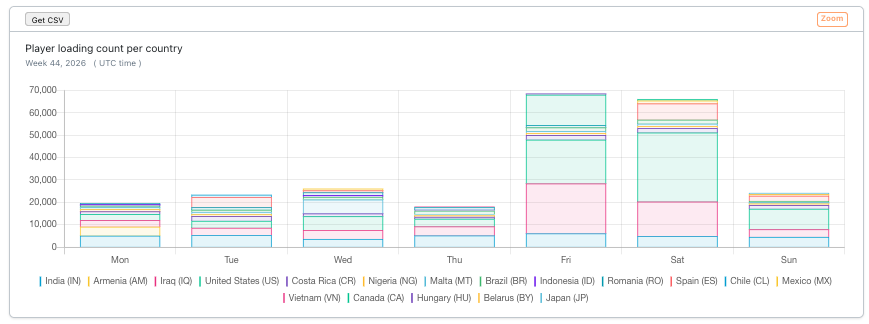
*Screenshot: Player loading count per country*

:::info
H5Live Player versions before **5.0.11** report the playback path only once the connection is established. The first player loadings of a MoQ playback are therefore counted on the [H5Live](./h5live) page, so this chart can show a few percent fewer player loadings than actually occurred.
:::

### Used player versions

Distribution of MoQ playbacks based on the used version of the H5Live player. Switch between **Pie chart** and **Table** view.

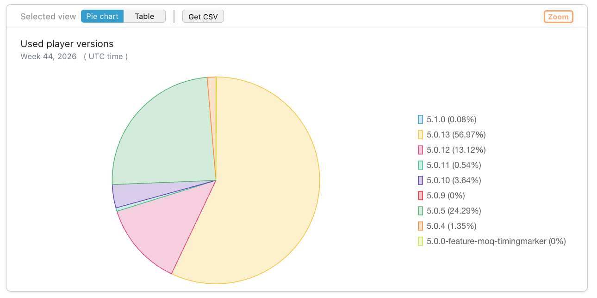
*Screenshot: Used player versions*

### Average and median player latency in seconds

The average and median latency of MoQ playbacks.

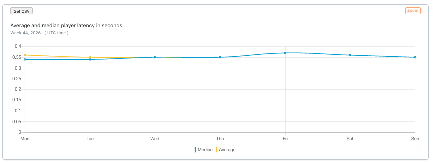
*Screenshot: Average and median player latency in seconds*

### Median play startup time in seconds

The time it takes until the playback of a stream is started via MoQ - first frame rendered by the H5Live player.

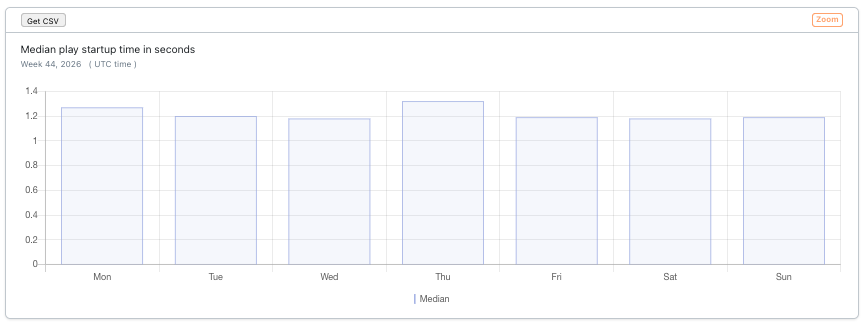
*Screenshot: Median play startup time in seconds*

### Status/Error Codes

The number and types of status and error codes which occurred during MoQ playbacks.
**View error codes** opens a page with an explanation for each code.

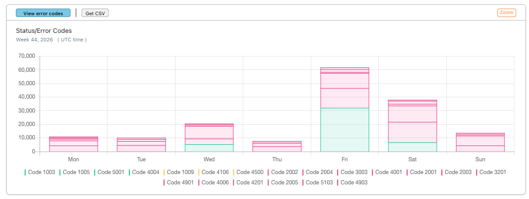
*Screenshot: Status/Error Codes*

### Stop reasons

The number and types of reasons why MoQ playbacks were stopped or interrupted.
**View stop reasons** opens a page with an explanation for each stop reason.

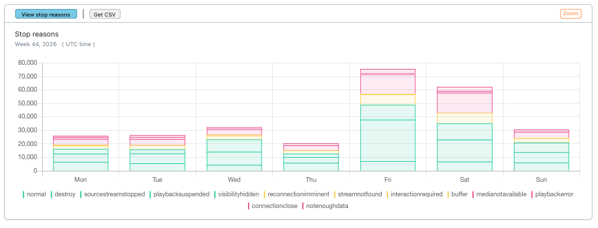
*Screenshot: Stop reasons*

### Percentiles of average player latency in seconds

The distribution of the average player latency of MoQ playbacks, shown as the 10th, 25th, 50th, 75th, 85th, 90th and 95th percentile.

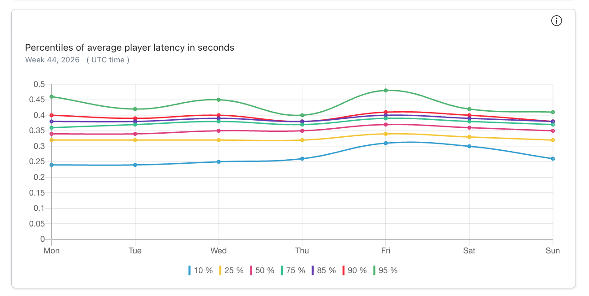
*Screenshot: Percentiles of average player latency in seconds*
