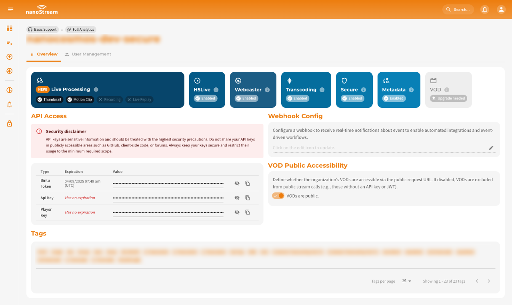

**nanoStream Cloud** is a powerful and flexible platform for **ultra-low-latency live streaming**.
This section introduces **bintu**, the central stream management system of nanoStream Cloud.
With bintu, you can easily create, manage, and monitor your live streams, either via the **Dashboard** or through the **API** for automated workflows.

## Getting Started

To get started with the **nanoStream Dashboard**, sign in with your existing *nanoStream account*.  

:::info Before starting
If you don’t have an account yet you can [sign up](https://dashboard.nanostream.cloud/signup), or get in touch with our sales team via [nanocosmos.net/contact](https://www.nanocosmos.net/contact) or by email at sales(at)nanocosmos.net.

*Need help accessing an existing organization or unsure how to proceed?*  
👉  Check the [Authentication section](/docs/dashboard/getting_started) in our docs for step-by-step guidance on creating an account, logging in or requesting access from your system administrator.
:::

Once logged in, you can access bintu through:

<article className="margin-vert--lg">
  <Columns className="list_ZO3j" >
    <Card className="col col--6 margin-horiz--md" href="/docs/dashboard/overview">
      <Card.Header title="Dashboard" />
      <Card.Body className="padding-vert--md">
        The <strong>nanoStream Cloud Dashboard</strong> provides an intuitive, web-based interface to manage streams, analytics, and account settings, where no coding is required.
      </Card.Body>
    </Card>
    <Card className="col col--6 margin-horiz--md" href="https://api.nanostream.cloud/docs/bintu/">
      <Card.Header title="bintu API" />
      <Card.Body className="padding-vert--md">
        The <strong>bintu API</strong> enables developers to automate stream creation, grouping, tagging, and management for global, scalable live streaming operations.
      </Card.Body>
    </Card>
  </Columns>
</article>

:::tip Find your Api Key
If you plan to use the **API**, you'll need the **API Key**, available in the Dashboard under your organization's settings: [dashboard.nanostream.cloud/organisation/overview](https://dashboard.nanostream.cloud/organisation/overview). 
*Only* nanoAdmin *have permission to access **API keys**.*

*Screenshot: Organisation Overview with API Access*
:::

## What is bintu?

**bintu** is the stream management system at the core of nanoStream Cloud. It connects your **live encoders**, **CDN**, and **playback clients** into one managed workflow.

With bintu, you can:

- Create and manage live streams
- Retrieve ingest and playback URLs
- Apply security and access control policies
- Enable live features such as recording, transcoding, or captions

Whether you're using the **Dashboard** or **API**, bintu ensures reliable and scalable stream delivery worldwide.

### Streams

A **stream** created with **bintu** represents a single live broadcast within nanoStream Cloud. It can be created manually via the Dashboard or automatically via the bintu API. Each stream has a **unique ID** and contains:

- An **ingest URL** for live encoding (e.g. RTMP, SRT, WHIP, WebRTC)
- **Playback URLs** for viewers (H5Live, HLS, RTMP, etc.)

Both are based on a basic URL e.g. *rtmp://bintu-stream.nanocosmos.de/live* and a stream name e.g. *XXXX-YYYY*.

You can use any live encoder, like [OBS](https://www.nanocosmos.net/blog/how-to-use-obs-for-low-latency-live-encoding-to-nanostream-cloud/) or [Osprey Talon](https://www.nanocosmos.net/blog/osprey-talon-and-nanostream-cloud/) or simply start streaming directly from your browser with the [nanoStream Webcaster](/docs/dashboard/start_streaming#ingesting-with-the-nanostream-webcaster). Find detailed step-by-step instructions [here](/docs/cloud/cloud_getting_started#start-a-stream).

:::tip Example Stream
Example stream ID: **1dec3bbc-758b-4879-a202-7ae877d511ba**

Stream information can be obtained by dashboard or API with
- API: https://bintu.nanocosmos.de/stream/ **1dec3bbc-758b-4879-a202-7ae877d511ba**
- Dashboard: https://dashboard.nanostream.cloud/stream/ **1dec3bbc-758b-4879-a202-7ae877d511ba**
:::

### Live Recording and VOD

Your live streams can be recorded and stored for later playback.
This allows you to repurpose live events as Video on Demand (VOD) assets or use recordings for compliance and analysis.
[Learn more →](/docs/cloud/live-recording-vod)

### Live Processing

Live Recording and VOD (Video on Demand) allow you to automatically store and replay your live streams. Once enabled, streams can be recorded for later playback or post-processing. [Learn more →](/docs/cloud/live_processing)

### Live Captions

With AI-powered real-time captioning, spoken words are automatically converted into on-screen text. This improves accessibility and engagement for global audiences, especially in multilingual or large-scale live events. [Learn more →](/docs/cloud/live_captions)

### Security and Access Control

Security is a key pillar of nanoStream Cloud. It provides multiple layers of protection to keep your content, streams, and data safe:

- **Transport Security**: All communication uses HTTPS/TLS by default. [Details →](/docs/cloud/security)
- **Authorization**: Access to streams can be controlled via secure tokens and webhooks.
- **nanoStream Guardian**: Block unwanted access to your streams. It supports IP-based blocking, referrer filtering, and CIDR range restrictions. [Read more →](/docs/cloud/guardian)
- **RBAC (Role-Based Access Control)**: Limit Dashboard and API permissions by user roles. [More about user roles →](/docs/cloud/user_roles)

### nanoStream CDN

Behind the scenes, bintu connects to the nanoStream global CDN, ensuring that both ingest and playback URLs automatically route to the closest available server. This geographic load balancing provides optimized latency and stability for your audience, no matter where they are located.