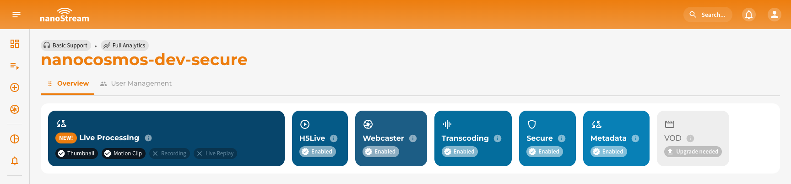

:::warning Prerequisites
To make use of **Live Processing**, it must be explicitly enabled for your organization. Activation may be subject to additional pricing or service terms.

You can verify whether this feature is available by navigating to [dashboard.nanostream.cloud/organisation](https://dashboard.nanostream.cloud/organisation) in your dashboard.  
In the **[Enabled Packages](/docs/dashboard/organization_overview#enabled-packages)** section, locate the entry for `Live Processing`. If it shows **Upgrade needed**, please contact us.

  

To activate `live processing` or learn more about available plans, feel free to reach out via [nanocosmos.net/contact](https://www.nanocosmos.net/contact). We're happy to assist you in finding the best setup for your use case.
:::

## Overview

**Live Processing** enables you to automatically enhance, extend, or transform your live streams within the nanoStream Cloud infrastructure.  
These real-time processing features can be applied to any active stream, allowing operators to generate thumbnails, create motion previews, record segments, or offer instant replay capabilities, all without additional local encoding steps.

Live Processing runs entirely in the cloud and is optimized for ultra-low-latency workflows. This makes it ideal for use cases such as interactive live streaming, gaming, auctions, or betting environments where both live engagement and data-driven automation are crucial.

Typical benefits include:

- Automated generation of dynamic stream assets (thumbnails, replays, highlights)
- Improved content management and viewer experience
- Consistent processing across global ingest regions

## Example Use Cases

| **Live Process**  | **Use Case Scenario** | **Solution** |
|--|--|--|
| [**Recording**](../cloud/live_processing#recording) | An online casino operator needs to record all live gaming sessions for audit and compliance purposes while also offering players access to past sessions. | Enable the Recording feature during stream setup to automatically save each session, ensuring regulatory compliance and offering players the ability to review previous gameplay. |
| [**Thumbnail**](../cloud/live_processing#thumbnail)    | A live auction platform wants to display snapshots of the auctioneer’s current lot on the homepage to attract more bids in real time. | Use Thumbnail Generation to keep the auction feed visually engaging, automatically updating previews of the active items as they are presented. |
| [**Replay**](../cloud/live_processing#replay) | A sports betting company wants to allow users to instantly replay significant moments, like a goal or controversial decision, during live football matches. | Activate the Replay feature to provide instant replays, helping users stay informed without disrupting the live stream. |
| [**Motion Clip**](../cloud/live_processing#motion-clip) | An online betting platform wants to enhance user interaction by allowing them to view highlights of key moments in a game, encouraging faster bets. | Use Motion Clips to generate exciting snippets, offering viewers real-time previews of critical moments, which they can quickly watch and place bets on without leaving the stream. |

## Live Processing Options

### Thumbnail

The **Thumbnail** feature periodically captures still images (snapshots) of a live stream at defined intervals. These snapshots can be displayed in dashboards, user interfaces, or custom applications to visualize stream activity.

Typical use cases include:
- Visual overviews of multiple streams for monitoring
- Dynamic website previews or stream galleries
- Content management workflows where image-based indexing is required

:::tip Key Benefits
- Enables fast, lightweight visual monitoring of live streams
- Reduces the need for continuous video playback
- Useful for dashboards, portals, or automated content management systems
:::

| Setting    | Description                 | Min | Max   |
| ---------- | --------------------------- | --- | ----- |
| `interval` | Time between each snapshot. | 10s | 3600s |

### Motion Clip

The **Motion Clip** option generates short, animated sequences of your live stream by combining a series of snapshots into a short video-like preview. This provides a dynamic alternative to static thumbnails and helps convey activity at a glance.

Typical use cases include:
- Preview animations for live event listings
- Interactive betting and sports dashboards
- Automated highlight snippets for social media or app displays

:::tip Key Benefits
- Delivers more engaging content previews than static images
- Ideal for showcasing live activity or capturing fast-moving scenes
- Can be integrated with content feeds or automated media workflows
:::

| Setting    | Description                    | Min | Max   |
| ---------- | ------------------------------ | --- | ----- |
| `duration` | Length of each generated clip. | 1s  | 60s   |
| `interval` | Time between each snapshot.    | 10s | 3600s |

### Recording

The **Recording** process allows your live stream (or portions of it) to be automatically stored and made available for later playback as **Video on Demand (VOD)**.  
This is fully cloud-managed and ideal for long-running live services that require replay, compliance, or archival functionality.

Typical use cases include:
- Legal or compliance-related stream storage  
- Rewatchable event content for users  
- Creating VOD libraries or backups of live shows

:::tip Key Benefits
- Automatically archives live sessions for future access  
- Enables VOD publishing and compliance tracking  
- Integrates seamlessly with the **Live Recording and VOD** feature set
:::

| Setting    | Description                     | Min | Max           |
| ---------- | ------------------------------- | --- | ------------- |
| `duration` | Length of the recorded segment. | 1s  | Entire stream |

### Replay

The **Replay** option provides real-time rewatch functionality, allowing viewers or operators to access recent portions of a live stream without interrupting ongoing playback. This is particularly valuable in interactive or event-driven scenarios, such as live sports, auctions, or eSports.

Typical use cases include:
- Sports replays during live matches
- Quick rewatch for moderation or compliance review
- Audience-driven instant replay functionality

:::tip Key Benefits
- Allows instant playback of previous segments
- Maintains continuous live streaming without disruption
- Enhances interactivity and viewer retention
:::

| Setting    | Description                  | Min | Max           |
| ---------- | ---------------------------- | --- | ------------- |
| `duration` | Length of the replay buffer. | 1s  | Entire stream |


## Accessing Live Processing Assets

Once a stream has been processed, all generated assets, such as **thumbnails**, **motion clips**, or **replay segments**, can be accessed either **programmatically** via the **bintu REST API** or directly within the **nanoStream Cloud Dashboard**. Each processed stream is automatically linked to one or more associated assets. These can be previewed, downloaded, or integrated into your own application depending on your workflow.

### Get Live Processing Assets via REST API

You can retrieve processed assets for a specific stream using the [bintu REST API](https://api.nanostream.cloud/docs/bintu/#operation/Stream%20Info).  
This endpoint returns metadata for the stream, including a list of available processing outputs (e.g., thumbnails, motion clips, or replay URLs).

It is possible to retrieve stream info with the following roles:

|<span className="role role-admin">nanoAdmin</span>|<span className="role role-user">nanoUser</span>|<span className="role role-readonly">nanoReadOnly</span>|
|---|---|---|
| ✓ | ✓ | ✓ |

**Parameters**
- `YOUR_STREAM_ID`: the unique ID of your stream in nanoStream Cloud
- `X-BINTU-APIKEY`: your API key for authentication

:::info Locate your API Key
To find your API key, please sign in to your nanoStream Cloud/Bintu account and copy your API key [here](https://dashboard.nanostream.cloud/organisation).
:::

```js title="bintu/get_stream.sh"
curl --request GET \
  --url 'https://bintu.nanocosmos.de/stream/YOUR_STREAM_ID?asset_limit=10' \
  --header 'X-BINTU-APIKEY: REPLACE_WITH_YOUR_API_KEY'
```

:::note Advanced Developer bintu API docs
For additional languages, advanced configuration options, and complete request/response samples, please refer to the official **bintu API documentation**: [api.nanostream.cloud/docs/bintu](https://api.nanostream.cloud/docs/bintu/). \
The API reference provides full details on all available endpoints and workflows for managing stream options, including the topic discussed in this section.
:::

When requesting stream details via the **bintu REST API**, the response contains all available ingest, playout, and processing information. Below is a simplified example response showing different output formats for a single stream and its related assets:

```json title="Example: GET /stream/{YOUR_STREAM_ID}"
{
  "id": "YOUR_STREAM_ID",
  "streamgroup": "YOUR_STREAM_ID",
  ...
  "playout": {
    "h5live": [
      {
        "id": "YOUR_PASSTHROUGH_STREAM_ID",
        ...
        "processing": [
          { "id": "rec", "duration": null },  // Recording Settings for Passthrough Stream
          { "id": "replay", "duration": null }, // Replay Settings for Passthrough Stream
          { "id": "thumbs", "interval": 10 }, // Thumbnail Settings for Passthrough Stream
          { "id": "motionclip", "interval": 10, "duration": 5 } // Motionclip Settings for Passthrough Stream
        ],
        "tags": ["Passthrough"],  // Auto-generated tag if the streamgroup was created using the nanoStream Cloud Dashboard
        "index": 0
      },
      {
        "id": "YOUR_TRANSCODE_STREAM_ID",
        ...
        "processing": [
          { "id": "rec", "duration": null },  // Recording Settings for 1. Transcode Stream
          { "id": "replay", "duration": null },  // Replay Settings for 1. Transcode Stream
          { "id": "thumbs", "interval": 10 },  // Thumbnail Settings for 1. Transcode Stream
          { "id": "motionclip", "interval": 10, "duration": 5 }  // Motionclip Settings for 1. Transcode Stream
        ],
        "tags": ["1. Transcode"], // Auto-generated tag if the streamgroup was created using the nanoStream Cloud Dashboard
        "index": 1
      },
      ....
    ],
    "rtmp": [
     {
        "id": "YOUR_PASSTHROUGH_STREAM_ID",
        ...
        "processing": [
          { "id": "rec", "duration": null },  // Recording Settings for Passthrough Stream
          { "id": "replay", "duration": null }, // Replay Settings for Passthrough Stream
          { "id": "thumbs", "interval": 10 }, // Thumbnail Settings for Passthrough Stream
          { "id": "motionclip", "interval": 10, "duration": 5 } // Motionclip Settings for Passthrough Stream
        ],
        "tags": ["Passthrough"],  // Auto-generated tag if the streamgroup was created using the nanoStream Cloud Dashboard
        "index": 0
      },
      {
        "id": "YOUR_TRANSCODE_STREAM_ID",
        ...
        "processing": [
          { "id": "rec", "duration": null },  // Recording Settings for 1. Transcode Stream
          { "id": "replay", "duration": null },  // Replay Settings for 1. Transcode Stream
          { "id": "thumbs", "interval": 10 },  // Thumbnail Settings for 1. Transcode Stream
          { "id": "motionclip", "interval": 10, "duration": 5 }  // Motionclip Settings for 1. Transcode Stream
        ],
        "tags": ["1. Transcode"], // Auto-generated tag if the streamgroup was created using the nanoStream Cloud Dashboard
        "index": 1
      },
      ...
    ],
    // Recordings of the stream are available here if 1. vod is enabled for the organisation or 2. the live process recording is active
    "web": [
      {
        "url": "https://bintu-vod.nanocosmos.de:443/vod/STREAM_NAME.mp4",
        "type": "vod",  // The type "vod" indicates that this is a recording of the stream
        "streamId": "STREAM_ID",
        ...
      },
      ...
    ],
    "hls": [ ... ],
    // Thumbnails can be found here, sorted per quality of the stream (if streamgroup)
    "thumbnails": [
      {
        "url": "https://bintu-vod.nanocosmos.de:443/vod/thumbnails/STREAM_NAME.jpg",
        "type": "image",
        "streamId": "YOUR_PASSTHROUGH_ID",
        "streamname": "YOUR_PASSTHROUGH_STREAMNAME"
        ...
      },
      {
        "url": "https://bintu-vod.nanocosmos.de:443/vod/thumbnails/STREAM_NAME.jpg",
        "type": "image",
        "streamId": "YOUR_TRANSCODE_ID",
        "streamname": "YOUR_TRANSCODE_STREAMNAME"
      },
      ...
    ],
    // To start a replay session, you will find all assets and urls here
    "replay": [
      {
        "url": "https://replay.nanocosmos.de/live-replay/demo/?streamname=xsTvy-JgqqV&bintu=bintu.nanocosmos.de",
        "type": "playout",
        "streamId": "YOUR_PASSTHROUGH_ID",
        "streamname": "YOUR_PASSTHROUGH_STREAMNAME"
        ...
      },
      ...
    ],
    // Motionclips are stored in this property
    "motionclip": [
      {
        "url": "https://bintu-vod.nanocosmos.de:443/vod/thumbnails/xsTvy-JgqqV.gif",
        "type": "gif",
        "streamId": "YOUR_PASSTHROUGH_ID",
        "streamname": "YOUR_PASSTHROUGH_STREAMNAME"
        ...
      },
      {
        "url": "https://bintu-vod.nanocosmos.de:443/vod/thumbnails/xsTvy-nkQMf.gif",
        "type": "gif",
        "streamId": "YOUR_TRANSCODE_ID",
        "streamname": "YOUR_TRANSCODE_STREAMNAME"
        ...
      },
      ...
    ]
  }
}
```

:::tip Developer Tip
You can automate the retrieval of live processing assets by integrating the bintu REST API into your own dashboard or content management system.
This is particularly useful for dynamic monitoring interfaces or automated highlight generation.
:::


### Get Live Processing Assets via Dashboard

All live processing assets can be accessed via the nanoStream Cloud Dashboard. There is a separate tab for this in each [stream overview](/docs/dashboard/stream_overview#single-stream-overview), where all assets are stored. The dashboard documentation provides a detailed introduction to the various live processes and how they are presented in the dashboard.

<article className="margin-vert--lg">
  <Columns className="list_ZO3j" >
    <Card className="col col--6 margin-horiz--md" href="/docs/dashboard/live_processing">
      <Card.Header title="Installation">Dashboard: Live Processing</Card.Header>
      <Card.Body className="padding-vert--md">Learn more about live processes and their appearance in the dashboard.</Card.Body>
    </Card>
    <Card className="col col--6 margin-horiz--md" href="/docs/dashboard/live_processing#overview-of-live-processing-options">
      <Card.Header title="Configuration">Overview of live processing options</Card.Header>
      <Card.Body className="padding-vert--md">Learn how to access your data via the dashboard.</Card.Body>
    </Card>
  </Columns>
</article>


:::tip Accessing the live processing assets
The live processing tab can be accessed in various areas of the dashboard:

- **Stream Overview**: [dashboard.nanostream.cloud/stream/YOUR-STREAM-ID](https://dashboard.nanostream.cloud/stream/YOUR-STREAM-ID)
- **Playout Overview**: [dashboard.nanostream.cloud/playout/YOUR-STREAM-ID](https://dashboard.nanostream.cloud/playout/YOUR-STREAM-ID)
- **Webcaster Overview**: [dashboard.nanostream.cloud/webcaster/YOUR-STREAM-ID](https://dashboard.nanostream.cloud/webcaster/YOUR-STREAM-ID)
:::