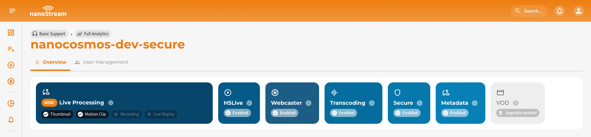

**Live Captions** convert speech into readable text in multiple languages in real time to support accessibility and compliance. This feature improves accessibility and keeps viewers engaged, especially for streams with spoken content, in sound-off environments, or for users who are hard of hearing.

Through the **nanoStream Cloud Dashboard**, you can easily set up, manage, and integrate Live Captions into your playback environment. This guide explains how to enable, configure, and use Live Captions from within the dashboard.

<article className="margin-vert--lg">
  <Columns className="list_ZO3j">
    <Card className="col col--4 margin-horiz--md" href="/docs/cloud/live_captions#how-it-works">
      <Card.Header title="How Live Captions Work" />
      <Card.Body>Detailed explanation of the real-time caption generation process and low-latency delivery.</Card.Body>
    </Card>
    <Card className="col col--4 margin-horiz--md" href="/docs/cloud/live_captions#asr-engines-and-languages">
      <Card.Header title="Supported ASR Engines & Languages" />
      <Card.Body>Overview of available engines and the full list of source and target languages, including regional variants.</Card.Body>
    </Card>
        <Card className="col col--4 margin-horiz--md" href="/docs/cloud/live_captions#managing-live-captions">
      <Card.Header title="Managing Live Captions via API" />
      <Card.Body>Learn how to control captions programmatically using the bintu API, including adding, editing, and removing captions.</Card.Body>
    </Card>
  </Columns>
</article>

:::warning Prerequisites
You can verify whether this feature is available by navigating to [dashboard.nanostream.cloud/organisation](https://dashboard.nanostream.cloud/organisation) in your dashboard.  
In the **[Enabled Packages](./organization_overview#enabled-packages)** section, locate the entry for `Live Captions`. If it shows **Upgrade needed**, please contact us.

  

To activate `Live Captions` or learn more about available plans, feel free to reach out via [nanocosmos.net/contact](https://www.nanocosmos.net/contact). We're happy to assist you in finding the best setup for your use case.
:::

:::info Live Caption Security Requirements
Live captions are only available for **secure playback**. Therefore, by enabling `live captions`, you will also need to enable the `secure` feature. Please reach out to our sales team via [nanocosmos.net/contact](https://www.nanocosmos.net/contact) or by email at sales(at)nanocosmos.net if you have any questions. \
To learn more about secure playback, visit the dedicated article [Secure Playback (H5Live)](/docs/cloud/security#secure-playback).
:::

## Add Live Captions to a New Stream

When creating a new stream in the dashboard, live captions can be configured directly.

*Screenshot: Adding live captions during stream creation*

First, select the desired live caption engine. Then specify the language of the audio  (i.e., the language spoken during the stream). Next, select one or more target languages in which the captions should be displayed. Live Captions support translation and can output text in multiple target languages simultaneously.\
Once the engine and languages are configured, click **Create stream**, this saves the settings as part of the stream configuration. From that point, Live Captions will automatically activate as soon as the stream goes live, with the first lines typically appearing within 5–7 seconds.

## Overview of Live Captions Setup

After creating a stream, you can access **Live Captions** playout and code snippets in several dashboard locations:

- **Stream Overview:** [dashboard.nanostream.cloud/stream/YOUR-STREAM-ID](https://dashboard.nanostream.cloud/stream/YOUR-STREAM-ID)
- **New Stream Instructions:** [dashboard.nanostream.cloud/stream/new/YOUR-STREAM-ID](https://dashboard.nanostream.cloud/stream/new/YOUR-STREAM-ID)
- **Playout Overview:** [dashboard.nanostream.cloud/playout/YOUR-STREAM-ID](https://dashboard.nanostream.cloud/playout/YOUR-STREAM-ID)
- **Webcaster Overview:** [dashboard.nanostream.cloud/webcaster/YOUR-STREAM-ID](https://dashboard.nanostream.cloud/webcaster/YOUR-STREAM-ID)

In all these areas (except **New Stream Instructions**), you’ll find a dedicated **Live Captions tab**, which includes:

- **Live Captions Player**.
- **Language selector** below the player to switch between enabled target languages.
- Current **engine**, **source language**, and **target language(s)**.
- Options to **add**, **edit**, or **remove** captions.
- **Secure Playback Token** with decoded informations.
- **Captions Playout** URLs for each target language.

*Screenshot: Live Captions Overview Tab*

## Modify Live Captions Setup

To modify existing Live Captions settings, open the **Live Captions tab** in any Stream Overview.

:::warning Important
Changes only take effect after **re-ingesting your stream**. If the stream is live, modifications apply **after stopping and restarting**.
:::

**Edit Live Captions**: Click **Edit**. Then update the **engine**, **source language**, or **target languages** and save your changes.

*Screenshot: Editing Live Captions settings*

**Remove Live Captions**: Click **Confirm & Delete** and the captions will be removed.

*Screenshot: Removing Live Captions from a stream*
