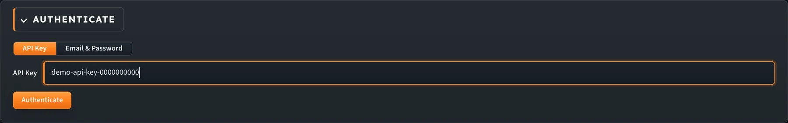
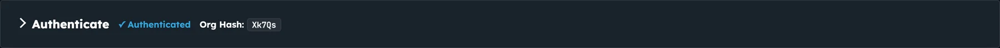
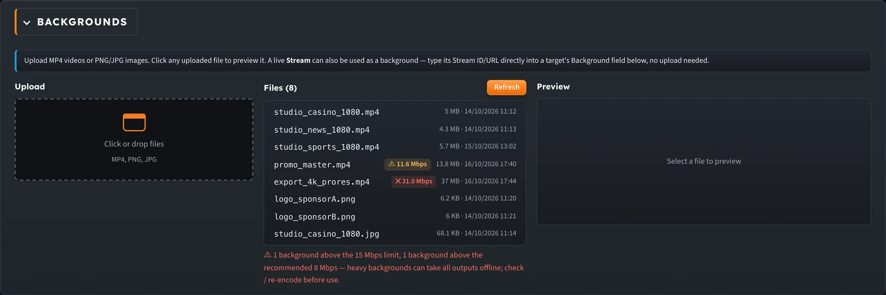
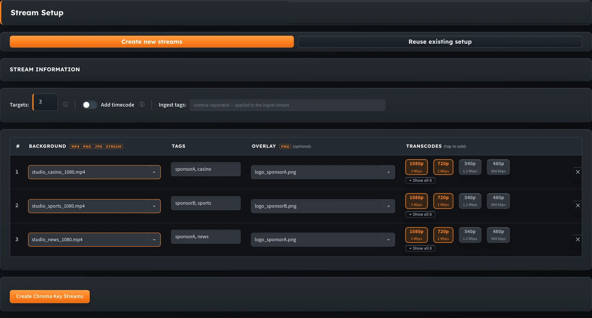
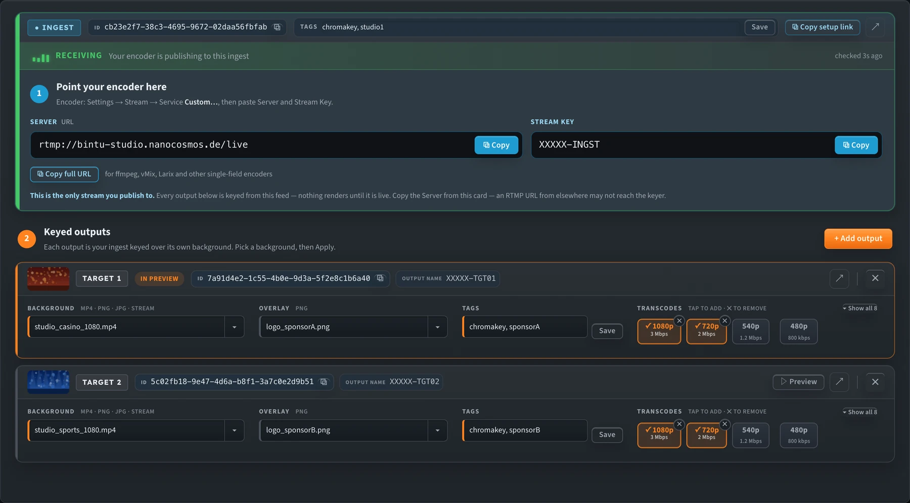
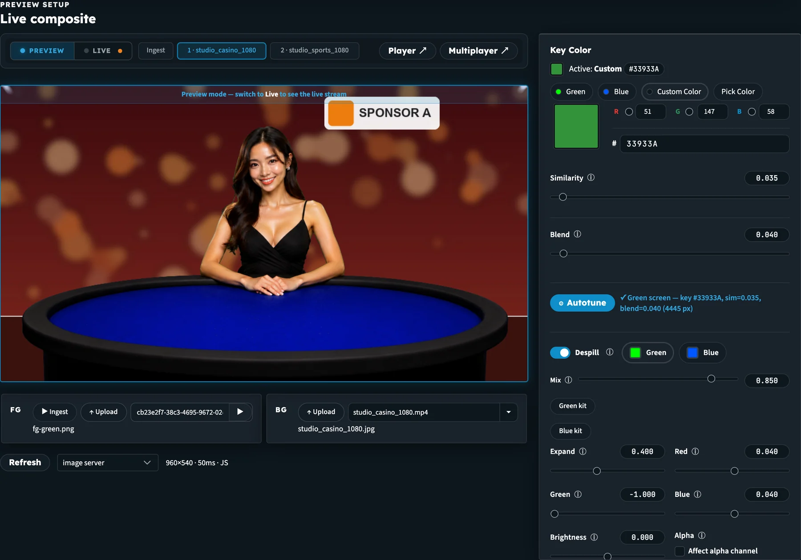
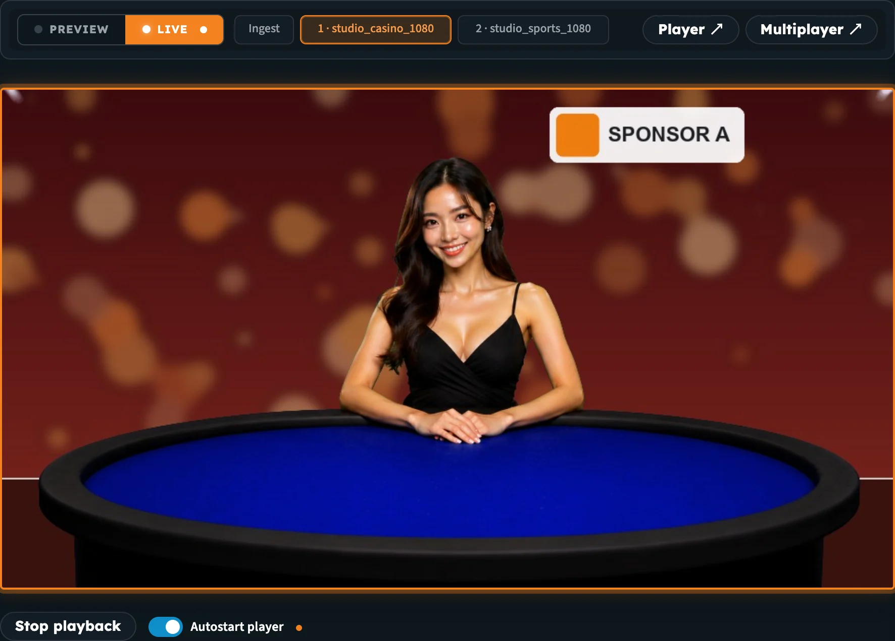
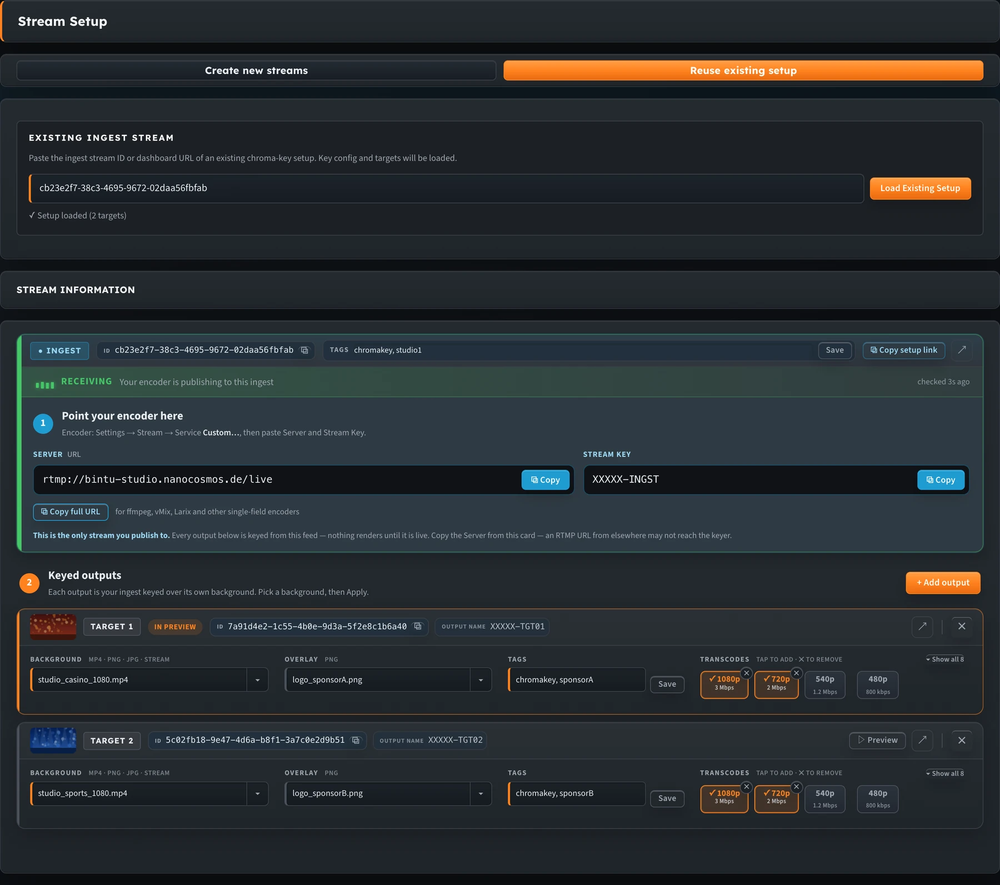

import ThemedImage from '@theme/ThemedImage';

# Chroma Key: Getting Started

nanoStudio **Chroma Key** removes the green or blue screen behind your presenter and replaces it with a new background. This happens in the nanoStream Cloud pipeline. You send **one** green-screen stream, and nanoStream delivers one or more finished, keyed streams to your viewers in real time.

You set everything up in the **Chroma Setup Tuner**, a browser tool that creates the streams, lets you tune the key against a live preview, and pushes your settings to the live output.

:::tip Open the tuner
[chromakey.nanocosmos.net/chroma-setup-tuner.html](https://chromakey.nanocosmos.net/chroma-setup-tuner.html)
:::

:::info Also in the Builder Hub
The same tool runs inside the [Builder Hub](../builder-hub/builder_hub_overview) under **Build › Multi-Brand › Set up chroma key**, next to a player that shows every branded output side by side. You can also try chroma key there on our sample content. See [Builder Hub: Chroma Key and Branded Outputs](../builder-hub/builder_hub_chroma_key).
:::


<ThemedImage
  alt="The five steps: sign in, upload, create, tune, go live"
  sources={{
    light: require('../assets/nanostudio/diagrams/chroma-steps-light.webp').default,
    dark: require('../assets/nanostudio/diagrams/chroma-steps-dark.webp').default,
  }}
/>

## How it works

Each chroma key setup has one **ingest** stream and one or more **target** streams (outputs).

| Stream | What it is |
|---|---|
| **Ingest** | The raw green-screen feed. Your encoder (OBS, vMix, a hardware encoder) sends to this stream. |
| **Target** | A keyed output. The presenter is cut out of the ingest and placed over this target's background, with an optional logo overlay on top. Viewers watch target streams. |

One ingest can feed **multiple outputs**, and you can keep adding outputs as your production grows. Each target has its own background, overlay, tags and transcoding ladder, so a single camera can produce several differently branded shows at the same time.

<ThemedImage
  alt="An encoder sends RTMP to the ingest, keying runs in nanoStream Cloud, and each target gets its own background and logo"
  sources={{
    light: require('../assets/nanostudio/diagrams/chroma-ingest-to-outputs-light.webp').default,
    dark: require('../assets/nanostudio/diagrams/chroma-ingest-to-outputs-dark.webp').default,
  }}
/>

_One ingest, many branded outputs. Each target has its own background, overlay, tags and ABR ladder._


Every ingest and target is a regular nanoStream Cloud stream. It shows up in the Dashboard, takes RTMP from any encoder, plays in the H5Live Player with the same low latency as your other streams, and can have its own adaptive bitrate (ABR) ladder.

## Before you start

| You need | Details |
|---|---|
| **nanoStream account** | An API key from the [Dashboard](https://dashboard.nanostream.cloud), or your Dashboard email and password |
| **Green or blue screen** | Evenly lit |
| **Encoder** | OBS, vMix, ffmpeg or a hardware encoder that can send RTMP. See [Live Encoding](../cloud/live_encoding). |
| **Backgrounds** | MP4 video, PNG or JPG at the same resolution as your camera (1280×720 or 1920×1080) |
| **Browser** | A current version of Chrome, Firefox, Edge or Safari |

## Step 1: Sign in

1. Open the [Chroma Setup Tuner](https://chromakey.nanocosmos.net/chroma-setup-tuner.html).
2. Sign in with one of these:
   - **API Key**: paste your bintu API key from the Dashboard.
   - **Email & Password**: use your Dashboard login.
3. Click **Authenticate**. Your **Org Hash** appears, and the rest of the tool unlocks.



_Sign in with an API key, or switch to Email & Password._

After you sign in, the panel collapses to a summary line:



_The summary shows your sign-in status and your Org Hash._

## Step 2: Upload backgrounds and overlays

Open **Backgrounds** and drag your files into the uploader, or click to choose them.

- **Backgrounds**: MP4 (loops automatically), PNG or JPG
- **Overlays**: transparent PNG logos or graphics, uploaded in the same place

Files are stored for your organisation and show up in every output's **Background** and **Overlay** pickers. Click a file to preview it.



_Two MP4s are flagged: ⚠ 11.6 Mbps (above the recommended 8 Mbps) and ✕ 31.0 Mbps (above the 15 Mbps limit)._

### Prepare MP4 backgrounds

All outputs of a chroma setup are rendered by **one** processing job. One background that is too heavy can slow that job down and take **every** output offline, not just the one using it. Export video backgrounds with these settings:

| Setting | Recommended |
|---|---|
| **Codec** | H.264 in an MP4 file |
| **Resolution** | The same as your camera: 1280×720 or 1920×1080 (16:9) |
| **Bitrate** | **3–5 Mbps**, and no more than 8 Mbps |
| **Length** | A short, seamless loop (backgrounds loop automatically) |

The uploader measures each MP4's **average bitrate** (file size ÷ duration) before uploading and shows it next to the file:

| Average bitrate | What happens |
|---|---|
| **Up to 8 Mbps** | Uploaded normally |
| **Above 8 Mbps** | ⚠ Uploaded with a warning. It works, but adds load for every output. Re-encode it if you can. |
| **Above 15 Mbps** | ✕ **Rejected.** The file isn't uploaded. Re-encode it as H.264 at 8 Mbps or less, at 720p or 1080p, and try again. |

Files you uploaded earlier are checked too. The file list marks heavy MP4s with ⚠ (above 8 Mbps) or ✕ (above 15 Mbps). If a file's details can't be read it shows **? bitrate**, and clicking **Refresh** checks it again.

## Step 3: Create your streams

Open **Stream Setup** and choose one of these:

- **Create new streams** for a new production
- **Reuse existing setup** for a show you've set up before (see [Reuse an existing setup](#reuse-an-existing-setup))

To create new streams:

1. Set **Targets** to the number of outputs you need. Each output gets its own row. Optionally add **Ingest tags** for the ingest stream, or turn on **Add timecode** to add timecode metadata to the new streams.
2. For each row, choose a **Background**. You can pick an uploaded file, type a filename or URL, or enter the stream name or stream ID of another live stream to use it as the background.
3. Optionally choose an **Overlay** PNG, add **Tags** (for example `sponsorA, studio1`), and tap the **Transcodes** you want for adaptive bitrate playback.
4. Click **Create Chroma Key Streams**.



_Three targets, each with its own background, tags, overlay and 1080p + 720p renditions._

The tuner creates the ingest and all targets and shows them under **Stream Information**. The ingest card scrolls into view and pulses once.

- **① Point your encoder here** (the ingest card) shows the **Server** and **Stream Key** to enter in your encoder, each with a **Copy** button. **Copy full URL** copies both in one go (`server/key`) for single-field encoders such as ffmpeg, vMix and Larix.

  The **Server** for a chroma key ingest is always:

  ```
  rtmp://bintu-studio.nanocosmos.de/live
  ```

  Publishing to this server is what starts the chroma key for your outputs.
- **② Keyed outputs** has one card per target. A target's **Output name** is not something you publish to. Your encoder only ever sends to the ingest.



_The ingest card shows exactly what to enter in your encoder. Each output card can be edited while live._

:::warning Use the chroma key server
Send your camera to `rtmp://bintu-studio.nanocosmos.de/live` with the ingest's **Stream Key**. If your encoder sends the same stream key to another RTMP server, for example one copied from the Dashboard or an older setup, the stream can arrive but the chroma key doesn't start, and your outputs stay black.
:::

For details on each field, see [Outputs & Branding](chroma_key_outputs).

Then start your encoder and check that the feed arrives:

1. Point your encoder at the **Server** and **Stream Key** from the ingest card, and start streaming. In OBS: **Settings → Stream → Service: Custom…**.
2. Check the signal strip under the ingest card's header (see the table below).
3. Above the preview, switch from **Preview** to **Live**.
4. Click a source tab to put it **on-air**:
   - **Ingest** shows your raw green-screen feed, so you can confirm it's arriving.
   - **1 · …, 2 · …** (one tab per target, labelled with its number and background) show each keyed output with its background and overlay.

The signal strip checks the ingest every 5 seconds and shows when it last checked:

| Strip | Meaning |
|---|---|
| **Receiving** (green, moving bars) | Your encoder is publishing to the ingest. The card's accent turns green. |
| **Waiting for signal** (red, pulsing) | Nothing is arriving yet. Check the Server and Stream Key in your encoder. |
| **Status unknown** (grey) | The check failed. It keeps retrying. |

If the Live player or the foreground says the stream isn't live, click **Where do I publish? →** to jump back to the ingest card.

## Step 4: Tune the key

The **Live composite** workbench shows a preview on the left and the key controls on the right.

1. Switch to **Preview**.
2. Load a foreground frame. Once the ingest is receiving, Preview loads it as the foreground automatically. If it doesn't, click **▶ Ingest** next to **FG**.

   

   You can also click **↑ Upload** to use a still frame or video file, or click **Use Live Frame** to take a snapshot of the on-air player.
3. Click **Autotune**. It detects green or blue, sets the key colour, picks **Similarity** and **Blend** values, and applies a matching despill preset.
4. Check the result and fine-tune the sliders if you need to.



_Preview mode after Autotune. The preview shows the target that is selected (amber), with its background and overlay._

For what each control does, see [Tuning the Key](chroma_key_tuning).

## Step 5: Go live

1. Switch to **Live**.
2. Click a target tab to put it **on-air**. The red tally shows which output is on air. Key, despill and EQ settings apply to all outputs; overlay position applies to the output you've selected. Switching between sources only changes the player and doesn't restart the stream.
3. Adjust the controls. In Live mode **every chroma control works in real time**: key colour, similarity, blend, despill, EQ and overlay position go to the running stream straight away, without restarting it. The status line tells you the change is applied to the running process but not saved yet.
4. Click **Apply Now** to save your settings to the stream, so they're kept when the stream restarts. New backgrounds and overlays also need Apply: an output card shows **● Needs Apply** until you do.

   

   **Stop & unlock after Apply** is on by default. After every Apply, the tuner **stops the ingest stream and then unlocks it**, so the running stream restarts with the saved configuration and new backgrounds and overlays take effect straight away. Each restart briefly interrupts the stream while your encoder reconnects. **Bounce** does the same stop and unlock once, when you click it. Make sure your encoder's automatic reconnect is on (in OBS: **Settings → Advanced → Automatically Reconnect**).
5. Click the next target to put it on-air and check it. Key settings are shared, so you only need to adjust its overlay and background.

The Apply button reads **Apply Now** in Live mode and **Apply to Stream** in Preview mode.



_Live mode: the red tally and border show the on-air target. You see your changes on it in real time._

**Player ↗** opens the outputs in a standalone player, and **Multiplayer ↗** shows the ingest and all targets side by side.

:::tip Key sequence
Tune in **Preview** → **Apply to Stream** → switch to **Live**.
:::

Your chroma configuration is saved with the ingest stream. You can close the tuner while you're live, and open the setup again at any time with [Reuse an existing setup](#reuse-an-existing-setup).

:::info Share your outputs
Each target is a normal nanoStream stream. Play it with the [H5Live Player](../nanoplayer/nanoplayer_introduction), embed it with the Dashboard [code snippets](../dashboard/code_snippets), or protect it with [secure playback](../dashboard/secure_playback), the same as any other stream.
:::

## Reuse an existing setup

Use this to reopen a chroma configuration you've already set up and fix things on that composition, for example to change a background or a logo.

1. In **Stream Setup**, choose **Reuse existing setup**.
2. Paste the **ingest stream ID** or its Dashboard URL. The ID is the UUID at the end of `dashboard.nanostream.cloud/stream/…`.
3. Click **Load Existing Setup**.



_A loaded setup with two targets. Backgrounds, overlays, tags and renditions come back as they were saved._

The tuner restores the key settings, targets, backgrounds and overlays. On a loaded setup you can:

- change a target's background, overlay and tags while it's live
- add transcoding renditions
- click **+ Add output** to add a new target without touching the others

To hand a setup to someone else, click **Copy setup link** on the ingest card. The link reopens this setup and never contains your API key. When they open it, the setup ID is filled in and the setup loads as soon as they sign in.

## Next steps

- [Outputs & Branding](chroma_key_outputs): backgrounds, overlays, tags and transcodes per output
- [Tuning the Key](chroma_key_tuning): what every control does
- [Troubleshooting & FAQ](chroma_key_troubleshooting)
- [Builder Hub: Chroma Key and Branded Outputs](../builder-hub/builder_hub_chroma_key): the same tool inside the Builder Hub
