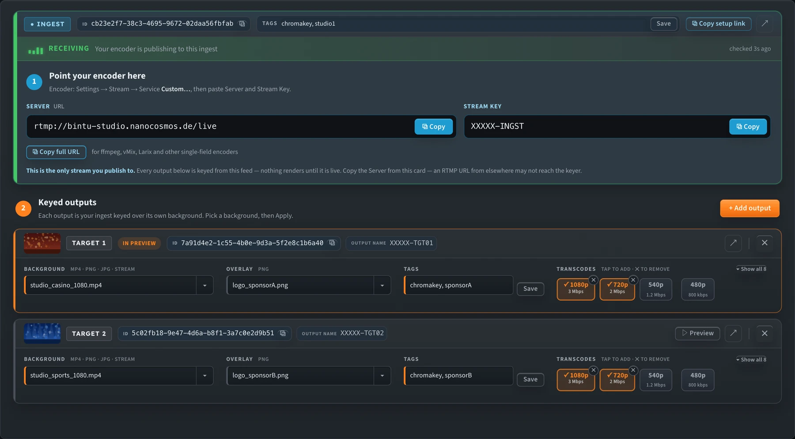

import ThemedImage from '@theme/ThemedImage';

# Outputs & Branding

One green-screen ingest can feed **multiple outputs** (targets), and you can add more at any time. Each output is a separate nanoStream stream with its own look. For example, the same presenter can appear in a sports studio with a sports sponsor's logo on one output, and in a news studio with a different logo on another, at the same time and from one camera.

Each output has four settings:

| Setting | What it does |
|---|---|
| **Background** | The scene the presenter is placed over |
| **Overlay** | An optional PNG logo or graphic on top of the result |
| **Tags** | Labels stored on the stream |
| **Transcodes** | Extra lower-bitrate renditions for adaptive bitrate (ABR) playback |

_Under **② Keyed outputs**, every output card has its own Background, Overlay, Tags and Transcodes._

Each output card also shows:

| On the card | What it means |
|---|---|
| **Thumbnail** | A preview of the background: the image, a video frame, a **LIVE** tile for a stream background, or **BG** if it can't load |
| **In preview** / **On air** | This output is the one selected in the workbench, in Preview (amber) or Live (red) mode |
| **▷ Preview** | Selects this output in the workbench |
| **● Needs Apply** | The background or overlay has changed but hasn't been applied yet |
| **Output name** | The output's stream name. Don't publish to it: your encoder only sends to the ingest. |
| **↗** / **✕** | Open the stream in the Dashboard / delete the output |

## Background

Each output has one background. In the **Background** field you can:

- pick an uploaded **MP4**, **PNG** or **JPG** from the ▾ list (videos loop)
- type a filename
- type the **stream name** or **stream ID** of another live nanoStream stream, to use live video as the background

Use the same resolution as your camera (1280×720 or 1920×1080) so the background isn't stretched or letterboxed.

### Heavy backgrounds are flagged

All outputs share one processing job, so one heavy MP4 background can affect **every** output. The tuner flags MP4 backgrounds by their average bitrate:

| Marker | Meaning |
|---|---|
| ⚠ badge in the list, **amber** border on the Background field | Above 8 Mbps: it works, but re-encode it if you can |
| ✕ badge in the list, **red** border on the Background field | Above 15 Mbps: re-encode it before you use it |
| **? bitrate** badge | The bitrate couldn't be read. Click **Refresh** in Backgrounds to check again. |

Hover over a flagged field to see the warning. For the recommended export settings, see [Prepare MP4 backgrounds](chroma_key_getting_started#prepare-mp4-backgrounds).

## Overlay

An overlay is a PNG, usually a transparent logo, placed on top of the keyed picture.

1. Upload the PNG in **Backgrounds** (overlays and backgrounds share one uploader).
2. Choose it in the output's **Overlay** field. To turn the overlay off, choose **none**.
3. Set the position and size in the **Overlay** section under the key controls:
   - **X / Y**: position in pixels from the top-left corner of the frame
   - **Scale %**: size compared with the original PNG (1–500%, where 100% is the original size)
   - **Presets**: one click to place it top-left, top-right, bottom-left, bottom-right or centre

Positions follow the real frame: the ingest's resolution, or 1920×1080 until it's known. The **Frame** label below the presets shows which size is in use, and presets allow for the overlay's own size so it stays inside the frame.

The Overlay section acts on whichever output you're currently previewing or have on-air. In Live mode, position changes go to the on-air output in real time. A new **Scale** needs **Apply**.

<ThemedImage
  alt="Overlay position: X and Y in pixels from the top-left corner of the output frame, Scale sets the size, and five preset positions"
  sources={{
    light: require('../assets/nanostudio/diagrams/chroma-overlay-position-light.webp').default,
    dark: require('../assets/nanostudio/diagrams/chroma-overlay-position-dark.webp').default,
  }}
/>

_The Overlay section shows which PNG and target it is editing (here logo_sponsorA.png · Target 1)._

:::info Overlays are all or none
An overlay only appears if **every** output has one. Each output can use a different PNG. When you pick an overlay for one output, the tuner fills in the others for you, and choosing **none** clears them all.
:::

## Tags

Tags are free-text labels stored on each stream, for example `chromakey`, `sponsorA` or `studio1`. Enter them separated by commas and click **Save**. Tags update on the running stream. Use them to find and group streams in the Dashboard and the API (see [Stream Tags](../cloud/bintu_stream_tags)).

## Transcodes (adaptive bitrate)

Transcodes add lower-resolution, lower-bitrate versions of an output, so viewers on weak connections still get smooth playback. The player switches between them automatically. More renditions give smoother playback on poor networks, but each one is another stream to encode. See [Adaptive Bitrate (ABR) and Live Transcoding](../dashboard/abr_transcoding).

The **Transcodes** chips show your organisation's transcoding profiles as resolution and bitrate. A common ladder (1080p, 720p, 540p, 480p) is shown first. Click **Show all** for the full list.

- **When creating streams:** tap a chip to turn that rendition on or off.
- **On a loaded setup:** renditions running on the output are ticked in orange. Tap another chip to add that rendition to the running stream, or click **✕** on a ticked chip to remove it. The result is shown on the card.

## Add another output

On a loaded setup, click **+ Add output** to create a new keyed target. It starts with the default background, and the existing outputs are not affected. Then set its background, overlay, tags and transcodes in its new card.

To delete an output, click **✕** on its card. The **↗** icon opens that stream in the Dashboard.

## Applying changes to a live output

Key, despill, EQ and overlay position changes go to the running stream in real time in Live mode. A new background or overlay needs **Apply**: the card shows **● Needs Apply** until you click it. With **Stop & unlock after Apply** on (the default), the ingest restarts after Apply so the change takes effect straight away. If an output still shows the old background after you apply, see [Stream not updating after Apply](chroma_key_troubleshooting#stream-not-updating-after-apply).

## Watch every output at once

In the [Builder Hub](../builder-hub/builder_hub_overview), **Build › Multi-Brand › Watch branded outputs** plays your green-screen input and every branded output side by side, so you can check each background and overlay in one place. See [Watch branded outputs](../builder-hub/builder_hub_chroma_key#watch-branded-outputs).
