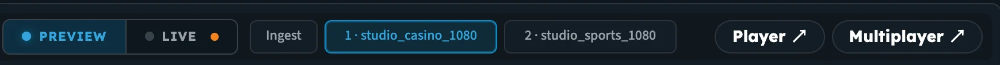
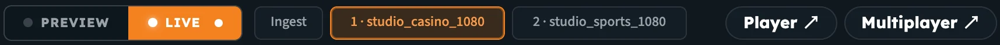
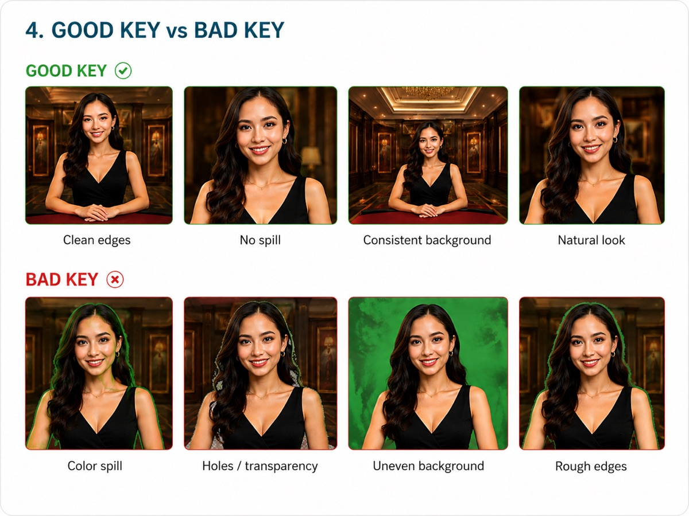

import ThemedImage from '@theme/ThemedImage';

# Tuning the Key

A good key removes all of the screen, keeps all of the presenter, and leaves clean edges with no coloured fringe. This page explains each control in the Chroma Setup Tuner and how to get your settings onto the live stream.

:::tip Fastest route to a good key
Load a representative frame, click **Autotune**, then adjust **Similarity** and **Blend** in small steps. Most setups need only these three actions.
:::

:::info Every control works in real time
In Live mode, changes to the key colour, similarity, blend, despill, EQ and overlay position go to the running stream straight away, without restarting it. Click **Apply Now** to save them to the stream. See [Push your settings to the live stream](#push-your-settings-to-the-live-stream).
:::

<ThemedImage
  alt="The order the controls are applied: camera frame, key colour, similarity, blend, despill, EQ, overlay, output"
  sources={{
    light: require('../assets/nanostudio/diagrams/chroma-control-order-light.webp').default,
    dark: require('../assets/nanostudio/diagrams/chroma-control-order-dark.webp').default,
  }}
/>

_The order the controls are applied, from the raw camera frame to the finished output._

## Preview vs Live

Above the preview there's a **Preview | Live** switch and a row of source tabs: **Ingest**, then one tab per target, labelled with its number and background (for example **1 · studio_casino_1080**).

_Preview: the selected target has an amber tally._

_Live: the on-air target has a red tally._

| Mode | Clicking a source tab… | Tally |
|---|---|---|
| **Preview** | shows that source in a local preview, so you can experiment without touching the live stream | Amber |
| **Live** | puts that source **on-air**. Key changes apply to all outputs in real time; you watch them on the on-air output. | Red |

### Preview sources

- **FG** (foreground) is your green-screen picture. It uses the ingest stream by default. You can also upload a still frame or enter another stream ID.
- **BG** (background) can be an uploaded asset or a live stream name.
- **Use Live Frame** takes a snapshot of the on-air player, so Autotune and the preview match the real stream.

_The key controls column, top to bottom: key colour, Similarity, Blend, Autotune, Despill, EQ, Overlay and the Apply panel._

## Key colour

The colour to remove. Choose **Green** or **Blue**, enter a **Custom Color** (hex or RGB), or use **Pick Color** to sample the actual screen colour from the frame.

Don't assume your screen is pure `#00FF00`. Lighting and camera settings change the real colour, and sampling it (or running Autotune) gives a cleaner key.

## Autotune

**Autotune** analyses the foreground frame and:

1. detects whether you're using a green or a blue screen
2. sets the key colour from the screen pixels
3. tests Similarity and Blend combinations and picks the best one
4. applies the matching despill preset

Always check the result against your picture, especially hair and hands, and fine-tune if needed.

## Similarity and Blend

| Control | What it does | Too low | Too high |
|---|---|---|---|
| **Similarity** | How much of the colour range around the key colour is removed | Patches of screen stay visible | Holes appear in the presenter. Fine detail such as hair and fingers is lost. |
| **Blend** | How softly the edge fades between presenter and background | Hard, jagged edges | A see-through halo around the presenter |

The tuner starts at **Similarity 0.25** and **Blend 0.10**; Autotune usually lands much lower (around 0.03–0.12 Similarity, 0.02–0.06 Blend). Change values in small steps of about **0.005–0.01**.

## Despill

Light from the screen reflects onto the presenter, leaving a green or blue tint on skin, hair and edges. This is called *spill*. **Despill** removes it after the key is made.

Turn Despill on with its switch, then set:

- **Type**: **Green** or **Blue**, matching your screen
- **Mix**: how strongly the spill is removed (default 0.50).
- **Green kit / Blue kit**: one-click presets that set the type, Mix and the advanced despill values (Mix 0.85 green, 0.75 blue)

If skin starts to look pink or magenta, the despill is too strong. Lower the **Mix**.

:::note Advanced despill controls
**Expand**, **Red**, **Green**, **Blue**, **Brightness** and **Alpha** fine-tune the despill. Start with a kit, then adjust them if you need to. Like every control, they apply to the running stream in real time in Live mode.
:::

## EQ

The EQ adjusts the presenter's picture after keying, so it matches the new background. Turn it on with the **EQ Filter** switch.

| Control | Default | Use it when… |
|---|---|---|
| **Brightness** | 0 (range −1 to 1) | The presenter looks darker or brighter than the background |
| **Contrast** | 1 | The presenter looks flat or washed out |
| **Saturation** | 1 (0 = greyscale) | Colours look dull after keying, or you want a stylised look |
| **Gamma** | 1 (range 0.1–10) | You want to adjust the midtones without changing pure black or white |

Hover over, click or tap the **ⓘ** icon next to any control, or move to it with the keyboard, for a short explanation.

## Push your settings to the live stream

1. Switch to **Live** and click the target you want to change, so it's on-air.
2. Adjust the controls. Your changes go to the running stream in real time, and the status line tells you they're applied to the running process but not saved yet.
3. Click **Apply Now** to save them to the stream, so they're kept when the stream restarts.

| Option | What it does |
|---|---|
| **Apply Now** | Saves the current settings to the stream, together with any new backgrounds and overlays. In Preview mode the same button reads **Apply to Stream**. |
| **Reset Defaults** | Returns all controls to their starting values |
| **Stop & unlock after Apply** | On by default. Restarts the ingest after Apply, so the saved configuration, including new backgrounds and overlays, takes effect straight away. |
| **Stop / Unlock / Bounce** | Manual ingest controls. **Bounce** does Stop and Unlock in one click. |

The key, despill and EQ settings are shared by all outputs, so tune once. Put each output on-air to check its background and overlay. Switching between sources doesn't restart the stream.

:::warning Restarting interrupts the stream
**Stop & unlock after Apply** and **Bounce** briefly interrupt the ingest while your encoder reconnects. Tuning in Live mode doesn't need them, because key, despill, EQ and overlay position changes apply without a restart. If you only want to save tuned values during a show, turn the toggle off before you click **Apply Now**. Make sure your encoder's automatic reconnect is on (in OBS: **Settings → Advanced → Automatically Reconnect**).
:::

## Check your key

Before you go live:

- Have the presenter **move**: wave their arms, turn their head and walk. The key should hold during motion.
- Look at the edges against a **bright, contrasting background** (red, magenta or yellow). Problems that hide against dark backgrounds become obvious.
- Compare with the examples below.

If you see one of these problems, go to [Troubleshooting & FAQ](chroma_key_troubleshooting).
