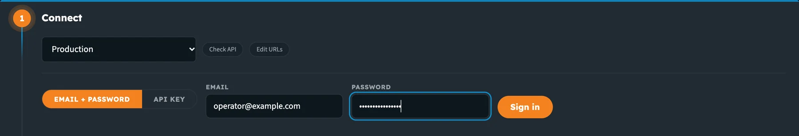
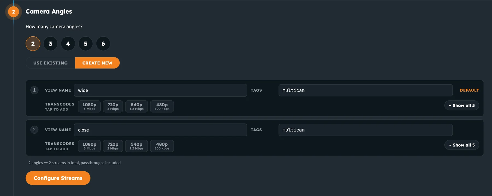
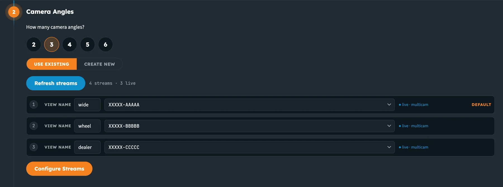
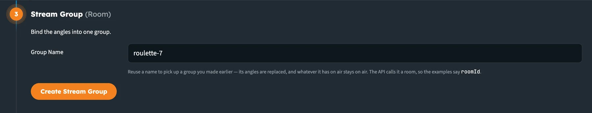
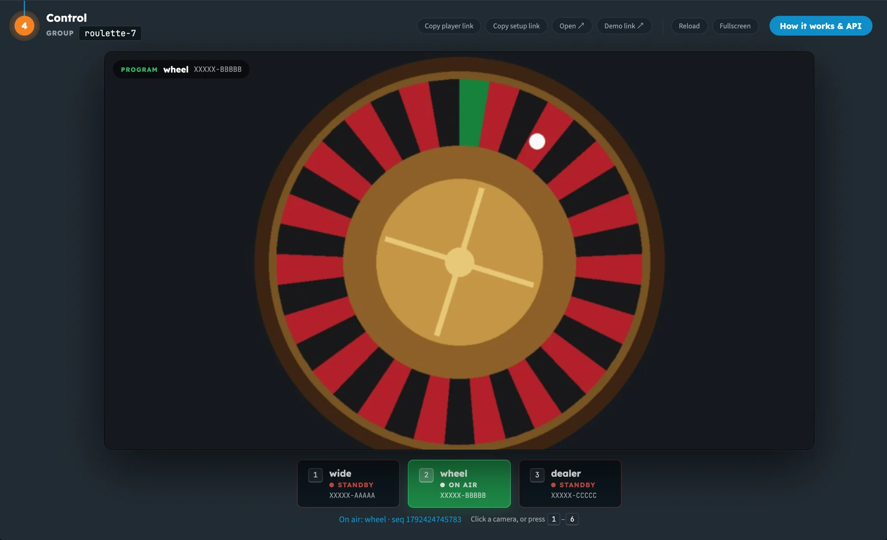

import ThemedImage from '@theme/ThemedImage';

import Tabs from '@theme/Tabs';
import TabItem from '@theme/TabItem';

# Multi-Camera Switching

**Multi-camera stream switching** lets you cut between several camera angles, such as a wide shot, a close-up of the roulette wheel and the dealer, while your viewers watch **one continuous video**. Each angle is a normal nanoStream live stream. You decide which angle is on air, and every connected player follows within a moment.

There's no video mixer or production software involved. Switching is driven by the nanoStream **Real-Time API** and the hosted **Switch Player**.

**Use cases**

- **Live casino / iGaming:** a table has 3–4 cameras (wide shot, wheel, dealer, table layout), and the game software cuts based on game events.
- **Sports:** cut between camera positions during a match.
- **Live events:** switch between stage, audience and backstage cameras.

:::tip Try it first
Open the [Stream Switching demo](https://web.pages.gitlab.nanocosmos.cloud/switch-player/demo.html), sign in with your Dashboard account, and set up a group of angles in a few minutes. The demo shows every API call it makes, so you can copy them into your own integration.
:::

## How it works

1. **Set up a stream group** (the API calls it a *room*). Send the list of camera angles to `POST /rooms/setup`. The API checks each stream and returns a ready-to-embed **player URL**.
2. **Embed the player.** Put the player URL in an iframe on your page. Viewers start watching the default angle straight away.
3. **Switch angles.** When you want to cut, your backend calls `PUT /rooms/{roomId}/switch` with the angle to put on air.
4. **Players follow.** The API pushes the change to every connected player, and each one switches to the new angle without a gap.


<ThemedImage
  alt="Cameras send streams to nanoStream Cloud; your backend calls the Real-Time API to set up and switch; the API tells every Switch Player which angle to play"
  sources={{
    light: require('../assets/realtime-api/diagrams/switching-architecture-light.webp').default,
    dark: require('../assets/realtime-api/diagrams/switching-architecture-dark.webp').default,
  }}
/>

_Your backend decides when to cut. The Real-Time API tells every player, and each player switches to the new angle without a gap._

**Built-in reliability**

- **Never a black screen.** If a switch fails, the player retries and keeps playing the last good angle.
- **Instant start.** Viewers see video as soon as the player loads. There's no waiting screen.
- **Late joiners are in sync.** A viewer who joins or reconnects gets the angle that's on air right now.
- **Order is guaranteed.** Every switch has a sequence number, so an old event can never overwrite a newer one.

## Try it in the demo (no code)

The [Stream Switching demo](https://web.pages.gitlab.nanocosmos.cloud/switch-player/demo.html) walks through the same steps as the API, in four stations. Use it to try switching before you write any code, or to show it to your team.

**1. Connect.** Choose the environment and sign in with your Dashboard email and password, or with an API key.



_Sign in with the same account you use for the Dashboard._

**2. Camera Angles.** Choose how many angles you need (2–6). **Create new** makes a fresh stream for each angle, with optional tags and transcodes. **Use existing** lets you pick streams your organisation already has.



_Create new: each angle gets a name, tags and an optional transcoding ladder._



_Use existing: match each angle name to one of your streams. Live streams are marked._

**3. Stream Group.** Give the group a name, or leave it blank to generate one, and click **Create Stream Group**. This calls `POST /rooms/setup`.



_The stream group is what the API calls a room._

**4. Control.** The player shows what viewers see. Click a camera (or press **1**–**6**) to cut. The on-air angle is green, and the others are on standby.



_Cut to wheel: the player follows, and the status line shows the sequence number of the switch._

**Copy player link** gives you the URL to embed, and **How it works & API** shows the ingest details and the exact API calls for your group.

## Before you start

- A nanoStream account with Multi-Camera Stream Switching enabled (see the note below)
- One **live stream per camera angle** (up to 10), with an encoder sending to each. See [Start Streaming](../cloud/live_encoding).
- A **bintu token** for API calls (see [Authentication](realtime_api_switching_reference#authentication))

The examples below use the production API, `https://real-time-api.nanostream.cloud`.

:::info Business feature
Multi-Camera Stream Switching requires a business upgrade. Contact our sales team through the [contact form](https://www.nanocosmos.de/contact) or by email to sales(at)nanocosmos.de.
:::

## Step 1: Set up a stream group

Call `POST /rooms/setup` once per group, for example once per table or show. Give each angle a **label** of your choice and mark exactly one as `active`. That angle is what viewers see first.

<Tabs groupId="lang" queryString>
<TabItem value="curl" label="curl" default>

```bash
curl -X POST https://real-time-api.nanostream.cloud/rooms/setup \
  -H "Authorization: Bearer $BINTU_TOKEN" \
  -H "Content-Type: application/json" \
  -d '{
    "roomId": "roulette-7",
    "streams": [
      { "label": "wide",   "stream": "XXXXX-AAAAA", "active": true },
      { "label": "wheel",  "stream": "XXXXX-BBBBB" },
      { "label": "dealer", "stream": "XXXXX-CCCCC" }
    ]
  }'
```

</TabItem>
<TabItem value="js" label="JavaScript (Node.js)">

```js
const res = await fetch('https://real-time-api.nanostream.cloud/rooms/setup', {
  method: 'POST',
  headers: {
    'Authorization': `Bearer ${process.env.BINTU_TOKEN}`,
    'Content-Type': 'application/json',
  },
  body: JSON.stringify({
    roomId: 'roulette-7',
    streams: [
      { label: 'wide',   stream: 'XXXXX-AAAAA', active: true },
      { label: 'wheel',  stream: 'XXXXX-BBBBB' },
      { label: 'dealer', stream: 'XXXXX-CCCCC' },
    ],
  }),
});
const { roomId, playerUrl } = await res.json();
```

</TabItem>
</Tabs>

The response contains the `playerUrl` you embed in Step 2:

```json
{
  "roomId": "roulette-7",
  "playerUrl": "https://…/player.html?roomId=roulette-7&token=…",
  "streams": [
    { "label": "wide",   "streamId": "951dfcca-…", "streamName": "XXXXX-AAAAA", "active": true },
    { "label": "wheel",  "streamId": "a1b2c3d4-…", "streamName": "XXXXX-BBBBB", "active": false },
    { "label": "dealer", "streamId": "f0e1d2c3-…", "streamName": "XXXXX-CCCCC", "active": false }
  ]
}
```

- `stream` accepts a stream name (`XXXXX-AAAAA`) or a stream ID (UUID).
- `roomId` is optional. If you leave it out, one is generated for you.
- Labels must be unique within a group. You use them in every switch call.

:::info Secure playback
If your organisation uses [secure playback tokens](../cloud/security_token_best_practices), add `"security": { "jwtoken": "<playback token>" }` to the setup request. The token is built into the player URL so the player can authenticate.
:::

## Step 2: Embed the player

Put the `playerUrl` in an iframe. Don't build the URL yourself: it contains a signed token that lets the player receive switch events for this group.

```html
<iframe
  src="PLAYER_URL_FROM_SETUP"
  width="1280"
  height="720"
  frameborder="0"
  allow="autoplay; fullscreen"
  allowfullscreen>
</iframe>
```

The player starts muted with autoplay, and uses the **balancedadaptive** latency mode.

## Step 3: Switch angles

Call `PUT /rooms/{roomId}/switch` whenever you want to cut. Send the label to put on air in `active`, and the full set of angles (label → stream name) in `angles`, every time.

<Tabs groupId="lang" queryString>
<TabItem value="curl" label="curl" default>

```bash
curl -X PUT https://real-time-api.nanostream.cloud/rooms/roulette-7/switch \
  -H "Authorization: Bearer $BINTU_TOKEN" \
  -H "Content-Type: application/json" \
  -d '{
    "active": "wheel",
    "angles": {
      "wide":   "XXXXX-AAAAA",
      "wheel":  "XXXXX-BBBBB",
      "dealer": "XXXXX-CCCCC"
    }
  }'
```

</TabItem>
<TabItem value="js" label="JavaScript (Node.js)">

```js
await fetch('https://real-time-api.nanostream.cloud/rooms/roulette-7/switch', {
  method: 'PUT',
  headers: {
    'Authorization': `Bearer ${process.env.BINTU_TOKEN}`,
    'Content-Type': 'application/json',
  },
  body: JSON.stringify({
    active: 'wheel',
    angles: { wide: 'XXXXX-AAAAA', wheel: 'XXXXX-BBBBB', dealer: 'XXXXX-CCCCC' },
  }),
});
```

</TabItem>
</Tabs>

```json
{ "ok": true, "roomId": "roulette-7", "active": "wheel", "seq": 1726900749616 }
```

Every player in the group switches to the `wheel` angle.

## Next steps

- [Stream Switching API Reference](realtime_api_switching_reference): every endpoint, field, event and error
- [Stream Switching demo](https://web.pages.gitlab.nanocosmos.cloud/switch-player/demo.html): try it in your browser
- [Secure Playback](../cloud/security_token_best_practices): protect your streams with tokens
