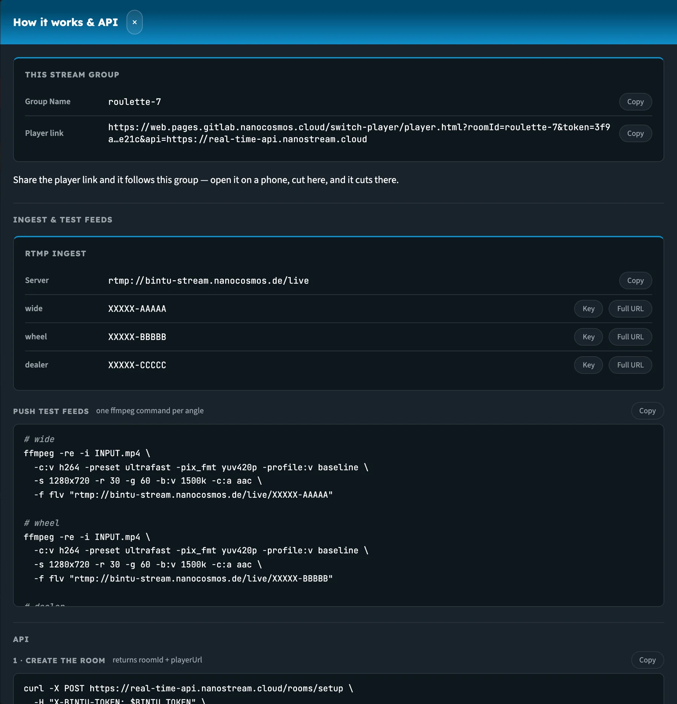
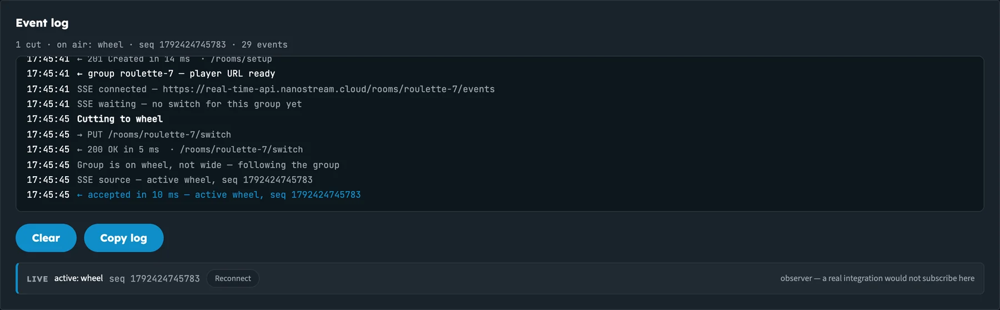

import ThemedImage from '@theme/ThemedImage';

# Multi-Camera Switching: API Reference

Multi-camera switching uses three endpoints of the nanoStream **Real-Time API**. For a walkthrough, see [Multi-Camera Stream Switching](realtime_api_switching).

**Base URL:** `https://real-time-api.nanostream.cloud`

| Method | Path | Called by | Purpose |
|---|---|---|---|
| `POST` | [`/rooms/setup`](#post-roomssetup) | Your backend | Set up a stream group and get the player URL |
| `PUT` | [`/rooms/{roomId}/switch`](#put-roomsroomidswitch) | Your backend | Change the angle that's on air |
| `GET` | [`/rooms/{roomId}/events`](#get-roomsroomidevents) | The player | Receive switch events (server-sent events) |

All requests and responses use JSON, and all calls must use **HTTPS**.

<ThemedImage
  alt="Sequence of calls: set up the room, the player subscribes to events, your backend switches, the player follows"
  sources={{
    light: require('../assets/realtime-api/diagrams/switching-sequence-light.webp').default,
    dark: require('../assets/realtime-api/diagrams/switching-sequence-dark.webp').default,
  }}
/>

_Solid arrows are requests, dashed arrows are responses and events._


## Authentication

`/rooms/setup` and `/rooms/{roomId}/switch` need a **bintu token** (a JWT) in one of these headers:

```
Authorization: Bearer <bintu token>
X-BINTU-TOKEN: <bintu token>
```

This is the same bintu token you use with the other nanoStream Cloud APIs. You can get one from the nanoStream Cloud Dashboard or the bintu API, or create one from your API key with the [Cloud Token Service](https://doc.pages.nanocosmos.de/cloudtokenservice-api-docs/#operation/Create%20a%20token%20for%20the%20bintu%20services).

The switching endpoints also accept your bintu API key directly, in an `X-BINTU-APIKEY` header.

`/rooms/{roomId}/events` doesn't use your bintu token. It uses the signed player `token` that `/rooms/setup` puts in the player URL. This token can only read switch events for that one group, so it's safe to give to viewers.

## POST /rooms/setup

Sets up a stream group (room) and returns a ready-to-embed player URL. Call it once per group, for example when a table opens. Each stream is checked against your account.

### Request body

| Field | Type | Required | Description |
|---|---|---|---|
| `roomId` | string | No | Your name for the group, for example `roulette-7`. If you leave it out, one is generated. |
| `streams` | array | Yes | 1–10 camera angles. Exactly one must have `active: true`. |
| `streams[].label` | string | Yes | Your name for the angle, for example `wide`. Must be unique within the group. Used in switch calls. |
| `streams[].stream` | string | Yes | Stream name (`XXXXX-YYYYY`) or stream ID (UUID) |
| `streams[].active` | boolean | No | `true` for the angle viewers see first. Default `false`. |
| `security.jwtoken` | string | No | Playback token for organisations with [secure playback](../cloud/security_token_best_practices). Built into the player URL. |

```json
{
  "roomId": "roulette-7",
  "streams": [
    { "label": "wide",   "stream": "XXXXX-AAAAA", "active": true },
    { "label": "wheel",  "stream": "XXXXX-BBBBB" },
    { "label": "dealer", "stream": "XXXXX-CCCCC" }
  ]
}
```

### Response `201 Created`

| Field | Type | Description |
|---|---|---|
| `roomId` | string | The group ID. Use it in switch calls. |
| `playerUrl` | string | The URL to embed in an iframe |
| `streams[]` | array | Each angle with its `label`, `streamId` (UUID), `streamName` and `active` flag |

### Errors

| Status | Meaning |
|---|---|
| `400` | Missing or invalid input, for example no `active` angle, or more than one |
| `401` | Missing or invalid bintu token |
| `404` | A stream wasn't found in your account |
| `504` | An upstream service couldn't be reached. Try again. |

## PUT /rooms/\{roomId\}/switch

Changes the angle that's on air. All connected players switch to it.

### Path parameters

| Parameter | Description |
|---|---|
| `roomId` | The group ID from `/rooms/setup` |

### Request body

| Field | Type | Required | Description |
|---|---|---|---|
| `active` | string | Yes | Label of the angle to put on air. Must be a key in `angles`. |
| `angles` | object | Yes | The full set of angles as `label: streamName`. Send it with **every** switch call. |

```json
{
  "active": "wheel",
  "angles": {
    "wide":   "XXXXX-AAAAA",
    "wheel":  "XXXXX-BBBBB",
    "dealer": "XXXXX-CCCCC"
  }
}
```

### Response `200 OK`

| Field | Type | Description |
|---|---|---|
| `ok` | boolean | `true` when the switch was sent to the players |
| `roomId` | string | The group ID |
| `active` | string | The angle now on air |
| `seq` | integer | Sequence number (a timestamp in milliseconds). Players use it to ignore out-of-date events. |

```json
{ "ok": true, "roomId": "roulette-7", "active": "wheel", "seq": 1726900749616 }
```

### Errors

| Status | Meaning |
|---|---|
| `400` | Missing or invalid input, for example `active` isn't in `angles` |
| `401` | Missing or invalid bintu token |
| `504` | An upstream service couldn't be reached. Try again. |

## GET /rooms/\{roomId\}/events

A [server-sent events](https://developer.mozilla.org/en-US/docs/Web/API/Server-sent_events) stream that tells the player which angle is on air. The hosted Switch Player opens it automatically.

```
GET /rooms/roulette-7/events?token=<player token>
```

| Parameter | In | Description |
|---|---|---|
| `roomId` | path | The group ID |
| `token` | query | The signed player token from the `playerUrl` |

### Events

| Event | When | Data |
|---|---|---|
| `source` | On connect (if an angle has been switched to) and on every switch | `roomId`, `active` label, `seq`, and `source.streamname` |
| `waiting` | On connect, if no switch has happened yet | `roomId` |
| `: ping` | Every 20 seconds | Keep-alive comment, no data |

```
event: source
data: {"roomId":"roulette-7","active":"wheel","seq":1726900749616,"source":{"streamname":"XXXXX-BBBBB"}}
```


<ThemedImage
  alt="Timeline of one event connection: connect, waiting, a ping every 20 seconds, and a source event on each switch"
  sources={{
    light: require('../assets/realtime-api/diagrams/switching-event-timeline-light.webp').default,
    dark: require('../assets/realtime-api/diagrams/switching-event-timeline-dark.webp').default,
  }}
/>

_A source event arrives on connect if an angle is already on air, and again on every switch._

The event stream only contains the angle on air. Viewers never receive the full list of angles.

## Player URL parameters

The `playerUrl` from `/rooms/setup` already contains everything the player needs. You can append this optional parameter:

| Parameter | Description |
|---|---|
| `security.jwtoken` | Playback token for secure playback, if you didn't pass one to `/rooms/setup` |

**Defaults:** autoplay on, starts muted (`automute`), fast start on, `latencyControlMode=balancedadaptive`.

## Error format

All errors use the same JSON shape:

```json
{
  "error": {
    "code": "bad_request",
    "message": "exactly one stream must be active"
  }
}
```

| `code` | Status |
|---|---|
| `bad_request` | 400 |
| `unauthenticated` | 401 |
| `forbidden` | 403 |
| `stream_not_found` | 404 |
| `internal_error` | 500 |
| `upstream_error` | 502 |
| `upstream_unavailable` | 504 |

## Interactive reference

The full OpenAPI reference, where you can try every call, is at [real-time-api.nanostream.cloud/docs](https://real-time-api.nanostream.cloud/docs).

The [Stream Switching demo](https://web.pages.gitlab.nanocosmos.cloud/switch-player/demo.html) also shows every call for your own group. **How it works & API** lists the player link, ingest details and ready-made requests, and the **Event log** records each request and event as it happens.



_The How it works & API drawer, filled in for the group roulette-7._



_The event log for one cut: PUT /switch, its 200 response, and the source event the players received._
